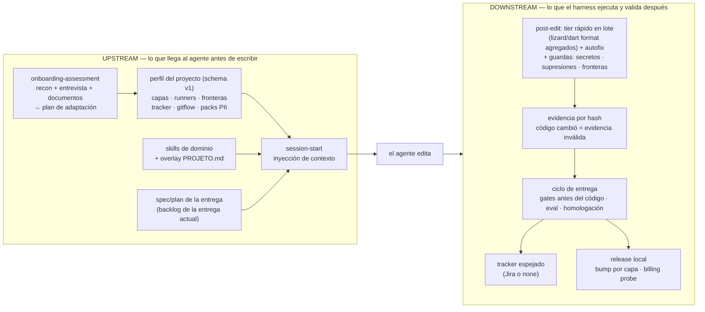

# Omni Harness — infraestructura agnóstica para agentes de código

<p align="center">
  
  
  
  
  
  
  
  
  
  
  
  
  
  
</p>

> **LANGUAGE / IDIOMA / 语言:** [English](README.md) · [Português (BR)](README.pt-BR.md) · [Español](README.es.md) · [简体中文](README.zh-CN.md) — **la versión en inglés es la referencia.**

> **Infraestructura neutral de calidad y workflow para agentes de código**: el mismo motor de gates determinísticos, los mismos hooks y el mismo contexto de sesión en cualquier IDE o CLI — y el conocimiento del proyecto en un **perfil** que el equipo edita sin tocar código. El stack y la arquitectura del hospedero son **dato de configuración**, no acoplamiento. **Node 22, cero dependencias.**
>
> Nació dentro del monorepo Exemplo SaaS y fue separado (2026-11-22) — Exemplo SaaS hoy es solo el ejemplo de hospedero en [`quality/examples/exemplo-saas/`](quality/examples/exemplo-saas/README.md).

## Cómo funciona (la idea en 4 pilares)

1. **Motor determinístico** — `node quality/run.mjs` ejecuta gates testeables (`quality/gates/`) en tres niveles: **rápido** (cada edición), **rutina** (al concluir) y **completo** (riesgo alto). Herramienta ausente en el hospedero = aviso abierto con impacto y acción; nunca silencio, nunca crash.
2. **Perfil del hospedero** (`quality/profile/`) — todo lo que varía por proyecto: capas/stacks, fronteras de arquitectura, runners, umbrales, tracker, gitflow, política PII (packs), locale y overlay de prompts. Schema v1 validado (`quality/lib/profile.mjs`).
3. **Multi-host** — `harness-init` instala la integración correcta por agente: hooks nativos (Claude Code, Cline) o carriers de instrucciones (Codex, Copilot, Antigravity, Kiro, OpenCode, Kimi Code). Misma política, dos transportes.
4. **Ciclo de entrega** — investigación → gates que prueban la falla → implementación → evaluación, con backlog versionado y espejo en tracker (Jira o `none`).

## Upstream y Downstream

El harness actúa en los dos lados del agente: **inyecta contexto estructurado antes** (el conocimiento del producto vive en el perfil, no en la memoria del agente) y **valida/ejecuta después** (gates con veredicto y evidencia por hash). Falha abierta en ambos lados: un problema del harness vuelve como aviso con camino y acción — nunca tumba el trabajo en silencio.



| | Upstream | Downstream |
|---|---|---|
| **Pregunta que responde** | "¿El agente sabe lo que el proyecto espera?" | "¿Lo que entregó el agente pasa los gates?" |
| **Fuente de verdad** | perfil + overlay + skills de dominio + spec de la entrega | gates determinísticos + evidencia por hash |
| **Quién lo ejecuta** | `harness-init` → `onboarding-assessment` → session-start | `post-edit` → `quality/run.mjs` por tier → ciclo de entrega → release |
| **Si falta algo** | onboarding genera plan (`a definir` con default) | aviso abierto (`tool.missing`/`tool.delegated`) o rechazo con tail |

## Stacks

El motor es agnóstico: **el runner es mecanismo del núcleo; qué stack, dónde vive y cómo lo invoca el proyecto es dato del perfil.** Un runner sin config en el perfil queda inerte — un repo sin el stack no paga nada.

| Stack | Runner | Gates hoy |
|---|---|---|
| **Dart / Flutter** | `runners/flutter.mjs` | `dart analyze` archivo por archivo (foco en líneas añadidas), tests relacionados por feature, suite completa en el nivel completo |
| **TypeScript / Node** | `runners/typescript.mjs` (pnpm) | lint/tsc, tests relacionados, supply chain |
| **C# / .NET** | `runners/backend.mjs` (`runnerDotnet`) | `dotnet build -warnaserror` + `dotnet test --filter` + ambiente dedicado; `dotnet format` y `list package --vulnerable` opt-in |
| **Python** | vía uv | toolchain detectada (`uv`), falha abierta |
| **Go** | `runners/go.mjs` | `gofmt -l` + `go vet` (foco en líneas añadidas) + tests por paquete alterado; suite `-race` en el completo; golangci-lint opt-in |
| **Rust** | `runners/rust.mjs` | `cargo fmt --check` + `clippy --all-targets` + test por manifest del workspace; `--all-features` y `cargo audit` en el completo |
| **C++** | `runners/cpp.mjs` | clang-format dry-run + configure/build CMake + CTest; clang-tidy archivo por archivo (opt-in); sanitizers ASan/UBSan vía preset en el completo |
| **Java** | `runners/java.mjs` | wrapper primero (`./mvnw`/`./gradlew`), build/test; plugins opt-in (spotless/checkstyle/pmd/spotbugs); módulos Maven vía `-pl` |

Nuevas capas enlazan el runner: el perfil del hospedero declara `{ id: 'go', globs: ['**/*.go'] }` (igual `rust`/`cpp`/`java`) y el config `runnerGo`/`runnerRust`/`runnerCpp`/`runnerJava` (`root`, `packages`, `race`, `golangci`, `clippyArgs`, `audit`, `presets`, `tidy`, `tools`, `modules`, `workflow`). Parsers y armado de comandos son funciones puras con self-tests (`quality/test/runners-stacks.test.mjs`) — smoke real solo cuando `which()` encuentra la tool; diseño y libs recomendadas en [`docs/parking-lot/runners-go-rust-cpp-csharp-java.md`](docs/parking-lot/runners-go-rust-cpp-csharp-java.md).

Los hooks del RunStart listan ✔/✘ lo que el hospedero tiene (lizard, dart, flutter, dotnet, pnpm, uv, docker, firebase, osv-scanner…) — **IGNORADO no es aprobación**: el gate correspondiente queda "no medido" con aviso.

## Qué hay aquí

| Camino | Contenido |
|---|---|
| `quality/` | Motor de calidad (gates, riesgo, niveles), hooks de los dos hosts, ciclo de entrega en backlog, perfil del hospedero (`quality/profile/`), packs de política (`quality/packs/`), self-tests (`quality/test/`) |
| `.claude/`, `.clinerules/` | Hooks y reglas de los hosts Claude Code y Cline (misma política, dos transportes) |
| `scripts/harness-init.mjs` | Instalador: siembra el núcleo en un repo hospedero nuevo |
| `quality/examples/exemplo-saas/` | **Ejemplo completo** de un host multi-stack (perfil, overlay, skills, gates) — fuera de la suite y del discovery |
| `docs/harness/` | Documentación operacional, un doc por workflow |
| `docs/parking-lot/` | Diseño de la arquitectura agnóstica (R0–R5) y del soporte Go/Rust/C++/Java |

## Hosts de agente soportados

`harness-init` instala la integración correcta por host — hooks nativos donde existen, carrier de instrucciones donde el host solo lee prompt:

| Host | Estructura instalada | Cómo corre el harness |
|---|---|---|
| **Claude Code** | `.claude/settings.json` + `.claude/hooks/` + rules/agents | hooks nativos (SessionStart/Pre/Post/Stop/SubagentStop) |
| **Cline** | `.clinerules/hooks/` + reglas espejadas `.clinerules/*.md` | hooks finos que delegan al `cline-bridge` |
| **Codex CLI** | `AGENTS.md` de la raíz | patrón cross-tool; gates vía CLI (`node quality/run.mjs`) |
| **VS Code (Copilot)** | `.github/copilot-instructions.md` | instrucciones que apuntan a AGENTS.md + gates vía CLI |
| **Antigravity (Google)** | `.antigravity/rules/omni-harness.md` + `AGENTS.md` | carrier de reglas del workspace |
| **Kiro (AWS)** | `.kiro/steering/omni-harness.md` + `AGENTS.md` | steering siempre-on |
| **OpenCode** | `.opencode/plugin/omni-harness.js` + `AGENTS.md` | lee AGENTS.md nativamente; plugin bloquea bash por pre-bash y puntúa ediciones por post-edit |
| **Kimi Code CLI (Moonshot)** | `AGENTS.md` | lee AGENTS.md nativamente; lifecycle hooks nativos aún sin formato público — gates vía CLI |

Selección en el instalador: `--hosts claude-code,cline` (default) · `--hosts all` · `--hosts vscode,kiro`. `omni-harness doctor` muestra lo instalado.

**Paths sobrescribibles:** las estructuras propietarias cambian rápido — los paths son **dato del hospedero**, no código: `quality/hosts.json` (formato: `{"hosts": {"<id>": {"carrier": "...", "integration": [...]}}}`) sobrescribe el registro default sin tocar la lib. Ejemplo real en Exemplo SaaS: [`quality/examples/exemplo-saas/hosts.json`](quality/examples/exemplo-saas/hosts.json). Listar resueltos: `omni-harness hosts [destino] [--json]`.

## Instalación y distribución

El harness es **Node 22, cero dependencias** — el canal natural es npm/pnpx. `pip`/`uv` no aplican (no es Python).

| Canal | Comando | Estado |
|---|---|---|
| **npm / pnpm dlx** (primario) | `pnpm dlx omni-harness init <destino> --nome <proyecto>` | requiere `npm publish` (package.json listo en la raíz; `files` ya permite ejemplo fuera y núcleo dentro) |
| **git / curl** (sin registry, hoy) | `bash install.sh <destino> --nome <proyecto>` desde una copia; con GitHub Releases: `RELEASE_URL=<tarball> curl -fsSL <url>/install.sh \| bash -s -- <destino>` | `install.sh` listo |
| **brew** (secundario, macOS/Linux) | `brew tap <ORG>/tap && brew install omni-harness` | fórmula template en `Formula/omni-harness.rb` (llenar `<ORG>`, `sha256` y publicar el tap tras la primera release en GitHub) |

CLI instalado: `omni-harness init|sync|doctor|--version`. `doctor` verifica node >= 22, herramientas externas (git, rtk, graphify, pnpm, dotnet, flutter, uv, biome) y el perfil del hospedero.

## Inicio rápido

```bash
node scripts/harness-init.mjs <destino> --nome <proyecto>   # siembra el núcleo en un repo hospedero
cd <destino> && (git init) && cd quality/tools && npm ci   # Biome del autofix
node quality/agents/sync-clinerules.mjs                    # espeja reglas para Cline
node --test quality/test/profile.test.mjs                  # perfil valida contra el schema
node quality/run.mjs --tier rapido                         # motor de calidad
```

## Perfiles

El perfil declara **todo lo que varía por proyecto**: capas/stacks, fronteras de arquitectura, métricas del ratchet, runners por stack (`runnerDotnet`, `runnerTs`, Flutter/Python; `runnerGo`/`runnerRust`/`runnerCpp`/`runnerJava` en el plan F1–F6), tracker (`jira`/`none`), gitflow (permanentes y matriz), política PII vía packs, locale y overlay de prompts. Schema v1 validado por `quality/lib/profile.mjs`; gate en `quality/test/profile.test.mjs`. Ejemplo completo de un host real en `quality/examples/exemplo-saas/`.

Tests del motor que ejercitan el ejemplo (gates, riesgo, hooks, tracker):

```bash
HARNESS_PROFILE_DIR="$PWD/quality/examples/exemplo-saas/profile" node --test quality/test/gates.test.mjs quality/test/risk.test.mjs
```

## Documentación

- Operacional, por workflow: [`docs/harness/INDEX.md`](docs/harness/INDEX.md) (pt-BR)
- Arquitectura agnóstica y decisiones (R0–R5): [`docs/parking-lot/harness-agnostico.md`](docs/parking-lot/harness-agnostico.md) (pt-BR)
- Runners por lenguaje (Go, Rust, C++, C#, Java — plan F1–F6): [`docs/parking-lot/runners-go-rust-cpp-csharp-java.md`](docs/parking-lot/runners-go-rust-cpp-csharp-java.md) (pt-BR)
- Inventario del bundle: [`HARNESS-MANIFEST.txt`](HARNESS-MANIFEST.txt)

## Comunidad

- **Contribuir:** [CONTRIBUTING.md](CONTRIBUTING.md) — branches `feat/*`, Conventional Commits. **Proyecto local, sin CI/Actions**: la batería local es la validación; el mantenedor comitea directo a `main` con ella verde. Contribución externa entra por PR de fork, revisada y mergeada manualmente tras la misma batería.
- **Seguridad:** [SECURITY.md](SECURITY.md) — reporte por advisory privado, nunca en issue pública.
- **Conducta:** [CODE_OF_CONDUCT.md](CODE_OF_CONDUCT.md) (Contributor Covenant 2.1).
- **Licencia:** [MIT](LICENSE).