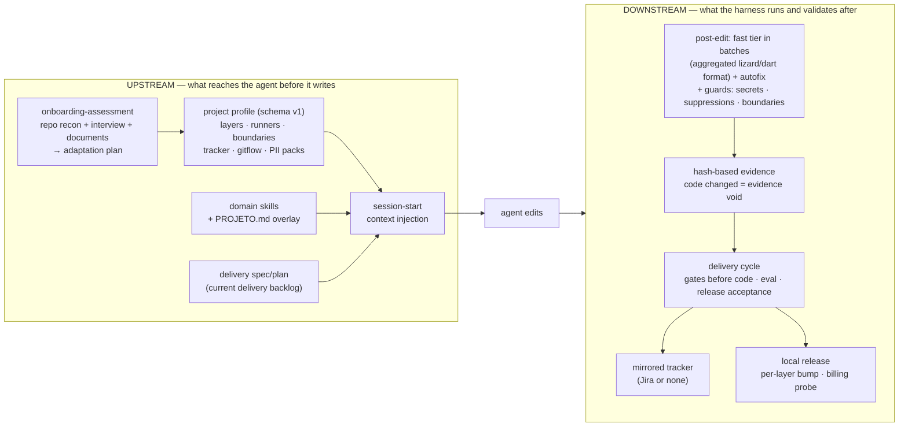

# Omni Harness — stack-agnostic harness for coding agents

<p align="center">
  
  
  
  
  
  
  
  
  
  
  
  
  
  
</p>

> **🤖 AGENT PROMPT — copy & paste this into any coding agent (Claude Code, Cline, OpenCode, Kimi Code, Codex…) to install and adapt the harness to this project:**

```text
GOAL: set up the Omni Harness in a coding-agent host and adapt it to this project.

1. INSTALL
   git clone https://github.com/paulocymbaum/omni-harness.git /tmp/omni-harness
   node /tmp/omni-harness/scripts/harness-init.mjs <PROJECT_PATH> --nome <PROJECT_NAME> --hosts <THIS_AGENT>
   # <PROJECT_PATH> = my current project repo; <THIS_AGENT> = the agent you are running in
   # (claude-code | cline | codex | opencode | kimicode | vscode | antigravity | kiro | all)
   cd <PROJECT_PATH>/quality/tools && npm ci

2. VALIDATE
   node quality/agents/sync-clinerules.mjs
   node --test quality/test/profile.test.mjs
   node quality/run.mjs --tier rapido

3. ONBOARDING (adapt the harness to this project)
   Run the skill "onboarding-assessment": read this repository, interview me in short blocks,
   collect the minimum product documents, and produce quality/onboarding/PLANO-ADAPTACAO.md
   (target profile: layers, runners per stack, boundaries-as-gates, domain skills, tracker/gitflow).
   Present the plan and WAIT for my approval before changing any file.

4. EXECUTE
   After my approval, execute the plan one step at a time (one artifact per step), keeping
   "node quality/run.mjs --tier rapido" green between steps, until the plan is fully consumed.

RULES: fail open (missing tool = warn, never crash); no secrets or PII in any file or commit;
ask me before anything destructive; do not edit files outside the plan without asking.
```

> **LANGUAGE / IDIOMA / 语言:** [English](README.md) · [Português (BR)](README.pt-BR.md) · [Español](README.es.md) · [简体中文](README.zh-CN.md) — **English is the reference version.**

> **Neutral quality and workflow infrastructure for coding agents**: the same deterministic gate engine, the same hooks and the same session context on any IDE or CLI — and the project knowledge in a **profile** the team edits without touching code. The host's stack and architecture are **configuration data**, not coupling. **Node 22, zero dependencies.**
>
> It was born inside the Exemplo SaaS monorepo and split out (2026-11-22) — Exemplo SaaS is now just the sample host in [`quality/examples/exemplo-saas/`](quality/examples/exemplo-saas/README.md).

## How it works (the idea in 4 pillars)

1. **Deterministic engine** — `node quality/run.mjs` runs testable gates (`quality/gates/`) in three tiers: **fast** (every edit), **routine** (on delivery) and **full** (high risk). Missing tool on the host = open warning with impact and action; never silence, never crash.
2. **Host profile** (`quality/profile/`) — everything that varies per project: layers/stacks, architecture boundaries, runners, thresholds, tracker, gitflow, PII policy (packs), locale and prompt overlay. Schema v1 validated (`quality/lib/profile.mjs`).
3. **Multi-host** — `harness-init` installs the right integration per agent: native hooks (Claude Code, Cline) or instruction carriers (Codex, Copilot, Antigravity, Kiro, OpenCode, Kimi Code). Same policy, two transports.
4. **Delivery cycle** — investigation → gates that prove the failure → implementation → evaluation, with a versioned backlog mirrored to a tracker (Jira or `none`).

## Upstream and Downstream

The harness works on both sides of the agent: it **injects structured context before** (product knowledge lives in the profile, not in the agent's memory) and **validates/executes after** (gates with verdicts and hash-based evidence). Fail-open on both sides: a harness problem comes back as a warning with path and action — it never kills your work silently.



| | Upstream | Downstream |
|---|---|---|
| **Question it answers** | "Does the agent know what the project expects?" | "Does what the agent delivered pass the gates?" |
| **Source of truth** | profile + overlay + domain skills + delivery spec | deterministic gates + hash-based evidence |
| **Who runs it** | `harness-init` → `onboarding-assessment` → session-start | `post-edit` → `quality/run.mjs` per tier → delivery cycle → release |
| **If something is missing** | onboarding produces a plan (`to define` with harness default) | open warning (`tool.missing`/`tool.delegated`) or rejection with tail |

## Stacks

The engine is agnostic: **the runner is core mechanism; which stack, where it lives and how the project invokes it is profile data.** A runner without profile config stays inert — a repo without the stack pays nothing.

| Stack | Runner | Gates today |
|---|---|---|
| **Dart / Flutter** | `runners/flutter.mjs` | per-file `dart analyze` (focus on added lines), feature-related tests, full suite at full tier |
| **TypeScript / Node** | `runners/typescript.mjs` (pnpm) | lint/tsc, related tests, supply chain |
| **C# / .NET** | `runners/backend.mjs` (`runnerDotnet`) | `dotnet build -warnaserror` + `dotnet test --filter` + dedicated environment; opt-in `dotnet format` and `list package --vulnerable` |
| **Python** | via uv | toolchain detected (`uv`), fail-open |
| **Go** | `runners/go.mjs` | `gofmt -l` + `go vet` (focus on added lines) + tests per changed package; `-race` suite at full tier; opt-in golangci-lint |
| **Rust** | `runners/rust.mjs` | `cargo fmt --check` + `clippy --all-targets` + tests per workspace manifest; `--all-features` and `cargo audit` at full tier |
| **C++** | `runners/cpp.mjs` | clang-format dry-run + CMake configure/build + CTest; per-file clang-tidy (opt-in); ASan/UBSan sanitizers via preset at full tier |
| **Java** | `runners/java.mjs` | wrapper first (`./mvnw`/`./gradlew`), build/test; opt-in plugins (spotless/checkstyle/pmd/spotbugs); Maven modules via `-pl` |

New layers bind the runner: the host profile declares `{ id: 'go', globs: ['**/*.go'] }` (same for `rust`/`cpp`/`java`) and config `runnerGo`/`runnerRust`/`runnerCpp`/`runnerJava` (`root`, `packages`, `race`, `golangci`, `clippyArgs`, `audit`, `presets`, `tidy`, `tools`, `modules`, `workflow`). Parsers and command builders are pure functions with self-tests (`quality/test/runners-stacks.test.mjs`) — real smoke only when `which()` finds the tool; design and recommended test libraries in [`docs/parking-lot/runners-go-rust-cpp-csharp-java.md`](docs/parking-lot/runners-go-rust-cpp-csharp-java.md).

RunStart hooks list ✔/✘ what the host has (lizard, dart, flutter, dotnet, pnpm, uv, docker, firebase, osv-scanner…) — **IGNORED is not approval**: the corresponding gate stays "unmeasured" with a warning.

## What is in here

| Path | Contents |
|---|---|
| `quality/` | Quality engine (gates, risk, tiers), hooks of both hosts, delivery cycle in backlog, host profile (`quality/profile/`), policy packs (`quality/packs/`), self-tests (`quality/test/`) |
| `.claude/`, `.clinerules/` | Hooks and rules of the Claude Code and Cline hosts (same policy, two transports) |
| `scripts/harness-init.mjs` | Installer: seeds the core into a new host repo |
| `quality/examples/exemplo-saas/` | **Full sample** of a multi-stack host (profile, overlay, skills, gates) — outside the suite and discovery |
| `docs/harness/` | Operational docs, one per workflow |
| `docs/parking-lot/` | Agnostic architecture design (R0–R5) and the Go/Rust/C++/Java support plan |

## Supported agent hosts

`harness-init` installs the right integration per host — native hooks where they exist, instruction carriers where the host only reads a prompt:

| Host | Installed structure | How the harness runs |
|---|---|---|
| **Claude Code** | `.claude/settings.json` + `.claude/hooks/` + rules/agents | native hooks (SessionStart/Pre/Post/Stop/SubagentStop) |
| **Cline** | `.clinerules/hooks/` + mirrored rules `.clinerules/*.md` | thin hooks delegating to `cline-bridge` |
| **Codex CLI** | root `AGENTS.md` | cross-tool standard; gates via CLI (`node quality/run.mjs`) |
| **VS Code (Copilot)** | `.github/copilot-instructions.md` | instructions pointing to AGENTS.md + gates via CLI |
| **Antigravity (Google)** | `.antigravity/rules/omni-harness.md` + `AGENTS.md` | workspace rules carrier |
| **Kiro (AWS)** | `.kiro/steering/omni-harness.md` + `AGENTS.md` | always-on steering |
| **OpenCode** | `.opencode/plugin/omni-harness.js` + `AGENTS.md` | reads AGENTS.md natively; plugin blocks bash via pre-bash and scores edits via post-edit |
| **Kimi Code CLI (Moonshot)** | `AGENTS.md` | reads AGENTS.md natively; native lifecycle hooks still without public format — gates via CLI |

Installer selection: `--hosts claude-code,cline` (default) · `--hosts all` · `--hosts vscode,kiro`. `omni-harness doctor` shows what is installed.

**Overridable paths:** vendor structures change fast — paths are **host data**, not code: `quality/hosts.json` (format: `{"hosts": {"<id>": {"carrier": "...", "integration": [...]}}}`) overrides the default registry without touching the lib. Live example in Exemplo SaaS: [`quality/examples/exemplo-saas/hosts.json`](quality/examples/exemplo-saas/hosts.json). List resolved: `omni-harness hosts [destino] [--json]`.

## Installation and distribution

The harness is **Node 22, zero dependencies** — the natural channel is npm/pnpx. `pip`/`uv` do not apply (not Python).

| Channel | Command | Status |
|---|---|---|
| **npm / pnpm dlx** (primary) | `pnpm dlx omni-harness init <dest> --nome <project>` | requires `npm publish` (package.json ready at root; `files` already allows sample outside and core inside) |
| **git / curl** (no registry, today) | `bash install.sh <dest> --nome <project>` from a copy; with GitHub Releases: `RELEASE_URL=<tarball> curl -fsSL <url>/install.sh \| bash -s -- <dest>` | `install.sh` ready |
| **brew** (secondary, macOS/Linux) | `brew tap <ORG>/tap && brew install omni-harness` | formula template in `Formula/omni-harness.rb` (fill `<ORG>`, `sha256` and publish the tap after the first GitHub release) |

Installed CLI: `omni-harness init|sync|doctor|--version`. `doctor` checks node >= 22, external tools (git, rtk, graphify, pnpm, dotnet, flutter, uv, biome) and the host profile.

## Quick start

```bash
node scripts/harness-init.mjs <dest> --nome <project>   # seeds the core into a host repo
cd <dest> && (git init) && cd quality/tools && npm ci   # Biome for autofix
node quality/agents/sync-clinerules.mjs                 # mirrors rules to Cline
node --test quality/test/profile.test.mjs               # profile validates against the schema
node quality/run.mjs --tier rapido                      # quality engine
```

## Profiles

The profile declares **everything that varies per project**: layers/stacks, architecture boundaries, ratchet metrics, runners per stack (`runnerDotnet`, `runnerTs`, Flutter/Python; `runnerGo`/`runnerRust`/`runnerCpp`/`runnerJava` in plan F1–F6), tracker (`jira`/`none`), gitflow (permanent branches and matrix), PII policy via packs, locale and prompt overlay. Schema v1 validated by `quality/lib/profile.mjs`; gate at `quality/test/profile.test.mjs`. Full example of a real host in `quality/examples/exemplo-saas/`.

Engine tests that exercise the sample (gates, risk, hooks, tracker):

```bash
HARNESS_PROFILE_DIR="$PWD/quality/examples/exemplo-saas/profile" node --test quality/test/gates.test.mjs quality/test/risk.test.mjs
```

## Documentation

- Operational, per workflow: [`docs/harness/INDEX.md`](docs/harness/INDEX.md) (pt-BR)
- Agnostic architecture and decisions (R0–R5): [`docs/parking-lot/harness-agnostico.md`](docs/parking-lot/harness-agnostico.md) (pt-BR)
- Runners per language (Go, Rust, C++, C#, Java — plan F1–F6): [`docs/parking-lot/runners-go-rust-cpp-csharp-java.md`](docs/parking-lot/runners-go-rust-cpp-csharp-java.md) (pt-BR)
- Bundle inventory: [`HARNESS-MANIFEST.txt`](HARNESS-MANIFEST.txt)

## Community

- **Contributing:** [CONTRIBUTING.md](CONTRIBUTING.md) — `feat/*` branches, Conventional Commits. **Local project, no CI/Actions**: the local battery is the validation; the maintainer commits straight to `main` with it green. External contributions come as fork PRs, reviewed and manually merged after the same battery.
- **Security:** [SECURITY.md](SECURITY.md) — report via private advisory, never in a public issue.
- **Conduct:** [CODE_OF_CONDUCT.md](CODE_OF_CONDUCT.md) (Contributor Covenant 2.1).
- **License:** [MIT](LICENSE).