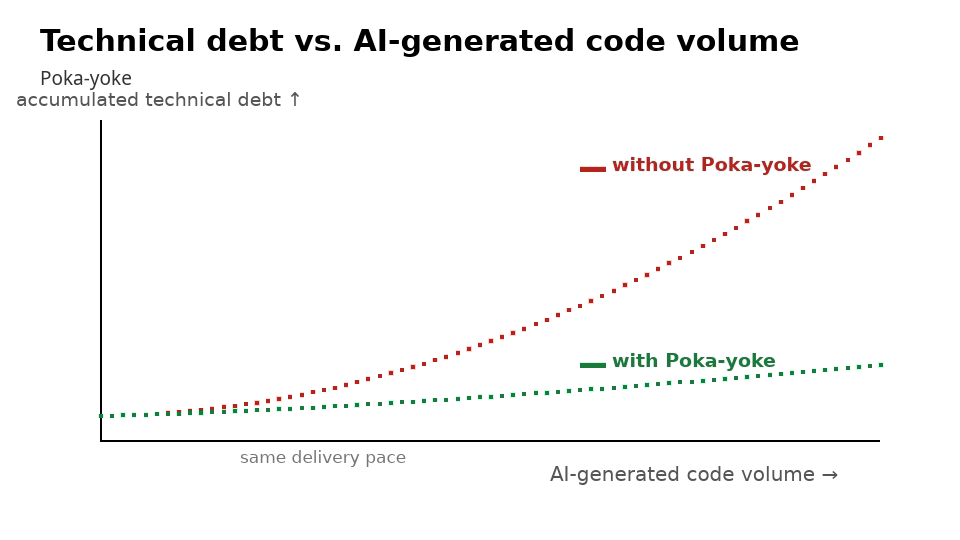
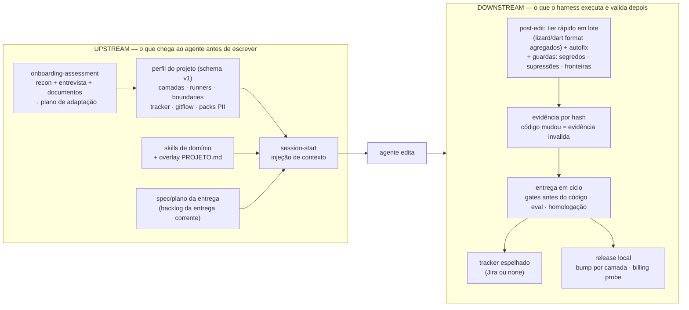

# Omni Harness — núcleo agnóstico de agentes de código

<p align="center">
  
  
  
  
  
  
  
  
  
  
  
  
  
  
</p>

> **🤖 PROMPT PARA AGENTE — copie e cole em qualquer agente (Claude Code, Cline, OpenCode, Kimi Code, Codex…) para instalar e adaptar o harness a este projeto (instruções em inglês, formato universal para agentes):**

```text
GOAL: set up the Omni Harness in a coding-agent host and adapt it to this project.

1. INSTALL
   git clone https://github.com/paulocymbaum/omni-harness.git /tmp/omni-harness
   node /tmp/omni-harness/scripts/harness-init.mjs <PROJECT_PATH> --nome <PROJECT_NAME> --hosts <THIS_AGENT>
   # <PROJECT_PATH> = my current project repo; <THIS_AGENT> = the agent you are running in
   # (claude-code | cline | codex | opencode | kimicode | vscode | antigravity | kiro | all)
   cd <PROJECT_PATH>/quality/tools && npm ci

2. VALIDATE
   node quality/agents/sync-clinerules.mjs
   node --test quality/test/profile.test.mjs
   node quality/run.mjs --tier rapido

3. ONBOARDING (adapt the harness to this project)
   Run the skill "onboarding-assessment": read this repository, interview me in short blocks,
   collect the minimum product documents, and produce quality/onboarding/PLANO-ADAPTACAO.md
   (target profile: layers, runners per stack, boundaries-as-gates, domain skills, tracker/gitflow).
   Present the plan and WAIT for my approval before changing any file.

4. EXECUTE
   After my approval, execute the plan one step at a time (one artifact per step), keeping
   "node quality/run.mjs --tier rapido" green between steps, until the plan is fully consumed.

RULES: fail open (missing tool = warn, never crash); no secrets or PII in any file or commit;
ask me before anything destructive; do not edit files outside the plan without asking.
```

> **LANGUAGE / IDIOMA / 语言:** [English](README.md) · [Português (BR)](README.pt-BR.md) · [Español](README.es.md) · [简体中文](README.zh-CN.md) — **a versão em inglês é a referência.**

> **Infraestrutura neutra de qualidade e workflow para agentes de código**: o mesmo motor de gates determinísticos, os mesmos hooks e o mesmo contexto de sessão em qualquer IDE ou CLI — e o conhecimento do projeto num **perfil** que o time edita sem tocar em código. Stack e arquitetura do hospedeiro são **dado de configuração**, não acoplamento. **Node 22, zero dependências.**
>
> Nasceu dentro do monorepo Exemplo SaaS e foi apartado (2026-11-22) — o Exemplo SaaS hoje é apenas o exemplo de hospedeiro em [`quality/examples/exemplo-saas/`](quality/examples/exemplo-saas/README.md).
## Por que este existe — Poka-yoke para código gerado por IA

**Poka-yoke** (ポカヨケ, "à prova de erros") é um conceito da transformação enxuta, vindo do Sistema de Produção Toyota (Shigeo Shingo): dispositivos que **impedem que um defeito avance para o próximo passo** do processo. No pensamento enxuto, o custo de um defeito **compõe com a escala** — quanto mais tarde (e em maior volume) ele é encontrado, mais caro é o reparo, e o **débito técnico acumula de forma multiplicativa**.

Agentes de código geram linhas numa velocidade que **multiplica exatamente esse risco**: volume alto, revisão humana que não acompanha e erros repetidos em padrão, não por exceção.



O Omni Harness aplica essa premissa ao código gerado por IA: **gates determinísticos bloqueiam o defeito no passo em que ele nasce** (poka-yoke que falha alto, nunca aviso silencioso), e **todo erro identificado deterministicamente é realimentado ao modelo** como contexto de correção de curso na iteração seguinte. A mesma classe de erro para de se repetir, o esforço de revisão cai e o débito técnico acumulado **cai de forma drástica em vez de compor** — é isso que mantém a entrega acelerada por IA segura **na escala**.

- **Falhe alto, falhe cedo** — o veredito de um gate é um sinal de pare, não um aviso para ignorar.
- **Realimentação, não arqueologia** — o erro volta ao agente como contexto acionável, não ao humano como investigação.
- **Determinístico, não impressão** — o mesmo defeito, a mesma detecção, todas as vezes; é isso que torna o ciclo confiável.


## Como funciona (a ideia em 4 pilares)

1. **Motor determinístico** — `node quality/run.mjs` roda gates testáveis (`quality/gates/`) em três níveis: **rápido** (a cada edição), **rotina** (ao concluir) e **completo** (risco alto). Ferramenta ausente no hospedeiro = aviso aberto com impacto e ação; nunca silêncio, nunca crash.
2. **Perfil do hospedeiro** (`quality/profile/`) — tudo que varia por projeto: camadas/stacks, fronteiras de arquitetura, runners, thresholds, tracker, gitflow, política PII (packs), locale e overlay de prompts. Schema v1 validado (`quality/lib/profile.mjs`).
3. **Multi-host** — `harness-init` instala a integração certa para cada agente: hooks nativos (Claude Code, Cline) ou carriers de instruções (Codex, Copilot, Antigravity, Kiro, OpenCode, Kimi Code). Mesma política, dois transportes.
4. **Ciclo de entrega** — investigação → gates que provam a falha → implementação → avaliação, com backlog versionado e espelho em tracker (Jira ou `none`).

## Upstream e Downstream

O harness atua nos dois lados do agente: **injeta contexto estruturado antes** (o conhecimento do produto mora no perfil, não na memória do agente) e **valida/executa depois** (gates com veredito e evidência por hash). Falha aberta nos dois lados: problema do harness volta como aviso com caminho e ação — nunca derruba o trabalho em silêncio.



| | Upstream | Downstream |
|---|---|---|
| **Pergunta que responde** | "O agente sabe o que o projeto espera?" | "O que o agente entregou passa nos gates?" |
| **Fonte da verdade** | perfil + overlay + skills de domínio + spec da entrega | gates determinísticos + evidência por hash |
| **Quem roda** | `harness-init` → `onboarding-assessment` → session-start | `post-edit` → `quality/run.mjs` por tier → ciclo de entrega → release |
| **Se algo falta** | onboarding gera plano (`a definir` com default) | aviso aberto (`tool.missing`/`tool.delegated`) ou reprovação com tail |

## Stacks

O motor é agnóstico: **runner é mecanismo no núcleo; qual stack, onde ela vive e como o projeto a invoca é dado do perfil.** Runner sem config no perfil fica inerte — repo sem a stack não paga nada.

| Stack | Runner | Gates hoje |
|---|---|---|
| **Dart / Flutter** | `runners/flutter.mjs` | `dart analyze` arquivo a arquivo (foco em linhas adicionadas), testes relacionados por feature, suíte completa no nível completo |
| **TypeScript / Node** | `runners/typescript.mjs` (pnpm) | lint/tsc, testes relacionados, supply chain |
| **C# / .NET** | `runners/backend.mjs` (`runnerDotnet`) | `dotnet build -warnaserror` + `dotnet test --filter` + ambiente dedicado; `dotnet format` e `list package --vulnerable` opt-in |
| **Python** | via uv | toolchain detectada (`uv`), falha aberta |
| **Go** | `runners/go.mjs` | `gofmt -l` + `go vet` (foco em linhas adicionadas) + testes por pacote alterado; suíte `-race` no completo; golangci-lint opt-in |
| **Rust** | `runners/rust.mjs` | `cargo fmt --check` + `clippy --all-targets` + teste por manifest do workspace; `--all-features` e `cargo audit` no completo |
| **C++** | `runners/cpp.mjs` | clang-format dry-run + configure/build CMake + CTest; clang-tidy arquivo a arquivo (opt-in); sanitizers ASan/UBSan via preset no completo |
| **Java** | `runners/java.mjs` | wrapper primeiro (`./mvnw`/`./gradlew`), build/test; plugins opt-in (spotless/checkstyle/pmd/spotbugs); módulos Maven via `-pl` |

Camadas novas ligam o runner: o perfil do hospedeiro declara `{ id: 'go', globs: ['**/*.go'] }` (idem `rust`/`cpp`/`java`) e o config `runnerGo`/`runnerRust`/`runnerCpp`/`runnerJava` (`root`, `packages`, `race`, `golangci`, `clippyArgs`, `audit`, `presets`, `tidy`, `tools`, `modules`, `workflow`). Parsers e montagens de comando são funções puras com self-tests (`quality/test/runners-stacks.test.mjs`) — smoke real só quando `which()` acha a tool; desenho e libs de teste recomendadas em [`docs/parking-lot/runners-go-rust-cpp-csharp-java.md`](docs/parking-lot/runners-go-rust-cpp-csharp-java.md).

Hooks do RunStart listam ✔/✘ o que o hospedeiro tem (lizard, dart, flutter, dotnet, pnpm, uv, docker, firebase, osv-scanner…) — **IGNORADO não é aprovação**: o gate correspondente fica "não medido" com aviso.

## O que há aqui

| Caminho | Conteúdo |
|---|---|
| `quality/` | Motor de qualidade (gates, risco, níveis), hooks dos dois hosts, ciclo de entrega em backlog, perfil do hospedeiro (`quality/profile/`), packs de política (`quality/packs/`), self-tests (`quality/test/`) |
| `.claude/`, `.clinerules/` | Hooks e regras dos hosts Claude Code e Cline (mesma política, dois transportes) |
| `scripts/harness-init.mjs` | Instalador: semeia o núcleo num repo hospedeiro novo |
| `quality/examples/exemplo-saas/` | **Exemplo completo** de um host multi-stack (perfil, overlay, skills, gates) — fora da suíte e do discovery |
| `docs/harness/` | Documentação operacional, um doc por workflow |
| `docs/parking-lot/` | Desenho da arquitetura agnóstica (R0–R5) e do suporte Go/Rust/C++/Java |

## Hosts de agente suportados

`harness-init` instala a integração certa para cada host — hooks nativos onde existem, carrier de instruções onde o host só lê prompt:

| Host | Estrutura instalada | Como o harness roda |
|---|---|---|
| **Claude Code** | `.claude/settings.json` + `.claude/hooks/` + regras/agents | hooks nativos (SessionStart/Pre/Post/Stop/SubagentStop) |
| **Cline** | `.clinerules/hooks/` + regras espelhadas `.clinerules/*.md` | hooks finos delegando ao `cline-bridge` |
| **Codex CLI** | `AGENTS.md` da raiz | padrão cross-tool; gates via CLI (`node quality/run.mjs`) |
| **VS Code (Copilot)** | `.github/copilot-instructions.md` | instruções apontando AGENTS.md + gates via CLI |
| **Antigravity (Google)** | `.antigravity/rules/omni-harness.md` + `AGENTS.md` | carrier de regras do workspace |
| **Kiro (AWS)** | `.kiro/steering/omni-harness.md` + `AGENTS.md` | steering sempre-on |
| **OpenCode** | `.opencode/plugin/omni-harness.js` + `AGENTS.md` | lê AGENTS.md nativamente; plugin bloqueia bash pelo pre-bash e pontua edições pelo post-edit |
| **Kimi Code CLI (Moonshot)** | `AGENTS.md` | lê AGENTS.md nativamente; lifecycle hooks nativos ainda sem formato público — gates via CLI |

Seleção no instalador: `--hosts claude-code,cline` (default) · `--hosts all` · `--hosts vscode,kiro`. `omni-harness doctor` mostra o que está instalado.

**Paths sobrescritáveis:** estruturas proprietárias mudam rápido — os paths são **dado do hospedeiro**, não código: `quality/hosts.json` (formato: `{"hosts": {"<id>": {"carrier": "...", "integration": [...]}}}`) sobrescreve o registro default sem tocar a lib. Exemplo real no Exemplo SaaS: [`quality/examples/exemplo-saas/hosts.json`](quality/examples/exemplo-saas/hosts.json). Listar resolvidos: `omni-harness hosts [destino] [--json]`.

## Instalação e distribuição

O harness é **Node 22, zero dependências** — o canal natural é npm/pnpx. `pip`/`uv` não se aplicam (não é Python).

| Canal | Comando | Estado |
|---|---|---|
| **npm / pnpm dlx** (primário) | `pnpm dlx omni-harness init <destino> --nome <projeto>` | requer `npm publish` (package.json pronto na raiz; `files` já permite exemplo fora e núcleo dentro) |
| **git / curl** (sem registry, hoje) | `bash install.sh <destino> --nome <projeto>` a partir de uma cópia; com GitHub Releases: `RELEASE_URL=<tarball> curl -fsSL <url>/install.sh \| bash -s -- <destino>` | `install.sh` pronto |
| **brew** (secundário, macOS/Linux) | `brew tap <ORG>/tap && brew install omni-harness` | fórmula template em `Formula/omni-harness.rb` (preenche `<ORG>`, `sha256` e publica o tap após a primeira release no GitHub) |

CLI instalado: `omni-harness init|sync|doctor|--version`. `doctor` checa node >= 22, ferramentas externas (git, rtk, graphify, pnpm, dotnet, flutter, uv, biome) e o perfil do hospedeiro.

## Início rápido

```bash
node scripts/harness-init.mjs <destino> --nome <projeto>   # semeia o núcleo num repo hospedeiro
cd <destino> && (git init) && cd quality/tools && npm ci   # Biome do autofix
node quality/agents/sync-clinerules.mjs                    # espelha regras para o Cline
node --test quality/test/profile.test.mjs                  # perfil valida contra o schema
node quality/run.mjs --tier rapido                         # motor de qualidade
```

## Perfis

O perfil declara **tudo que varia por projeto**: camadas/stacks, fronteiras de arquitetura, métricas do ratchet, runners por stack (`runnerDotnet`, `runnerTs`, Flutter/Python; `runnerGo`/`runnerRust`/`runnerCpp`/`runnerJava` no desenho F1–F6), tracker (`jira`/`none`), gitflow (permanentes e matriz), política PII via packs, locale e overlay de prompts. Schema v1 validado por `quality/lib/profile.mjs`; gate em `quality/test/profile.test.mjs`. Exemplo completo de um host real em `quality/examples/exemplo-saas/`.

Testes do motor que exercitam o exemplo (gates, risco, hooks, tracker):

```bash
HARNESS_PROFILE_DIR="$PWD/quality/examples/exemplo-saas/profile" node --test quality/test/gates.test.mjs quality/test/risk.test.mjs
```

## Documentação

- Operacional, por workflow: [`docs/harness/INDEX.md`](docs/harness/INDEX.md)
- Arquitetura agnóstica e decisões (R0–R5): [`docs/parking-lot/harness-agnostico.md`](docs/parking-lot/harness-agnostico.md)
- Runners por linguagem (Go, Rust, C++, C#, Java — desenho F1–F6): [`docs/parking-lot/runners-go-rust-cpp-csharp-java.md`](docs/parking-lot/runners-go-rust-cpp-csharp-java.md)
- Inventário do bundle: [`HARNESS-MANIFEST.txt`](HARNESS-MANIFEST.txt)

## Comunidade

- **Contribuir:** [CONTRIBUTING.md](CONTRIBUTING.md) — branches `feat/*`, Conventional Commits. **Projeto local, sem CI/Actions**: a bateria local é a validação; o mantenedor committa direto em `main` com ela verde. Contribuição externa entra por PR de fork, revisada e mergeada manualmente após a mesma bateria.
- **Segurança:** [SECURITY.md](SECURITY.md) — reporte por advisory privado, nunca em issue pública.
- **Conduta:** [CODE_OF_CONDUCT.md](CODE_OF_CONDUCT.md) (Contributor Covenant 2.1).
- **Licença:** [MIT](LICENSE).
