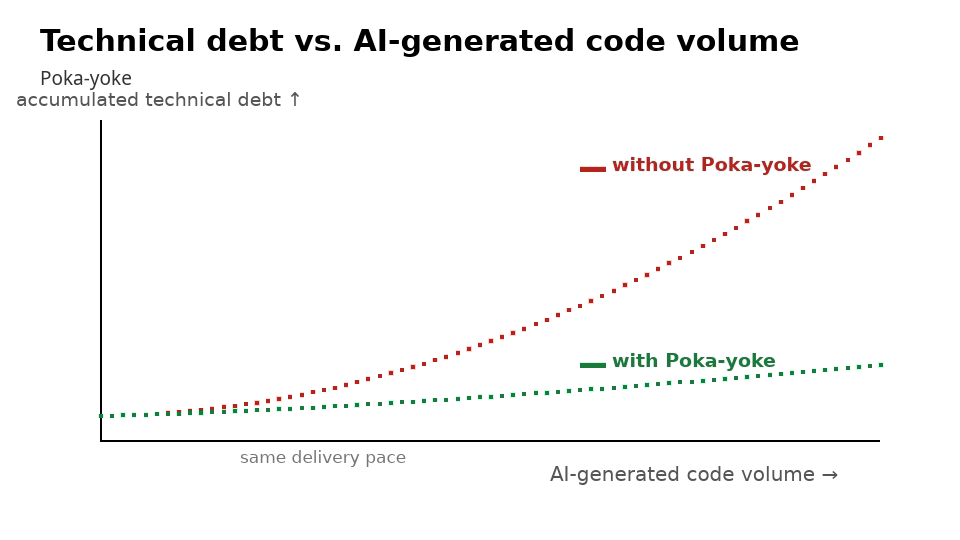
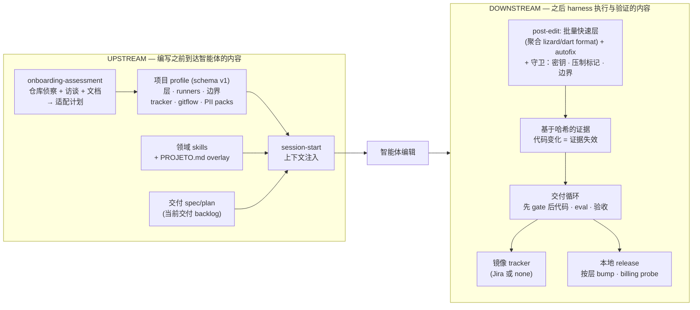

# Omni Harness — 面向编程智能体的栈无关 harness

<p align="center">
  
  
  
  
  
  
  
  
  
  
  
  
  
  
</p>

> **🤖 智能体 PROMPT — 将以下内容复制粘贴到任何编程智能体（Claude Code、Cline、OpenCode、Kimi Code、Codex…）中，以安装并将 harness 适配到本项目（说明为英文，通用格式）：**

```text
GOAL: set up the Omni Harness in a coding-agent host and adapt it to this project.

1. INSTALL
   git clone https://github.com/paulocymbaum/omni-harness.git /tmp/omni-harness
   node /tmp/omni-harness/scripts/harness-init.mjs <PROJECT_PATH> --nome <PROJECT_NAME> --hosts <THIS_AGENT>
   # <PROJECT_PATH> = my current project repo; <THIS_AGENT> = the agent you are running in
   # (claude-code | cline | codex | opencode | kimicode | vscode | antigravity | kiro | all)
   cd <PROJECT_PATH>/quality/tools && npm ci

2. VALIDATE
   node quality/agents/sync-clinerules.mjs
   node --test quality/test/profile.test.mjs
   node quality/run.mjs --tier rapido

3. ONBOARDING (adapt the harness to this project)
   Run the skill "onboarding-assessment": read this repository, interview me in short blocks,
   collect the minimum product documents, and produce quality/onboarding/PLANO-ADAPTACAO.md
   (target profile: layers, runners per stack, boundaries-as-gates, domain skills, tracker/gitflow).
   Present the plan and WAIT for my approval before changing any file.

4. EXECUTE
   After my approval, execute the plan one step at a time (one artifact per step), keeping
   "node quality/run.mjs --tier rapido" green between steps, until the plan is fully consumed.

RULES: fail open (missing tool = warn, never crash); no secrets or PII in any file or commit;
ask me before anything destructive; do not edit files outside the plan without asking.
```

> **LANGUAGE / IDIOMA / 语言:** [English](README.md) · [Português (BR)](README.pt-BR.md) · [Español](README.es.md) · [简体中文](README.zh-CN.md) — **以英文版为准。**

> **面向编程智能体的中立质量与工作流基础设施**：在任何 IDE 或 CLI 上，使用相同的确定性 gate 引擎、相同的 hooks 和相同的会话上下文——而项目知识保存在团队无需改代码即可编辑的**配置档案（profile）**中。宿主项目的栈与架构是**配置数据**，不是耦合。**Node 22，零依赖。**
>
> 它诞生于 Exemplo SaaS 单体仓库并在 2026-11-22 拆分——Exemplo SaaS 现在只是 [`quality/examples/exemplo-saas/`](quality/examples/exemplo-saas/README.md) 中的示例宿主。
## 这个项目为何存在 —— 面向 AI 生成代码的 Poka-yoke（防错）

**Poka-yoke**（ポカヨケ，"防错"）是精益变革中的一个概念，源自丰田生产方式（新乡重夫）：通过装置**让缺陷无法流向下一个工序**。在精益思想中，缺陷的成本**随规模复合增长**——发现得越晚（数量越大），修复越贵，**技术债呈乘数式累积**。

编程智能体生成代码的速度**恰恰放大了这一风险**：产量高、人工评审跟不上，而且错误以模式化方式重复出现，而非偶发。



Omni Harness 把这一前提应用到 AI 生成的代码上：**确定性 gate 在缺陷诞生的那一步就将其拦截**（高声失败的防错装置，绝不静默告警），并且**每一个被确定性识别的错误都会作为纠偏上下文回馈给模型**。同类错误不再重复，评审负担下降，累积技术债**急剧下降而非持续复合**——这正是让 AI 加速的交付在**规模化**时依然安全的关键。

- **高声失败，尽早失败** —— gate 的判定是停止信号，不是可以忽略的告警。
- **回馈循环，而非考古** —— 错误作为可执行的上下文回到智能体手中，而不是留给人类去挖掘。
- **确定性，而非感觉** —— 同样的缺陷，同样的检测，每次如此；这正是回馈循环可信的原因。


## 工作原理（4 个支柱）

1. **确定性引擎** — `node quality/run.mjs` 以三个层级运行可测试的 gates（`quality/gates/`）：**快速**（每次编辑）、**例行**（交付完成时）和**完整**（高风险）。宿主缺少工具 = 带影响与行动的开放告警；绝不静默，绝不崩溃。
2. **宿主配置档案** (`quality/profile/`) — 项目间所有可变项：层/栈、架构边界、runners、阈值、tracker、gitflow、PII 策略（packs）、locale 与 prompt overlay。Schema v1 已验证（`quality/lib/profile.mjs`）。
3. **多宿主** — `harness-init` 为每个智能体安装正确的集成：原生 hooks（Claude Code、Cline）或指令载体（Codex、Copilot、Antigravity、Kiro、OpenCode、Kimi Code）。同一策略，两种传输。
4. **交付循环** — 调查 → 用 gate 证明缺陷 → 实现 → 评估，带版本化 backlog 并镜像到 tracker（Jira 或 `none`）。

## Upstream 与 Downstream

harness 在智能体两侧工作：**事先注入结构化上下文**（产品知识保存在 profile 中，而不是智能体的记忆里），**事后验证/执行**（带判定的 gates 与基于哈希的证据）。两侧都是失败开放：harness 自身的问题会以带路径与行动的告警返回——绝不静默地毁掉你的工作。



| | Upstream | Downstream |
|---|---|---|
| **回答的问题** | “智能体知道项目期望什么吗？” | “智能体交付的产物通过 gates 了吗？” |
| **事实来源** | profile + overlay + 领域 skills + 交付 spec | 确定性 gates + 基于哈希的证据 |
| **谁来运行** | `harness-init` → `onboarding-assessment` → session-start | `post-edit` → 分层 `quality/run.mjs` → 交付循环 → release |
| **若缺失** | onboarding 生成计划（`待定` 并给出默认值） | 开放告警（`tool.missing`/`tool.delegated`）或带 tail 的拒绝 |

## 技术栈

引擎是无关的：**runner 是核心机制；哪个栈、在哪里以及项目如何调用它是 profile 数据。** profile 中没有配置的 runner 保持惰性——没有该栈的仓库零成本。

| 栈 | Runner | 当前 gates |
|---|---|---|
| **Dart / Flutter** | `runners/flutter.mjs` | 逐文件 `dart analyze`（聚焦新增行）、按 feature 的相关测试；完整层级跑全套 |
| **TypeScript / Node** | `runners/typescript.mjs` (pnpm) | lint/tsc、相关测试、供应链 |
| **C# / .NET** | `runners/backend.mjs` (`runnerDotnet`) | `dotnet build -warnaserror` + `dotnet test --filter` + 专用环境；可选 `dotnet format` 与 `list package --vulnerable` |
| **Python** | 通过 uv | 检测到的 toolchain（`uv`），失败开放 |
| **Go** | `runners/go.mjs` | `gofmt -l` + `go vet`（聚焦新增行）+ 按变更包的测试；完整层级跑 `-race` 套件；可选 golangci-lint |
| **Rust** | `runners/rust.mjs` | `cargo fmt --check` + `clippy --all-targets` + 按 workspace manifest 测试；完整层级 `--all-features` 与 `cargo audit` |
| **C++** | `runners/cpp.mjs` | clang-format dry-run + CMake configure/build + CTest；逐文件 clang-tidy（可选）；完整层级通过 preset 运行 ASan/UBSan |
| **Java** | `runners/java.mjs` | wrapper 优先（`./mvnw`/`./gradlew`），build/test；可选插件（spotless/checkstyle/pmd/spotbugs）；通过 `-pl` 指定 Maven 模块 |

新层通过 profile 绑定 runner：宿主 profile 声明 `{ id: 'go', globs: ['**/*.go'] }`（`rust`/`cpp`/`java` 同理）与配置 `runnerGo`/`runnerRust`/`runnerCpp`/`runnerJava`（`root`、`packages`、`race`、`golangci`、`clippyArgs`、`audit`、`presets`、`tidy`、`tools`、`modules`、`workflow`）。解析器与命令装配是纯函数并带自测（`quality/test/runners-stacks.test.mjs`）——只有 `which()` 找到工具时才跑真实 smoke；设计与推荐测试库见 [`docs/parking-lot/runners-go-rust-cpp-csharp-java.md`](docs/parking-lot/runners-go-rust-cpp-csharp-java.md)。

RunStart hooks 列出宿主拥有的 ✔/✘ 工具（lizard、dart、flutter、dotnet、pnpm、uv、docker、firebase、osv-scanner…）——**忽略不等于通过**：对应 gate 保持“未测量”并给出告警。

## 仓库内容

| 路径 | 内容 |
|---|---|
| `quality/` | 质量引擎（gates、风险、层级）、两个宿主的 hooks、backlog 交付循环、宿主 profile（`quality/profile/`）、策略 packs（`quality/packs/`）、自测（`quality/test/`） |
| `.claude/`, `.clinerules/` | Claude Code 与 Cline 宿主的 hooks 与规则（同一策略，两种传输） |
| `scripts/harness-init.mjs` | 安装器：将核心播种到新的宿主仓库 |
| `quality/examples/exemplo-saas/` | 多栈宿主的**完整示例**（profile、overlay、skills、gates）——在套件与发现之外 |
| `docs/harness/` | 运维文档，每个 workflow 一个文档 |
| `docs/parking-lot/` | 无关架构设计（R0–R5）与 Go/Rust/C++/Java 支持计划 |

## 支持的智能体宿主

`harness-init` 为每个智能体安装正确的集成——有原生 hooks 的装 hooks，只能读取 prompt 的装指令载体：

| 宿主 | 安装的结构 | harness 如何运行 |
|---|---|---|
| **Claude Code** | `.claude/settings.json` + `.claude/hooks/` + rules/agents | 原生 hooks（SessionStart/Pre/Post/Stop/SubagentStop） |
| **Cline** | `.clinerules/hooks/` + 镜像规则 `.clinerules/*.md` | 薄 hooks 委托给 `cline-bridge` |
| **Codex CLI** | 根目录 `AGENTS.md` | 跨工具标准；通过 CLI 运行 gates（`node quality/run.mjs`） |
| **VS Code (Copilot)** | `.github/copilot-instructions.md` | 指向 AGENTS.md 的指令 + CLI gates |
| **Antigravity (Google)** | `.antigravity/rules/omni-harness.md` + `AGENTS.md` | workspace 规则载体 |
| **Kiro (AWS)** | `.kiro/steering/omni-harness.md` + `AGENTS.md` | 常驻 steering |
| **OpenCode** | `.opencode/plugin/omni-harness.js` + `AGENTS.md` | 原生读取 AGENTS.md；插件通过 pre-bash 阻止 bash，通过 post-edit 为编辑打分 |
| **Kimi Code CLI (Moonshot)** | `AGENTS.md` | 原生读取 AGENTS.md；原生 lifecycle hooks 尚无公开格式——通过 CLI 运行 gates |

安装器选择：`--hosts claude-code,cline`（默认）· `--hosts all` · `--hosts vscode,kiro`。`omni-harness doctor` 显示已安装内容。

**路径可覆盖**：厂商结构变化快——路径是**宿主数据**，不是代码：`quality/hosts.json`（格式：`{"hosts": {"<id>": {"carrier": "...", "integration": [...]}}}`）在不触碰库的情况下覆盖默认注册。真实示例见 Exemplo SaaS：[`quality/examples/exemplo-saas/hosts.json`](quality/examples/exemplo-saas/hosts.json)。列出已解析：`omni-harness hosts [destino] [--json]`。

## 安装与分发

harness 是 **Node 22、零依赖**——自然渠道是 npm/pnpx。`pip`/`uv` 不适用（不是 Python）。

| 渠道 | 命令 | 状态 |
|---|---|---|
| **npm / pnpm dlx**（主要） | `pnpm dlx omni-harness init <dest> --nome <project>` | 需要 `npm publish`（根目录 package.json 就绪；`files` 已允许示例在外、核心在内） |
| **git / curl**（当前无 registry） | 从副本运行 `bash install.sh <dest> --nome <project>`；有 GitHub Releases 时：`RELEASE_URL=<tarball> curl -fsSL <url>/install.sh \| bash -s -- <dest>` | `install.sh` 已就绪 |
| **brew**（次要，macOS/Linux） | `brew tap <ORG>/tap && brew install omni-harness` | `Formula/omni-harness.rb` 模板（填 `<ORG>`、`sha256` 并在首次 GitHub release 后发布 tap） |

安装的 CLI：`omni-harness init|sync|doctor|--version`。`doctor` 检查 node >= 22、外部工具（git、rtk、graphify、pnpm、dotnet、flutter、uv、biome）与宿主 profile。

## 快速开始

```bash
node scripts/harness-init.mjs <dest> --nome <project>   # 将核心播种到宿主仓库
cd <dest> && (git init) && cd quality/tools && npm ci   # autofix 的 Biome
node quality/agents/sync-clinerules.mjs                 # 将规则镜像到 Cline
node --test quality/test/profile.test.mjs               # profile 对照 schema 校验
node quality/run.mjs --tier rapido                      # 质量引擎
```

## Profiles（配置档案）

profile 声明**项目间所有可变项**：层/栈、架构边界、棘轮指标、各栈 runners（`runnerDotnet`、`runnerTs`、Flutter/Python；计划 F1–F6 中的 `runnerGo`/`runnerRust`/`runnerCpp`/`runnerJava`）、tracker（`jira`/`none`）、gitflow（永久分支与矩阵）、通过 packs 的 PII 策略、locale 与 prompt overlay。Schema v1 由 `quality/lib/profile.mjs` 验证；gate 在 `quality/test/profile.test.mjs`。真实宿主的完整示例在 `quality/examples/exemplo-saas/`。

使用示例的引擎测试（gates、risk、hooks、tracker）：

```bash
HARNESS_PROFILE_DIR="$PWD/quality/examples/exemplo-saas/profile" node --test quality/test/gates.test.mjs quality/test/risk.test.mjs
```

## 文档

- 运维文档，按 workflow：[`docs/harness/INDEX.md`](docs/harness/INDEX.md)（pt-BR）
- 无关架构与决策（R0–R5）：[`docs/parking-lot/harness-agnostico.md`](docs/parking-lot/harness-agnostico.md)（pt-BR）
- 各语言 runners（Go、Rust、C++、C#、Java — 计划 F1–F6）：[`docs/parking-lot/runners-go-rust-cpp-csharp-java.md`](docs/parking-lot/runners-go-rust-cpp-csharp-java.md)（pt-BR）
- Bundle 清单：[`HARNESS-MANIFEST.txt`](HARNESS-MANIFEST.txt)

## 社区

- **贡献：** [CONTRIBUTING.md](CONTRIBUTING.md) — `feat/*` 分支、Conventional Commits。**本地项目，无 CI/Actions**：本地测试组即验证；维护者在绿色时直接提交到 `main`。外部贡献通过 fork PR 进入，经相同测试组后人工审查合并。
- **安全：** [SECURITY.md](SECURITY.md) — 通过私有 advisory 报告，不要使用公开 issue。
- **行为准则：** [CODE_OF_CONDUCT.md](CODE_OF_CONDUCT.md)（Contributor Covenant 2.1）。
- **许可：** [MIT](LICENSE)。