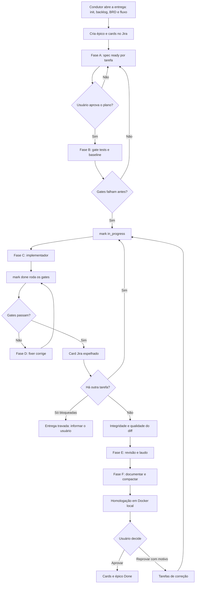

# Exemplo SaaS do usuário — Harness de entrega em ciclo
Status: ready

## Quem usa e onde começa

- Condutor da entrega: pessoa que pede a feature e decide as aprovações, ou o agente principal que orquestra o ciclo. Começa na skill `entrega-em-ciclo` (ponto de entrada: identifica se o pedido é planejar, implementar ou continuar).
- Subagentes por fase: `investigador-de-spec` (A), `eval-gate-author` (B), `implementador` (C), `eval-gate-fixer` (D), `avaliador-de-entrega` e `revisor-de-dominio` (E), `documentador` (F). Cada um devolve um handoff; não conversam com o usuário.
- Time de produto: acompanha pelos cards do Jira (projeto `OFLUXO`) e decide a homologação.

Tudo começa no terminal, na raiz do repositório, com `node quality/delivery/backlog.mjs ...`.

## Passos

1. Fase 0: o condutor cria a entrega (`backlog.mjs init docs/entregas/<AAAA-MM-DD-slug>`), cadastra tarefas com status `pending`, dependências e gates no `backlog.json`, e escreve o BRD e o fluxo do usuário (`brd.md`, `fluxo-usuario.md`). Cria o épico e os cards no Jira com `sync-context.mjs`.
2. Fase A: o `investigador-de-spec` lê o código e escreve `specs/<ID>.md` com `Status: ready`. O condutor mostra o `backlog.mjs status`, resume as specs e os links Jira e para, esperando aprovação explícita do usuário.
3. Fase B: depois da aprovação, o `eval-gate-author` escreve os gate tests em `quality/test/delivery/` e roda `eval.mjs <dir> <ID> --baseline` para provar que falham.
4. Fase C: o condutor marca a tarefa `in_progress` (`mark`), o `implementador` implementa só o que a spec diz, e o condutor marca `done`; o `mark` roda os gates e espelha no Jira.
5. O condutor pede a próxima tarefa com `backlog.mjs next <dir>` e repete a Fase C até acabar as tarefas.
6. Fase D, sempre que um gate falha: o `eval-gate-fixer` diagnostica a causa raiz, aplica a menor correção e re-roda; não forja evidência manual nem afrouxa asserção.
7. Revisão: com todas as tarefas `done`, o condutor roda `integridade.mjs`, `validate-testes.mjs`, `eval.mjs` por tarefa e `node quality/run.mjs --risk` mais o nível de qualidade indicado.
8. Fase E: o `revisor-de-dominio` revisa o diff e o `avaliador-de-entrega` emite o laudo (pronto para fechar, reparos necessários ou bloqueio externo).
9. Fase F: o `documentador` escreve a documentação e o `entrega.md`, e o condutor roda `compactar-entregas.mjs <dir>` para gerar o `SUMMARY.md`.
10. Homologação: ao marcar `done` a última tarefa, se BRD, fluxo e ambiente Docker estão prontos, a feature vai para `em_homologacao` e cards e épico para "Homologation". O condutor passa o `homologacao.md` ao usuário.
11. O usuário decide: `homologar <dir> --aprovar` (tudo Done) ou `homologar <dir> --reprovar --motivo "..."` (abrem-se tarefas de correção). A feature só é dada como entregue depois da aprovação.
12. Cada subagente encerra a sua fase com o bloco `## HANDOFF`, que o hook valida e grava em `docs/entregas/<slug>/handoffs/`.

## Diagrama

O diagrama mostra o ciclo de uma entrega, do backlog à homologação, com os laços de correção de gate e de reprovação.

## Caminhos alternativos e erros

- Pedido só de planejamento ("planejar", "levantar", "criar cards"): o ciclo para depois da Fase A e não implementa sem instrução explícita.
- Gate já passa no baseline: o gate não testa nada; revisar a spec e o gate.
- Dependência não concluída ou outra tarefa em andamento: `mark in_progress` recusa e diz qual.
- Gate falha no `mark done`: o status não muda; o erro lista os gates e o condutor aciona o fixer. Sem progresso após 3 reparos na mesma causa raiz, relata e pede rumo ao usuário.
- Tarefa bloqueada: `mark --status blocked --motivo "<o que falta> — <quem resolve>"`; decisão ou ação do usuário vira pergunta na hora; segue-se com `next`. Exit 3 significa travada: pare e entregue ao usuário a lista de bloqueios. Nunca declarar a entrega concluída.
- Gate `manual`: o runner o pula; a evidência é do humano e fica `manual-pendente` no handoff até ser anexada.
- Jira sem `JIRA_API_TOKEN`: o `mark` grava o backlog e avisa que o card não foi atualizado; com erro do Jira sai com exit 1 e indica o `sync-context.mjs` de reparo. Nunca criar card duplicado.
- Edição fora do escopo da entrega ativa: o hook `guarda-entrega.mjs` só avisa e só atua com `quality/.state/entrega-ativa.json`.
- Edição direta de `status` no `backlog.json`: o hook `guarda-backlog.mjs` nega; use o `mark`.
- Gate alterado depois do `in_progress`: o `mark done` recusa até haver `--correcao "<nota>"`.
- Homologação não inicia: BRD ou fluxo sem `Status: ready`, dado pessoal nos documentos, compose ausente ou roteiro vazio; o `mark` sai com exit 1 e lista as pendências, e depois se roda `homologar <dir>`.
- Sinais de force-pass (`done` sem `done_at`, dependência não concluída, teste tautológico): reportados por `integridade.mjs` e `validate-testes.mjs`; corrigir antes de seguir.
- Handoff inválido: o encerramento do subagente é bloqueado até haver bloco válido.
- Aprovação da homologação: quem conduz a entrega (o dono do produto) decide; não há aprovação em duas pessoas.
