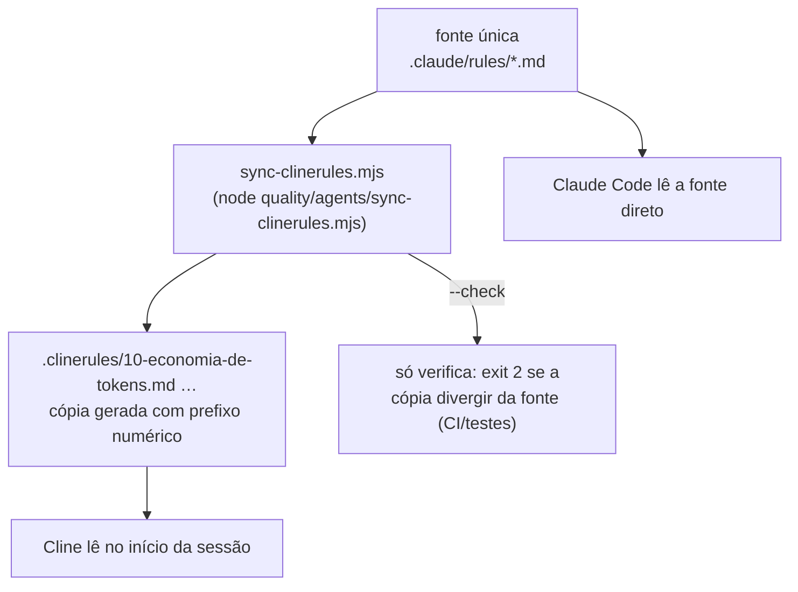

# 1. Carregamento de contexto

## Propósito

O contexto fixo de toda sessão é **mínimo e igual para os dois hosts**; o conhecimento de domínio entra **sob demanda**. O núcleo vale para toda tarefa (AGENTS.md), os temas carregam quando aparecem (skills), as regras permanentes são espelhadas para o Cline por geração (`.clinerules/`), e decisões operacionais viram regras curtas em `.claude/rules/`.

## Quando dispara

Abertura da sessão pelo host: Claude Code lê `CLAUDE.md` (que importa `@AGENTS.md`); o Cline lê o diretório `.clinerules/` (não resolve `@import`). Skills carregam pela descrição quando o tema da tarefa toca nelas (ou sob pedido: `/skill`).

## Peças e arquivos

| Peça | Conteúdo | Como chega ao agente |
|---|---|---|
| `AGENTS.md` (raiz) | Núcleo: missão, princípios, restrições, critérios de qualidade, formato de entrega, índice de módulos (§7) | Contexto fixo (Claude via `CLAUDE.md`; Codex e outros leem direto) |
| `CLAUDE.md` | `@AGENTS.md` + regras específicas do Claude Code (skills, agentes, hooks, ponteiro para README_AGENT_WORKFLOW) | Contexto fixo |
| `.claude/rules/*.md` (8) | Regras sempre ativas: economia-de-tokens, autofix-gates, comandos-curtos, deploy-actions-billing, gitflow-branches, backlog-e-gates, layering, fluxogramas | Claude Code: carga automática; **fonte única** — o espelho do Cline é gerado |
| `.clinerules/*.md` (5, gerado) | Espelho das regras sempre ativas para o Cline (prefixo numérico = ordem de leitura) | Contexto fixo do Cline |
| `.claude/skills/<tema>/SKILL.md` (19) | Domínio (modelo-de-contas, identidade-e-privacidade, eventos, mapa-multimodal, ui-fluxo, contratos-backend, analytics-negocios) e processo (avaliar-qualidade, documentar-entrega, entrega-em-ciclo, implementar-tarefa, revisar-entrega, product-owner, busca-de-codigo, modo-conciso, liberar-portas, brainstorm-ideias, gitflow) | Descrição no contexto; corpo + `references/` sob uso (progressive disclosure) |
| `.claude/agents/*.md` (8) | Papéis delegáveis com `tools:` restritas (doc 11) | Invocação por subagente |
| Prompt da tarefa | Escopo atual, arquivos-alvo, aceites | A cada pedido |

## Fluxo passo a passo (espelho das regras)



Regra de ouro: **editar só a fonte** em `.claude/rules/` (o topo do espelho diz "GERADO por sync-clinerules.mjs; não edite aqui"); depois `node quality/agents/sync-clinerules.mjs` (o `--check` reprova divergência). O hook `post-edit` roda a checagem quando uma fonte é editada.

## Perfil do projeto (R1 — harness agnóstico)

O **dado que varia por projeto** (camadas/stacks, globs de gerados e testes, enums canônicos de domínio, política PII via packs, locale, matchers de docs e de features) vive no **perfil**: `quality/profile/<nome>.json`, schema v1 validado por `quality/lib/profile.mjs`; gate: `quality/test/profile.test.mjs`. Packs de política ficam no core (`quality/packs/`, p.ex. `pii-br`) e são ativados pelo campo `packs` do perfil. Descoberta: env `HARNESS_PROFILE` (alias `FLUXO_PROFILE`) → único perfil no diretório → defaults genéricos vazios. Erro de schema **nunca derruba hooks** (falha aberta); o gate é quem reprova. Visão completa: [docs/parking-lot/harness-agnostico.md](../parking-lot/harness-agnostico.md).

**Overlay de prompts (R2):** o perfil do hospedeiro declara `prompt.overlay` — a **fonte viva do produto do host** (exemplo completo: [quality/examples/fluxo/](../../quality/examples/fluxo/README.md), com missão/estado/restrições do Fluxo) — e `prompt.domainSkills`/`prompt.domainRules` (skills e regras de domínio que pertencem ao projeto, não ao núcleo). O `sync-clinerules.mjs` espelha o overlay para `.clinerules/85-projeto.md` **só quando o perfil declara overlay** (o núcleo deste repo não declara nenhum) e marca no índice (80) quais skills são de overlay.

**Hosts de agente (R-distribuição):** o registro em [quality/lib/hosts.mjs](../../quality/lib/hosts.mjs) define a integração por host — hooks nativos (claude-code: `.claude/`; cline: `.clinerules/hooks/`) ou **carriers de instruções** (vscode/copilot: `.github/copilot-instructions.md`; antigravity: `.antigravity/rules/`; kiro: `.kiro/steering/`) e leitura de `AGENTS.md` (codex). Instalador: `harness-init --hosts a,b,all`; `omni-harness doctor` lista o instalado. **Paths são sobrescritáveis pelo hospedeiro** em `quality/hosts.json` (estruturas proprietárias mudam sem tocar a lib) — resolver: `omni-harness hosts [destino] --json`.

## Entradas, saídas e estado

- **Entrada:** nenhum dado dinâmico — tudo é arquivo versionado.
- **Saída:** contexto fixo do host + skills sob demanda; `.clinerules/` regenerado quando a fonte muda.
- **Estado:** nenhum (arquivos estáticos).

## Comandos

```bash
node quality/agents/sync-clinerules.mjs          # regenera .clinerules/*.md a partir de .claude/rules/
node quality/agents/sync-clinerules.mjs --check  # exit 2 se o espelho divergir
```

## Modos de falha e runbook

- **Editei `.clinerules/*.md` direto:** a próxima geração sobrescreve — a regra certa é editar `.claude/rules/` e sincronizar.
- **Regra nova precisa valer no Cline:** criar em `.claude/rules/` com o prefixo numérico desejado e rodar o sync.
- **Skill citada no AGENTS.md não existe:** o índice (§7) é ponteiro — corrigir a tabela, não criar skill vazia.
- **Contexto grande demais:** é sinal de que conteúdo saiu do núcleo — mover detalhe para skill/referência e deixar ponteiro (princípio do progressive disclosure).

## Paridade Claude Code ↔ Cline

| | Claude Code | Cline |
|---|---|---|
| Núcleo | `CLAUDE.md` (`@AGENTS.md`) | `.clinerules/` (cópia gerada das regras) |
| Skills | carregam pela descrição | o agente lê o `SKILL.md` do tema pela tabela §7 do AGENTS.md |
| Regras sempre ativas | `.claude/rules/*.md` (fonte) | `.clinerules/*.md` (espelho gerado) |

## Testes que provam o comportamento

O `--check` é a prova executável: `node quality/agents/sync-clinerules.mjs --check` (exit 2 = espelho divergente da fonte).

## Fontes

- [AGENTS.md](../../AGENTS.md) · [CLAUDE.md](../../CLAUDE.md) · [.claude/rules/](../../.claude/rules) · [.clinerules/](../../.clinerules)
- [sync-clinerules.mjs](../../quality/agents/sync-clinerules.mjs) · [.claude/skills/](../../.claude/skills)

