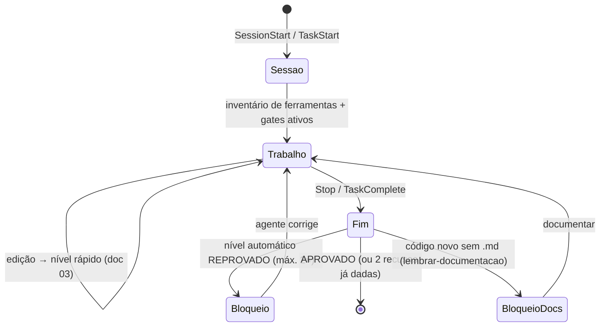

# 2. Ciclo de sessão e evidência

## Propósito

Preparar o ambiente no início da sessão do agente, acompanhar o risco acumulado e garantir que **nada encerra sem os gates do nível exigido passarem** — no máximo duas recusas por estado, para não prender o usuário. Também guarda a **evidência por hash**: um gate só vale para o estado exato da árvore que existia quando ele rodou.

**Hospedeiro sem git** (núcleo apartado): os hooks de abertura e encerramento **seguem ativos com o mesmo contexto** (inventário, gates, tracker); o que fica indisponível é a **evidência por hash** e os gates de sessão do Stop — o Stop informa isso em vez de silenciar, e o fluxo segue via CLI (`node quality/run.mjs --tier rapido`).

## Quando dispara

| Evento | Claude Code | Cline | Script |
|---|---|---|---|
| Início/retomada | `SessionStart` (startup, resume, clear, compact) | `TaskStart`, `TaskResume` | `session-start.mjs` via `cline-lifecycle.mjs` |
| Fim | `Stop` | `TaskComplete` (resultado volta como contexto, sem bloqueio) | `stop.mjs` + `.claude/hooks/lembrar-documentacao.mjs` |
| Fim de subagente | `SubagentStop` (8 papéis) | — | `.claude/hooks/handoff-subagente.mjs` — doc 11 |

## Peças e arquivos

| Arquivo | Responsabilidade |
|---|---|
| `quality/hooks/session-start.mjs` | Limpa estado de sessão antigo, inventaria ferramentas (lizard, dart, flutter, dotnet, pnpm, uv, docker, firebase, osv-scanner), informa gates e níveis em pt-BR |
| `quality/hooks/stop.mjs` | Roda o nível automático da matriz nos arquivos tocados na sessão (`--session`); REPROVADO bloqueia o encerramento (máx. 2 vezes por estado). **Avisa também deploy pendente** (QG-027): homologação aprovada e `deploy.md` sem registro depois dela — aviso, não bloqueia |
| `.claude/hooks/lembrar-documentacao.mjs` | No `Stop`: arquivo novo de domínio/API/migration/Functions sem nenhum `.md` tocado → bloqueia uma vez por conjunto de arquivos |
| `quality/hooks/cline-lifecycle.mjs` | Mesmos scripts para os eventos do Cline; como o fim de tarefa do Cline não pode ser bloqueado, o veredito volta como **contexto** com o mesmo texto |
| `quality/lib/anti-loop.mjs` | Detecta comandos idênticos repetidos no `run_commands` (3ª variação, 4ª aviso) e varia o comando para não morrer no detector de loop do CLI |
| `quality/.state/` | Estado de sessão: evidências por hash, risco acumulado, `graphify-guard.json`, `entrega-ativa.json` |

## Fluxo passo a passo



**Evidência por hash.** Todo `--tier` aprovado grava em `quality/.state/evidence/` o resultado amarrado ao hash da árvore. `pre-bash.mjs` (doc 04) só deixa passar `git commit`/`git push`/deploy se existir evidência aprovada **do nível exigido para o hash atual** — editar um arquivo depois do gate invalida a evidência. É o mecanismo que impede "rodou o gate, depois mudou o código, commitou mesmo assim".

## Comandos

O ciclo é todo por hooks — não há comando manual para "abrir sessão". Para reproduzir o que o `Stop` faz:

```bash
node quality/run.mjs --tier rapido --session <id>   # nível automático nos arquivos da sessão
node quality/hooks/session-start.mjs                # inventário de ferramentas (o que o agente vê no início)
```

## Variáveis de ambiente e configuração

| Variável | Efeito |
|---|---|
| `GRAPHIFY_HOOK_MODE` | `soft` (padrão) / `strict` / `off` — só afeta a guarda de busca (doc 04) |
| Teto de recursos (`resources.json`) | Vale para os gates rodados no `Stop` (doc 10) |

## Modos de falha e runbook

- **`Stop` bloqueou ("encerramento recusado"):** rodar o nível indicado, corrigir o REPROVADO e tentar de novo. Após 2 recusas no mesmo estado o hook desiste — **relatar ao usuário** o que ficou sem evidência, nunca afirmar que passou.
- **`lembrar-documentacao` bloqueou:** o conjunto de arquivos novos (domínio/API/migration/Functions) exige ao menos um `.md` tocado na mesma sessão — escrever/atualizar a doc do domínio e seguir.
- **Cline:** o fim de tarefa **nunca bloqueia** (a API não aceita); o mesmo veredito chega como mensagem de contexto. Tratar como bloqueio virtual: agir igual.
- **`anti-loop` avisou (4ª repetição):** mudar de estratégia (o detector de loop do CLI para a tarefa na 5ª idêntica; casos reais eram polls de `sleep N; ps` — consultar log com `Read` em vez de shell).
- **Estado corrompido em `quality/.state/`:** falha aberta — apagar o arquivo específico da sessão não quebra nada; os hooks recriam.

## Paridade Claude Code ↔ Cline

| | Claude Code | Cline |
|---|---|---|
| Início | `SessionStart` → `additionalContext` | `TaskStart`/`TaskResume` → mesmo texto |
| Fim | `Stop` pode **bloquear** (decision block) | `TaskComplete` só **contexto** (mesmo texto, sem bloqueio) |
| Registro | `quality/.state/` por sessão | igual, via `cline-lifecycle.mjs` |

## Testes que provam o comportamento

`node --test quality/test/hooks.test.mjs` (session-start, stop, post-edit) e `node --test quality/test/anti-loop.test.mjs`.

## Fontes

- [session-start.mjs](../../quality/hooks/session-start.mjs) · [stop.mjs](../../quality/hooks/stop.mjs) · [cline-lifecycle.mjs](../../quality/hooks/cline-lifecycle.mjs)
- [anti-loop.mjs](../../quality/lib/anti-loop.mjs) · [registro no settings.json](../../.claude/settings.json)

