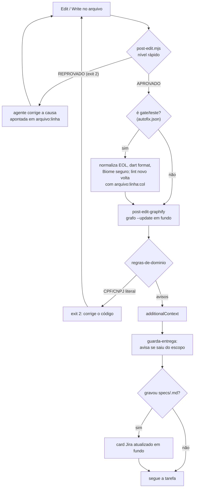

# 3. Loop de edição

## Propósito

Cada arquivo editado pelo agente passa por uma esteira de hooks no mesmo evento: qualidade rápida do arquivo, autocorreção leve de código de gate/teste, atualização do grafo, regras de domínio, guarda de fases da entrega e espelho de spec no Jira. É o loop mais executado do harness — a cada `Edit`/`Write`/`MultiEdit`/`NotebookEdit` da sessão.

## Quando dispara

Evento `PostToolUse` registrado em `.claude/settings.json`, na ordem:

1. `post-edit.mjs` — nível **rápido** no arquivo editado (matcher `Edit|Write|MultiEdit|NotebookEdit`);
2. `post-edit-graphify.mjs` — grafo incremental em fundo (mesmo matcher);
3. `regras-de-dominio.mjs` — CPF/CNPJ, enums, blockchain (matcher `Edit|Write|MultiEdit`);
4. `sync-spec-jira.mjs` — spec gravada → card Jira (mesmo matcher);
5. `guarda-entrega.mjs` — fases da entrega em ciclo (mesmo matcher do 1).

## Peças e arquivos

| Arquivo | Responsabilidade |
|---|---|
| `quality/hooks/post-edit.mjs` | Roda o nível rápido só no arquivo editado, comparando com o HEAD. REPROVADO → `exit 2` com relatório no stderr. APROVADO → uma linha de contexto + risco da sessão atualizado |
| `quality/lib/autofix.mjs` | Normaliza EOL/newline final, `dart format` e correções seguras do Biome **só em código de gate/teste** (`autofix.json`: `quality/**/*.mjs`, `.claude/hooks/**`, `scripts/tracker/**`, JSON de `quality/`, `test/**/*_test.dart`); valida sintaxe e lint **novo** contra o HEAD; para após 3 falhas seguidas no mesmo arquivo (`maxConsecutiveFailures`) |
| `quality/hooks/post-edit-graphify.mjs` | Depois de editar **código**, atualiza o grafo em fundo (`graphify-build --update`, incremental, offline, sob teto de recursos) |
| `.claude/hooks/regras-de-dominio.mjs` | **Bloqueia** (exit 2) CPF/CNPJ literal em código; **avisa** sobre `cpf`/`cnpj` bruto em resposta pública, enum de domínio redefinido fora do arquivo canônico e dependência de blockchain |
| `quality/delivery/guarda-entrega.mjs` | Com entrega ativa (`quality/.state/entrega-ativa.json`), **avisa** quando a edição sai do escopo da tarefa (informacional; desliga apagando o arquivo de estado) |
| `.claude/hooks/sync-spec-jira.mjs` | Ao gravar `docs/entregas/<slug>/specs/<ID>.md`, atualiza o card Jira em fundo (lógica em `quality/lib/spec-sync.mjs`; 1 sync a cada 2 min; `FLUXO_JIRA_AUTOSYNC=0` desliga) |

## Exemplo SaaS passo a passo



## Entradas, saídas e estado

- **Entrada:** payload do hook com o caminho do arquivo escrito e o conteúdo novo.
- **Saída:** veredito curto no stderr/stdout do hook; no Claude, `exit 2` devolve o texto ao modelo; no Cline, o texto volta como `contextModification` (doc 09).
- **Estado:** risco da sessão (`quality/.state/`), grafo `graphify-out/` atualizado em fundo, janela de autosync do Jira.

## Comandos

```bash
node quality/run.mjs --fix            # mesma autocorreção, em lote (o pre-commit também roda)
node quality/run.mjs --tier rapido    # nível rápido no diff inteiro
```

## Variáveis de ambiente e configuração

| Variável | Efeito |
|---|---|
| `FLUXO_AUTOFIX=0` | Desliga a autocorreção no hook (não contorna lint: erro novo continua bloqueando) |
| `FLUXO_JIRA_AUTOSYNC=0` | Desliga o autosync de spec → card |
| `quality/config/autofix.json` | Escopo e `maxConsecutiveFailures: 3` |

## Modos de falha e runbook

- **`exit 2` do `post-edit`:** ler `arquivo:linha:col`, editar o arquivo. Sintaxe nunca é reescrita pelo hook. Import não usado não é removido sozinho — remover ou usar.
- **3 falhas seguidas no mesmo arquivo:** o hook para de bloquear e avisa — **relatar ao usuário**, não insistir.
- **Lint só bloqueia erro novo** frente ao HEAD; erro legado não é desta tarefa — relate, não conserte.
- **CPF/CNPJ literal bloqueado:** remover o dado do código (usar o dado só em ambiente seguro, nunca versionado).
- **Guarda de entrega avisou:** a edição saiu do escopo da tarefa ativa — atualizar `scope` em `quality/.state/entrega-ativa.json` ou voltar ao escopo (doc 07).

## Paridade Claude Code ↔ Cline

O Cline ignora cancelamento no `PostToolUse`: o mesmo bloqueio chega como `contextModification` com texto igual ao do `exit 2` do Claude — tratar igual (editar o arquivo). A esteira roda via `cline-post-tool-use.mjs` + `quality/lib/cline-bridge.mjs` (doc 09).

## Testes que provam o comportamento

`node --test quality/test/hooks.test.mjs` (post-edit) · `node --test quality/test/autofix.test.mjs` · `node --test .claude/hooks/test/regras.test.mjs` (domínio) · testes de entrega: `node --test quality/test/delivery/guarda.test.mjs`.

## Fontes

- [post-edit.mjs](../../quality/hooks/post-edit.mjs) · [autofix.mjs](../../quality/lib/autofix.mjs) · [autofix.json](../../quality/config/autofix.json)
- [regras-de-dominio.mjs](../../.claude/hooks/regras-de-dominio.mjs) · [guarda-entrega.mjs](../../quality/delivery/guarda-entrega.mjs) · [sync-spec-jira.mjs](../../.claude/hooks/sync-spec-jira.mjs)

