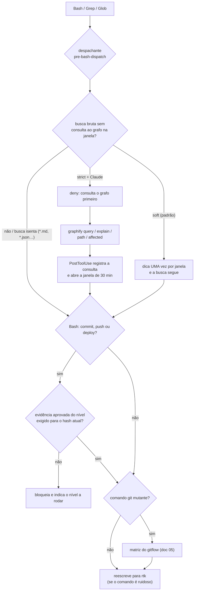

# 4. Busca de código e economia de tokens

## Propósito

Em um repo de ~5,8 mil arquivos, busca bruta (`Grep`, `Glob **`, `grep -r`, `rg`, `find -name`) devolve páginas de ruído e custa tokens. O harness incentiva o **grafo do graphify** como primeira consulta, filtra a saída do shell com **rtk** e mantém o grafo atualizado após cada edição — tudo por hook, sem depender da memória do agente.

## Quando dispara

Tudo no `PreToolUse`/`PostToolUse` de `Bash`, `Grep`, `Glob` — concentrados no **despachante único** `pre-bash-dispatch.mjs` (um processo em vez de quatro: ~28 ms contra ~240 ms de CPU por chamada). Etapas em ordem, **a primeira decisão vence**, cada etapa com falha aberta (bug numa etapa nunca derruba as outras):

1. **Guarda de busca** (Grep, Glob e Bash) — graphify primeiro;
2. **Evidência de commit/push/deploy** (Bash) — doc 10 e abaixo;
3. **Gitflow** (Bash) — doc 05;
4. **Reescrita rtk** (Bash, só se ninguém decidiu antes).

## Peças e arquivos

| Arquivo | Responsabilidade |
|---|---|
| `quality/hooks/pre-bash-dispatch.mjs` | Despachante: lê o payload uma vez e roda as 4 etapas em ordem |
| `quality/lib/search-guard.mjs` | Política pura da guarda de busca (modos, janela, isenções) |
| `quality/lib/search-message.mjs` | Mensagem pt-BR da dica/negação |
| `quality/hooks/pre-search-graphify.mjs` / `post-search-graphify.mjs` | Pre (avalia) e Post (registra consulta bem-sucedida e abre a janela) |
| `quality/agents/graphify-build.mjs` | Build/update do grafo sob teto de memória/CPU, sem chave de API |
| `quality/lib/rtk-rewrite.mjs` + `quality/hooks/pre-bash-rtk.mjs` | Reescrita de comandos ruidosos para `rtk <cmd>` |
| `quality/.state/graphify-guard.json` | Estado por sessão: última consulta bem-sucedida, dica já dada |

## Exemplo SaaS passo a passo



**Janela de 30 minutos** (`WINDOW_MS` em `search-guard.mjs`): abre só depois de uma consulta ao graphify que **terminou com sucesso e trouxe resultado** (registrada pelo `post-search-graphify.mjs`; o Pre nunca registra — antes de rodar não dá para saber). Busca fora de código (`docs/`, `*.md`, `*.json`) é isenta; `Read` de arquivo específico nunca é tratado como busca.

**Modos** (`GRAPHIFY_HOOK_MODE` no ambiente **antes** de abrir o agente; `GRAPHIFY_HOOK_STRICT=0|1` também aceito): `soft` (padrão) dica única por janela e segue; `strict` nega a busca bruta no Claude Code até haver consulta — no Cline vira dica a cada busca, porque `cancel` lá **aborta a tarefa inteira**; `off` desliga. Sem grafo ou sem a CLI, nada acontece (falha aberta).

**Evidência antes de commit/push/deploy** (`pre-bash.mjs`): exige evidência aprovada do nível exigido para o hash exato da árvore (doc 10); `deploy` com risco alto/crítico e `commit` com risco crítico viram `ask` (confirmação humana); flags de custo no deploy (ex.: `--memory`) também pedem `ask`.

**Reescrita rtk:** no Claude Code o `pre-bash-rtk.mjs` delega ao `rtk hook claude`; no Cline CLI/SDK o mesmo hook reescreve via `overrideInput`; na extensão VS Code do Cline (sem reescrita) a regra é o agente prefixar sozinho (`rtk git status`, `rtk test <cmd>`…). Sem binário `rtk` ou com `RTK_DISABLED=1`, não faz nada.

## Comandos do grafo

```bash
graphify query "SplashScreen"                 # onde fica / como funciona
graphify path "A" "B"                          # como A chega em B
graphify explain "símbolo ou arquivo"          # o que é
graphify affected "símbolo"                    # o que quebra se mudar
node quality/agents/graphify-build.mjs         # primeiro build (sempre --code-only no extract solto)
node quality/agents/graphify-build.mjs --update  # depois de editar código
```

Consulte por **identificador exato**, não por frase. Em Dart o extrator não traz linha — localize com `rtk grep -n "<símbolo>" <arquivo>` ou `Read` curto.

## Modos de falha e runbook

- **Busca negada no modo strict:** rodar um `graphify query` bem-sucedido; a janela abre e a busca passa.
- **Dica repetindo a cada busca no Cline:** comportamento esperado do strict adaptado; use `GRAPHIFY_HOOK_MODE=off` se incomodar.
- **Grafo velho:** `--update` (o hook de edição faz sozinho em fundo); grafo ausente: build completo.
- **rtk engoliu saída que eu precisava crua:** `rtk proxy <cmd>`; métricas: `rtk gain`; oportunidades perdidas: `rtk discover`.

## Testes que provam o comportamento

`node --test quality/test/search-guard.test.mjs` (modos e janela) · `node --test quality/test/hooks.test.mjs` (evidência do pre-bash e reescrita).

## Fontes

- [pre-bash-dispatch.mjs](../../quality/hooks/pre-bash-dispatch.mjs) · [search-guard.mjs](../../quality/lib/search-guard.mjs) · [rtk-rewrite.mjs](../../quality/lib/rtk-rewrite.mjs)
- Skill [busca-de-codigo](../../.claude/skills/busca-de-codigo/SKILL.md) · regra [economia-de-tokens](../../.claude/rules/economia-de-tokens.md)

