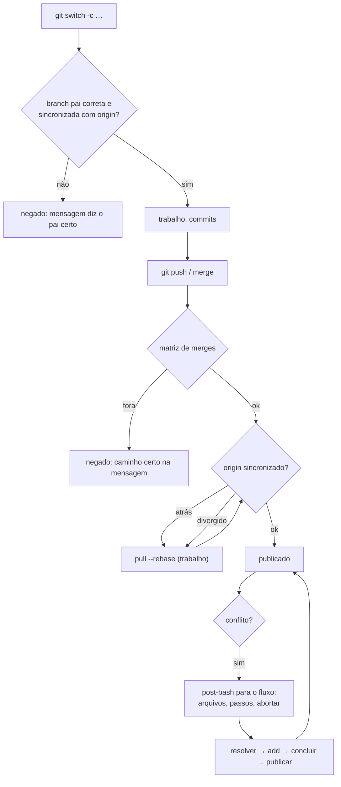

# 5. Gitflow determinístico

## Propósito

O repositório é compartilhado: todo push é observado por pessoas e pela esteira. O gitflow do projeto hospedeiro é garantido por **hooks determinísticos**, não pela memória do agente — taxonomia de branches, branch pai correta, matriz de merges, sincronização obrigatória com origin e runbook de conflitos, com mensagens acionáveis em pt-BR. As regras completas e as receitas: [skill gitflow](../../.claude/skills/gitflow/SKILL.md) e regra [gitflow-branches](../../.claude/rules/gitflow-branches.md).

## Quando dispara

`PreToolUse`/`PostToolUse` de **Bash** (etapas 2 e 3 do despachante, doc 04): criação de branch, merge, commit, pull, push, rebase/reset, delete.

## Peças e arquivos

| Arquivo | Responsabilidade |
|---|---|
| `quality/hooks/pre-bash-gitflow.mjs` | Taxonomia + branch pai na criação (pai sincronizada com origin; startPoint explícito aceito); matriz de merge (inclui `release/x.y.z → RELEASE` para o merge local); commit/push direto em main/develop negado (develop só recebe merge); **push em RELEASE sem merge commit negado com o comando de retomada do `release-bump.mjs`** (QG-025); pull de trabalho exige `--rebase`; push só com merge commit no develop e sincronizado; `--force` negado (após rebase: `--force-with-lease`, nunca em main/develop/release); delete de main/develop negado; remote inacessível pede confirmação humana |
| `quality/hooks/post-bash-gitflow.mjs` | Detecta conflito (merge/rebase/cherry-pick) e **para o fluxo** com runbook: arquivos em conflito, passos por operação, como publicar depois, como abortar; enquanto houver conflito, o Pre nega qualquer git que não seja de resolução |
| `quality/hooks/git-identity-guard.mjs` | Hook **core** de git (`pre-commit`/`pre-push`): commit e push tocando `main` só passam com identidade (autor ou committer) na allowlist do clone (`git config omniharness.allowed-emails`, semeada pelo `install.mjs` com o `user.email` do dono). Barreira definitiva contra outra conta é o branch protection do GitHub |
| `quality/lib/gitflow.mjs` | Política pura: taxonomia, matriz, decisões, parser |
| `quality/lib/gitstate.mjs` | Branch atual, estado de conflito, sync com origin |
| `quality/messages.pt-BR.json` | Mensagens (`gitflow.*`) |

## Exemplo SaaS canônico e matriz

```text
MAIN → DEVELOP → FEAT ⇄ DEVELOP (versão) → RELEASE (PIPELINE ou LOCAL) → MAIN
```

| Tipo | Nasce de | Volta para | Nome | Commit direto |
|---|---|---|---|---|
| `feat/` | develop | develop | `feat/<slug>` | não (só via merge) |
| `fix/` | develop | develop | `fix/<slug>` | não |
| `chore/` | develop | develop | `chore/<slug>` | não |
| `hotfix/` | main | main + develop (backmerge) | `hotfix/<slug>` | sim (estabilização) |
| `release/` | develop | main + RELEASE + develop (backmerge) | `release/x.y.z[-sufixo]` | via fix/ e hotfix/ |

Bloqueios de merge: main ← feat/fix/chore/develop; develop ← main ou branch fora da taxonomia; trabalho ← trabalho/main; hotfix ← develop; release ← develop/feat/main. **Publicar main é papel da esteira da release — ou do gêmeo local (doc 06) quando a esteira está sem minutos.**

## Exemplo SaaS passo a passo (receitas resumidas)

```bash
# Feature (FEAT ⇄ DEVELOP)
git switch develop && git pull --ff-only && git switch -c feat/<slug>
# … trabalho, commits …
git push -u origin feat/<slug>
git switch develop && git merge feat/<slug> && git push origin develop

# Hotfix (main → main + develop)
git switch main && git pull --ff-only && git switch -c hotfix/<slug>
# … correção …
git push -u origin hotfix/<slug>          # merge em main via PR/patch
git switch develop && git merge hotfix/<slug> && git push origin develop

# Release (develop → release/x.y.z → RELEASE/main/develop) — doc 06
```



## Modos de falha e runbook

- **"hotfix/ nasce de main":** a mensagem traz o pai correto — refazer o `switch -c` do jeito indicado.
- **Commit/push em main de outra conta:** o hook core `git-identity-guard.mjs` nega com a allowlist impressa. Dono do clone: `git config omniharness.allowed-emails <email>`; conta nova legítima entra na allowlist, nunca se desliga a guarda. Hook local se contorna com `--no-verify` — para valer contra outras contas no GitHub, ative o branch protection (restrict who can push → conta do dono).
- **Push de develop negado:** develop só aceita merge commit no HEAD; volte para a branch de trabalho e abra o PR/merge.
- **Conflito:** seguir o runbook impresso (`git status` → resolver blocos → `git add` → `git commit`/`git rebase --continue`/`git cherry-pick --continue` → publicar). Nunca contornar com `--no-verify` ou trocar de branch para driblar.
- **Remote inacessível:** o hook pede confirmação humana em vez de operar sem sync.
- **Erro clássico:** commitar direto na `RELEASE`/`main` — sempre `git branch --show-current` antes do primeiro `Edit`.

## Testes que provam o comportamento

`node --test quality/test/gitflow.test.mjs quality/test/gitflow-hooks.test.mjs` (política e hooks, por arquivo).

## Fontes

- [pre-bash-gitflow.mjs](../../quality/hooks/pre-bash-gitflow.mjs) · [post-bash-gitflow.mjs](../../quality/hooks/post-bash-gitflow.mjs) · [gitflow.mjs](../../quality/lib/gitflow.mjs)
- [SKILL.md do gitflow](../../.claude/skills/gitflow/SKILL.md) · [gitflow-branches.md](../../.claude/rules/gitflow-branches.md)

