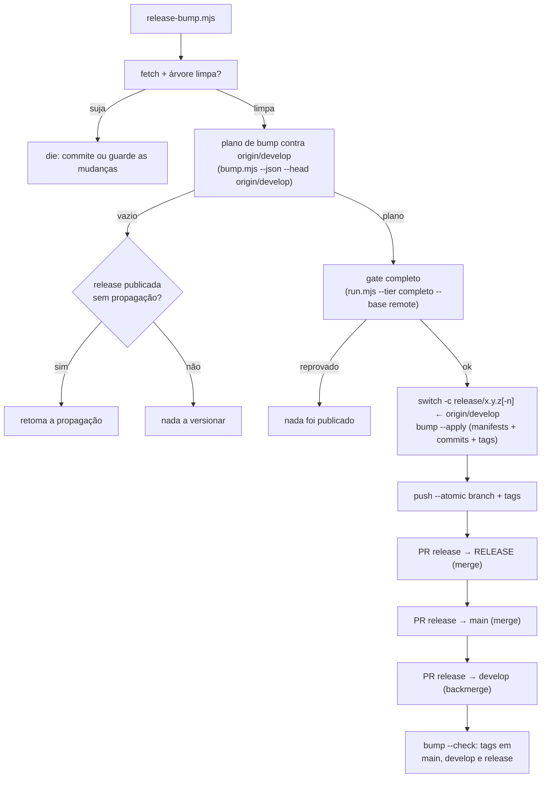

# 6. Versionamento por camada e release/deploy

## Propósito

Cada camada (`quality/config/layers.json`) tem versão própria, com **bump determinístico** por commits convencionais desde a última tag daquela camada (`BREAKING CHANGE` → major; `feat` → minor; demais → patch), salvo como tag `<camada>@vX.Y.Z`. Os scripts do harness de deploy e do espelho Jira (`scripts/deploy/**`, `scripts/tracker/**`) versionam na camada **quality** — mudança neles exige release como qualquer camada. A release nasce de `origin/develop`, é publicada com as tags e **propagada para `RELEASE`, `main` e `develop`** — pelo workflow do Actions ou pelo gêmeo local quando o Actions está sem minutos (caso atual: billing do GitHub quebrado).

## Quando dispara

- Push em `RELEASE` → workflow `release-tag.yml` (caminho Actions).
- `node scripts/deploy/local/release-bump.mjs` (caminho local, sem Actions) — o gêmeo.
- Deploys: `node scripts/deploy/release.mjs --run <id> [--local]` ou os scripts diretos de `scripts/deploy/local/`.

## Peças e arquivos

| Arquivo | Responsabilidade |
|---|---|
| `quality/version/bump.mjs` | CLI do bump: `--json` (plano), `--apply` (manifests+commits+tags), `--init` (baselines), `--next <camada>`, `--check`, `--base <ref>`, `--head <ref>` (planejar contra outra ref, ex. `origin/develop`), `--versions` |
| `quality/lib/versioning.mjs` | Política pura: parse de tags/manifests, cálculo do bump |
| `quality/lib/release-flow.mjs` | Decisões puras do fluxo local: nome da branch (maior versão-alvo), `PROPAGATE_TO = ['RELEASE','main','develop']`, retomada |
| `scripts/deploy/local/release-bump.mjs` | Gêmeo local do `release-tag.yml`: corta `release/x.y.z[-n]` de `origin/develop`, roda o gate completo, aplica o bump, publica branch+tags atomicamente, abre e mergeia os PRs de propagação; idempotente |
| `.github/workflows/release-tag.yml` | No Actions: `--init`/`--apply` no push de `RELEASE`, tags, GitHub Release; merge para main opt-in (`RELEASE_MERGE_MAIN=true`) |
| `scripts/deploy/release.mjs` | Orquestrador de deploy: `--probe` (billing), `--plan`, `--graph`, `--status`, `--run <id> [--local]` |
| `scripts/deploy/actions-quota.mjs` | Sonda de billing do Actions (`gh api`); sem saldo → deploy sempre local |
| `scripts/deploy/local/deploy-{api,web,worker}.sh` | Réplicas locais dos workflows de deploy (backend, web, Cloud Run Job do Creator) |
| `ofluxo_site/public/versions.json` | Regenerado a cada apply (`--versions`), por ambiente (prod ← main, hml ← RELEASE, dev ← develop) |

## Fluxo passo a passo (caminho local)



O plano contra `origin/develop` (não contra o checkout corrente) é o que torna o gêmeo independente da branch de pé na máquina — rodar a partir de `main` não esconde o pendente de develop. Cada camada conta do **próprio tag** (`creator-worker@v0.3.1..origin/develop`); camada sem tag conta da bifurcação com develop. `-n` no nome (`release/0.3.4-2`) entra quando a versão-alvo já teve release publicada.

## Caminho Actions e regra de billing

1. **Antes de TODO deploy por Actions** (`release.mjs --run` sem `--local`, `gh workflow run`, rerun, acompanhamento): rodar `node scripts/deploy/release.mjs --probe`.
2. Sem saldo (exit 1) → **deploy por script local SEMPRE**; não repetir no Actions nem "consertar workflow" por causa do billing.
3. Inconclusivo (token sem escopo de billing) → seguir com `--run`: o orquestrador faz a sonda de dispatch (`deploy-probe.yml`) e cai para o local se falhar.
4. Runbook: [docs/entregas/2026-11-14-fluxo-creator/deploy.md](../entregas/2026-11-14-fluxo-creator/deploy.md).

## Comandos

```bash
npm run version:bump                        # plano (dry run)
npm run version:bump -- --apply             # na release/*: manifests, commits e tags
npm run version:bump -- --init              # primeira vez: baselines por camada
npm run version:bump -- --next site         # versão do próximo apply (usada pelos builds)
npm run version:bump -- --check             # tags em main, develop e release (exit 2 se violar)
node scripts/deploy/local/release-bump.mjs [--dry-run] [--no-main] [--skip-propagate]
node scripts/deploy/release.mjs --probe | --plan | --status | --run <id> [--local]
bash scripts/deploy/local/deploy-api.sh | deploy-web.sh | deploy-worker.sh
```

Deploys injetam a versão calculada com `bump.mjs --next <camada>` (`VITE_APP_VERSION` no site/admin, `APP_VERSION` na imagem do backend). **Deploy nunca sai com versão pendente:** `release.mjs --run deploy-*` recusa enquanto o plano do bump não estiver vazio — rode antes a release/bump.

## Modos de falha e runbook

- **"árvore suja":** commitar ou guardar as mudanças alheias (ex.: `git stash push -m msg -- <paths>`, recuperável com `git stash pop`; nunca `stash -u` em arquivo seu).
- **Plano vazio mas há pendente:** conferir em que branch está o checkout — o plano local conta contra `origin/develop`; se ainda vazio, a camada pode estar sem tag nova mesmo (nada a fazer).
- **PR de propagação falhou (branch protection):** o script morre após publicar a release — é idempotente: rode de novo para retomar da propagação.
- **Propagação com `GH_ACTIONS=false` (QG-024):** o gêmeo propaga por **merge local `--no-ff`** direto em RELEASE/main/develop (matriz do gitflow completa: `release/x.y.z → RELEASE` é direção canônica). Com Actions ligado, volta ao PR via gh.
- **Nome da release reciclado (QG-025):** `release/x.y.z` totalmente propagada (nenhum destino pendente) tem o nome reaproveitado — a branch velha é apagada (local + remoto) e a nova recorta de `origin/develop`. Com propagação pendente, continua `-2`, `-3`… (a branch velha ainda é necessária para retomar).
- **Falha no meio da propagação:** o erro lista os destinos ainda pendentes e o comando de retomada (`node scripts/deploy/local/release-bump.mjs`) — a release já publicada não é re-publicada.
- **`--check` acusa pendência:** destino não propagado (ex.: `main` com `--no-main`) — propagar e rodar de novo.
- **Billing do Actions quebrado:** é bloqueio do dono da conta (Settings → Billing); em código, nada a fazer — usar o caminho local.

## Testes que provam o comportamento

`node --test quality/test/version.test.mjs quality/test/version-flow.test.mjs` (política e fluxo) · `node --test quality/test/release-flow.test.mjs` (decisões do gêmeo).

## Fontes

- [bump.mjs](../../quality/version/bump.mjs) · [versioning.mjs](../../quality/lib/versioning.mjs) · [release-flow.mjs](../../quality/lib/release-flow.mjs)
- [release-bump.mjs](../../scripts/deploy/local/release-bump.mjs) · [release.mjs](../../scripts/deploy/release.mjs) · [actions-quota.mjs](../../scripts/deploy/actions-quota.mjs)
- [release-tag.yml](../../.github/workflows/release-tag.yml) · regra [deploy-actions-billing](../../.claude/rules/deploy-actions-billing.md) · [SKILL gitflow §versionamento](../../.claude/skills/gitflow/SKILL.md)

