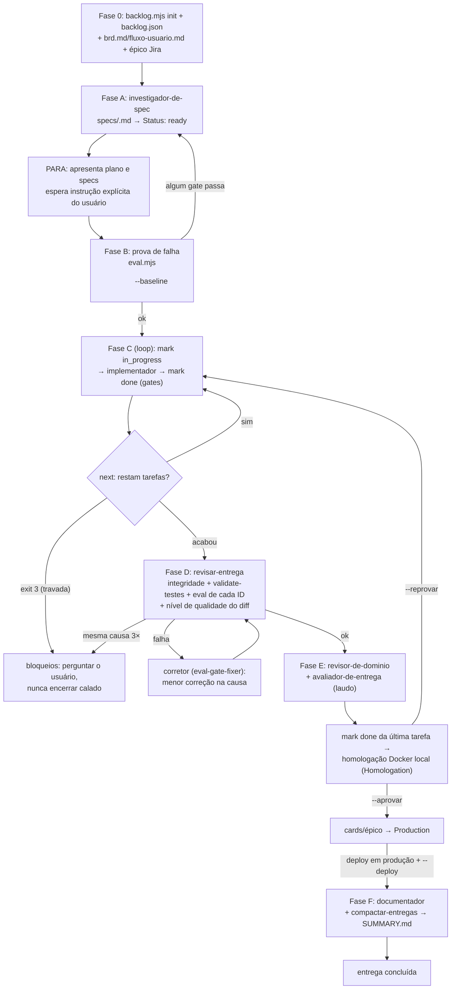
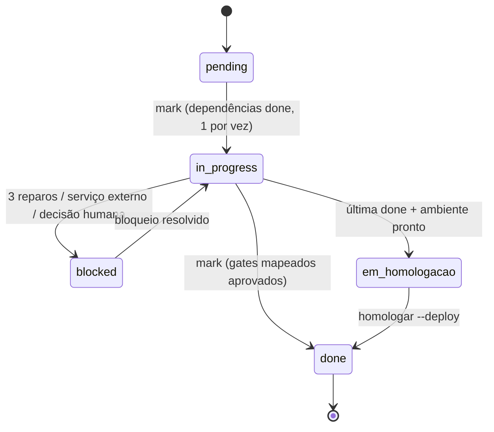

# 7. Entrega em ciclo

## Propósito

Entregas com várias tarefas (épico, fase, módulo novo) andam por **fases verificáveis por máquina**: investigar a spec, provar que os gates falham, implementar uma tarefa por vez, rodar os gates, avaliar, revisar, documentar, homologar e compactar. O estado vive em `docs/entregas/<AAAA-MM-DD-slug>/backlog.json` (fonte da verdade) e o espelho no Jira acompanha cada passo. Quem especifica não implementa; quem escreve o gate não implementa; nada é `done` sem gates passando.

## Quando dispara

Skill [`entrega-em-ciclo`](../../.claude/skills/entrega-em-ciclo/SKILL.md), executada pela **sessão principal** (subagente não dispara subagente). Ponto de entrada classifica a intenção: planejar (Fases 0+A e **para para aprovação**), implementar (Fase B em diante) ou continuar (retoma da fase gravada no backlog).

## Peças e arquivos

| Peça | Responsabilidade |
|---|---|
| `backlog.mjs` | `init · status · next · render · validate · mark · homologar` — único caminho para mudar status; `mark` roda os gates mapeados antes do `done`, grava datas, congela os gates e espelha no Jira |
| `eval.mjs <dir> <ID> [--baseline]` | Runner sem shell: executa os gates `command` (arrays, `cwd`, timeout), aceita evidência `manual` com `Resultado: APROVADO`; `--baseline` **prova a falha** num worktree da ref anterior |
| `integridade.mjs` | Detector de *force-pass*: assert tautológico, teste sem assert, skip incondicional, catch vazio, evidência manual incompleta |
| `validate-testes.mjs` | Estrutura dos gate tests em `quality/test/delivery/*.test.mjs` |
| `guarda-backlog.mjs` | Hook `PreToolUse` (Edit/Write): **nega** edição direta do `status` no `backlog.json`; tarefa nova só `pending` (JSON ilegível = falha aberta) |
| `guarda-entrega.mjs` | Hook `PostToolUse`: com `quality/.state/entrega-ativa.json`, avisa se a edição saiu do escopo da tarefa |
| `handoff.mjs` (+ hook `SubagentStop`) | Valida e grava o bloco HANDOFF de cada subagente em `docs/entregas/<slug>/handoffs/` |
| `compactar-entregas.mjs` | Ao fechar: arquiva e gera `SUMMARY.md` |
| `homologacao.mjs` | Homologação Docker local: `em_homologacao` → Homologation → aprovado (Production) / reprovado (In Progress) → `--deploy` (Done) |
| `overflow-roadmap.mjs`, `feature-docs.mjs`, `test-hygiene.mjs`, `lib.mjs`, `jira-mirror.mjs` | Roadmap vivo, docs de feature, higiene de testes, biblioteca comum e espelho Jira |
| `docs/entregas/<slug>/` | `backlog.json`, `specs/<ID>.md` (Status: ready), `eval-gates.json`, `evidencias/`, `eval-report.json/md`, `handoffs/`, `brd.md`, `fluxo-usuario.md`, `homologacao.md`, `entrega.md`, `SUMMARY.md` |

## Exemplo SaaS passo a passo (fases)





**Contratos principais.** `backlog.json`: `fase` ∈ `plano|specs|evals|implementacao|concluida`; `status` ∈ `pending|in_progress|done|blocked|em_homologacao`; tarefa com `depends_on`, chaves Jira e gates mapeados. `eval-gates.json`: gate `command` = **array sem shell** (nada de `bash -c`, pipe ou rede), `timeout_ms` (padrão 120 s, máx. 15 min), `required`; gate `manual` = caminho de evidência com `Resultado: APROVADO` + data, commit, observador e passos. O `mark in_progress` grava `gates_sha` (impressão dos gates); o `mark done` recusa gates alterados sem `--correcao "<o que mudou e por quê>"`.

## Comandos

```bash
node quality/delivery/backlog.mjs init docs/entregas/<slug> --feature <slug> [--compose <arq> --url <url> --roteiro "<passo>"]
node quality/delivery/backlog.mjs status docs/entregas/<slug>
node quality/delivery/backlog.mjs next docs/entregas/<slug>          # exit 3 = travada (só bloqueios)
node quality/delivery/backlog.mjs mark docs/entregas/<slug> <ID> --status in_progress|done|blocked --motivo "…"
node quality/delivery/eval.mjs docs/entregas/<slug> <ID> [--baseline]
node quality/delivery/integridade.mjs docs/entregas/<slug>
node quality/delivery/validate-testes.mjs quality/test/delivery/*.test.mjs
node quality/delivery/backlog.mjs homologar docs/entregas/<slug> [--aprovar | --reprovar --motivo "…"]
node quality/delivery/compactar-entregas.mjs docs/entregas/<slug>
node scripts/tracker/sync-context.mjs docs/entregas/<slug> --all        # espelho em lote (doc 08)
```

Códigos do `eval.mjs`: `0` aprovado · `1` gate obrigatório reprovado · `2` schema/caminho inválido. Timeout conta como reprovação. Ferramenta ausente no ambiente vira `IGNORADO`, não aprovado.

## Regras do ciclo (resumo — texto integral na skill)

1. Nenhuma tarefa implementa sem spec `Status: ready`; planejamento **para na Fase A**.
2. `done` só pelo `backlog.mjs mark`, com os gates mapeados aprovados.
3. Uma tarefa `in_progress` por vez; dependências `done` antes.
4. Gates não mudam depois de criados sem nota de correção na spec.
5. Bloqueio: motivo = o que falta + quem resolve; `next` (exit 3) e **nunca encerrar calado** (`.claude/rules/backlog-e-gates.md`).
6. Se o `mark` sai exit 1 por causa do Jira, o backlog já gravou — rodar o sync indicado na mensagem antes de seguir.

## Modos de falha e runbook

- **`mark done` recusou (gate reprovado):** relançar o implementador/corretor **uma vez** com o relatório; 2 falhas → `eval-gate-fixer`; mesma causa raiz 3× → `blocked --motivo`.
- **`guarda-backlog` negou edição:** o status só muda por `mark` — editar título/gates/dependências é livre, status não.
- **`guarda-entrega` avisou fora de escopo:** atualizar `scope` em `quality/.state/entrega-ativa.json` ou voltar ao escopo (desligar: apagar o arquivo).
- **Gates que sobem serviços falharam por porta ocupada:** skill `liberar-portas` — `node scripts/dev/liberar-portas.mjs 8089 55432 --dry-run` antes.
- **Homologação não subiu:** o `mark` lista as pendências (BRD/fluxo/Docker); corrigir e rodar `homologar <dir>` sem flag.
- **Evidência manual reprovada pela integridade:** campos obrigatórios ausentes ou evidência criada no mesmo commit do código sem artefato — completar a evidência, nunca inventar.

## Paridade Claude Code ↔ Cline

Os hooks do ciclo (`guarda-backlog`, `guarda-entrega`) rodam nos dois hosts pela ponte (doc 09). No Cline, a negação do `guarda-backlog` chega como bloqueio suave (`echo motivo; exit 1`) na CLI/SDK e como dica na extensão — o `mark` continua sendo o único caminho para o status.

## Testes que provam o comportamento

`node --test quality/test/delivery/backlog.test.mjs` · `quality/test/delivery/eval.test.mjs` · `quality/test/delivery/mark.test.mjs` · `quality/test/delivery/integridade.test.mjs` · `quality/test/delivery/guarda.test.mjs` · `quality/test/delivery/ciclo.integration.test.mjs` (por arquivo).

## Fontes

- [SKILL entrega-em-ciclo](../../.claude/skills/entrega-em-ciclo/SKILL.md) · [backlog-e-gates.md](../../.claude/rules/backlog-e-gates.md)
- [quality/delivery/](../../quality/delivery) · entrega de referência (15/15 done): [2026-10-01-harness-entrega-em-ciclo](../entregas/2026-10-01-harness-entrega-em-ciclo/SUMMARY.md)
- Desenho histórico e comparação com o `.cursor/` do game_concept: [README_AGENT_WORKFLOW.md §15](../../quality/examples/exemplo-saas/docs/README_AGENT_WORKFLOW.md)


