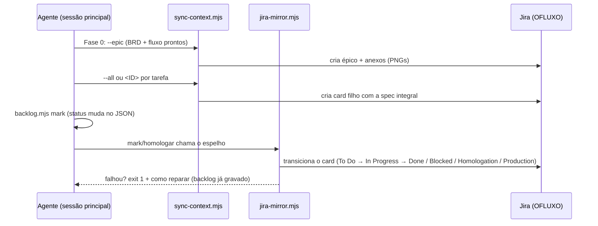

# 8. Espelho Jira

## Propósito

Cada entrega gerenciada pelo `backlog.json` tem cards no projeto **`OFLUXO`**, e eles acompanham cada passo **sem trabalho manual e sem LLM no caminho**: o mesmo estado do backlog gera sempre o mesmo conteúdo no card. O agente escreve os `.md`; os scripts publicam — descrição integral da spec, veredito dos gates, transições de status e anexos do fluxo do usuário.

## Quando dispara

| Momento | Quem publica |
|---|---|
| Fase 0 (épico + cards da feature) | `sync-context.mjs <dir> --epic` / `--all` |
| Tarefa nova ou retitulada | `sync-context.mjs <dir> <ID>` |
| Gravação de `specs/<ID>.md` | hook `sync-spec-jira.mjs` (autosync em fundo, 1 a cada 2 min por tarefa) |
| Mudança de status | **só** por `backlog.mjs mark` / `homologar` → `jira-mirror.mjs` |
| Lote | `sync-context.mjs <dir> --all` (conferir contagem com `backlog.mjs status`) |

## Peças e arquivos

| Arquivo | Responsabilidade |
|---|---|
| `scripts/tracker/jira-client.mjs` | Cliente minimalista da API REST v3 + Agile; credenciais de env carregadas pelo chamador |
| `scripts/tracker/sync-context.mjs` | Espelha tarefa → card: cria com summary + descrição integral (spec completa), re-sincroniza description, **summary** (quando diverge) e labels, sincroniza status e comentários |
| `scripts/tracker/epic.mjs` | Um épico por feature, com descrição para pessoas (visão, BRD, fluxo, como testar) e todos os cards como filhos |
| `scripts/tracker/attachments.mjs` | Anexos do épico (PNGs do fluxo); idempotente por nome+tamanho |
| `scripts/tracker/workflow-statuses.mjs` / `ensure-statuses.mjs` | Garante no workflow (team-managed) os status que o harness usa: `Blocked`, `Homologation`, `Cancelled` (idempotente) |
| `scripts/tracker/seed-harness-cards.mjs` | Cria cards das tarefas pendentes de um backlog (uso pontual/bootstrap) |
| `quality/delivery/jira-mirror.mjs` | Espelho usado por `mark`/`homologar`; **o backlog já gravou quando roda** — se o card não acompanhar, sai com exit 1 dizendo como reparar |
| `.claude/hooks/sync-spec-jira.mjs` + `quality/lib/spec-sync.mjs` | Autosync de spec → card (filtro de PII e de `Status: ready`) |
| `scripts/tracker/test-funcional.mjs` / `test-integracao.mjs` | Testes offline e real (com sandbox que se apaga) |
| `.claude/rules/backlog-e-gates.md` + `docs/jira/regras-de-epicos-e-cards.md` | Regras de naming, épico/BRD/fluxo e status |

## Exemplo SaaS passo a passo



**Mapeamento de status** (backlog → workflow do projeto): `pending` → To Do · `in_progress` → In Progress · `blocked` → Blocked (com o motivo no card) · `em_homologacao` → Homologation · aprovado → Production · `done` → Done (só depois do deploy em produção; `homologar --deploy`).

## Entradas, saídas e estado

- **Credenciais** (`.env`, gitignored): `JIRA_BASE_URL`, `JIRA_EMAIL`, `JIRA_API_TOKEN`, `JIRA_PROJECT_KEY`. Sem token, o `mark` funciona e avisa que o Jira não acompanhou; o autosync de spec também só avisa.
- **Saída:** links `…/browse/<CHAVE>` impressos pelo sync; comentários/anexos idempotentes (mesmo conteúdo não repete).
- **Estado:** o card é um **espelho** — a fonte da verdade é o repo (`backlog.json`, specs, `entrega.md`).

## Comandos

```bash
node scripts/tracker/sync-context.mjs docs/entregas/<slug> <ID>        # um card
node scripts/tracker/sync-context.mjs docs/entregas/<slug> --all       # épico + todos (conferir contagem)
node scripts/tracker/sync-context.mjs docs/entregas/<slug> --epic      # só o épico
node scripts/tracker/ensure-statuses.mjs                               # garante Blocked/Homologation/Cancelled
node scripts/tracker/test-funcional.mjs                                # offline
```

## Modos de falha e runbook

- **`mark` saiu exit 1 por causa do Jira:** o backlog **já foi gravado**; rodar o `sync-context.mjs` que a mensagem indica e só então dizer que o card atualizou. Nunca mudar status direto no JSON para "consertar" o espelho.
- **Contagem não bate após `--all`:** comparar com `backlog.mjs status`; re-rodar o sync dos divergentes.
- **Status inexistente no workflow:** rodar `ensure-statuses.mjs` / `workflow-statuses.mjs` (idempotentes).
- **PII/sigilo:** nunca colocar uid, e-mail, `businessId`, CPF/CNPJ ou token real em card; o filtro do autosync (spec-sync) é ajuda, não desculpa.

## Paridade Claude Code ↔ Cline

Os scripts são CLIs host-agnostic; o hook de autosync roda nos dois hosts pela ponte (doc 09). Sem credenciais, ambos seguem o fluxo com aviso — Jira nunca é pré-requisito de commit ou push.

## Testes que provam o comportamento

`node scripts/tracker/test-funcional.mjs` (offline) · `node scripts/tracker/test-integracao.mjs` (real, sandbox descartável) · `node --test quality/test/jira-workflow-statuses.test.mjs` · `node --test quality/test/delivery/mark.test.mjs` (recusa com Jira falhando, mockado).

## Fontes

- [scripts/tracker/](../../scripts/tracker) · [jira-mirror.mjs](../../quality/delivery/jira-mirror.mjs) · [sync-spec-jira.mjs](../../.claude/hooks/sync-spec-jira.mjs)
- Regras: [backlog-e-gates.md](../../.claude/rules/backlog-e-gates.md) · [regras-de-epicos-e-cards.md](../../docs/jira/regras-de-epicos-e-cards.md)

