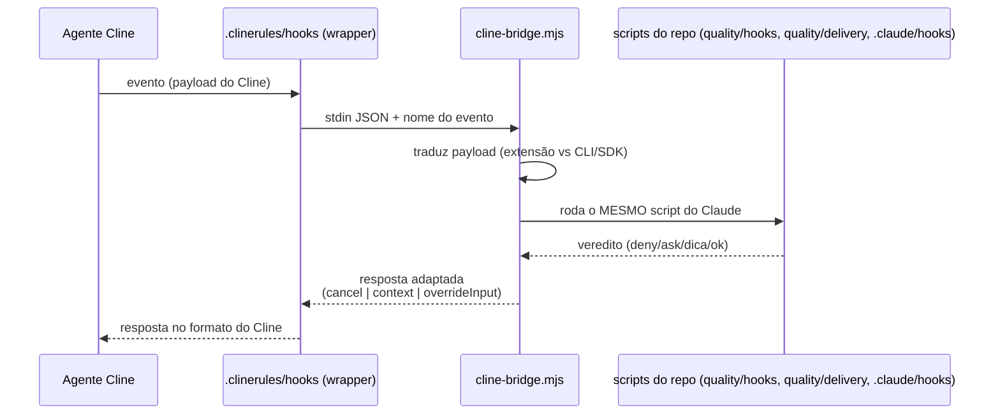

# 9. Ponte Claude ↔ Cline

## Propósito

Uma regra, uma implementação, dois hosts: o Cline (extensão VS Code, CLI e SDK) executa **os mesmos scripts** de hook do Claude Code por meio de uma ponte que traduz o payload do Cline para o formato do Claude. O que muda é só a **semântica de resposta** de cada host — e a ponte compensa as diferenças.

## Quando dispara

Os cinco eventos do Cline descobertos automaticamente em `.clinerules/hooks/` (extensão exige **"Enable Hooks"** ligado; CLI/SDK varrem a pasta também). O conteúdo sempre ativo vive em `.clinerules/`: **7 espelhos** gerados de `.claude/rules/` (economia, autofix, comandos-curtos, deploy/Actions, gitflow, backlog-e-gates, layering) + **`80-skills-e-agentes.md`**, índice gerado dos frontmatters de `.claude/skills/` e `.claude/agents/` — no Cline, leia o arquivo indicado antes de editar o domínio. Tudo gravado por `node quality/agents/sync-clinerules.mjs` (`--check` reprova drift):

| Cline | Equivalente Claude | Delega a |
|---|---|---|
| `PreToolUse` | `PreToolUse` (Bash, Grep, Glob + Edit/Write) | `cline-pre-tool-use.mjs` → `search-guard` + despachante + `guarda-backlog` |
| `PostToolUse` | `PostToolUse` | `cline-post-tool-use.mjs` → esteira do doc 03 (só informativo) |
| `TaskStart` / `TaskResume` | `SessionStart` | `cline-lifecycle.mjs` → `session-start.mjs` |
| `TaskComplete` | `Stop` | `cline-lifecycle.mjs` → `stop.mjs` + `lembrar-documentacao.mjs` |

Os wrappers em `.clinerules/hooks/` são CommonJS finos (não dependem do `type` do package.json), executáveis, com o nome exato do evento e sem extensão; falha aberta (respondem `{}`).

## Semântica de resposta (o coração da ponte)

| Resposta | Claude Code | Cline |
|---|---|---|
| `permissionDecision: deny` (Pre) | nega só o comando | `cancel: true` — **para a TAREFA INTEIRA** |
| `context` / `additionalContext` | dica no contexto do modelo | dica no contexto do modelo |
| `overrideInput` | — | reescreve a entrada da ferramenta (usado para rtk) |
| `exit 2` no Post | volta ao modelo como correção | **ignorado** → volta como `contextModification` |

Por isso a negação no Cline é **suave sempre que possível**: comando de shell bloqueável vira `echo <motivo>; exit 1` via `overrideInput` (o agente lê o motivo e segue); sem `overrideInput` disponível (extensão VS Code, edição de arquivo), nega com `cancel: true` — raro e explícito. No PostToolUse, o cancelamento é impossível: o mesmo texto do `exit 2` do Claude chega como `contextModification`, e o agente deve tratá-lo igual (editar o arquivo).

## Exemplo SaaS passo a passo



## Formatos de payload

- **Extensão VS Code:** `{ preToolUse: { toolName, parameters } }` — valores às vezes em JSON string.
- **CLI/SDK:** payload completo com `tool_name`/`tool_input` no formato do Claude.
A ponte aceita os dois e normaliza antes de chamar os scripts.

## Comandos

Nenhum comando manual: os wrappers são descobertos pelo host. Para testar a ponte localmente:

```bash
echo '{"tool_name":"Bash","tool_input":{"command":"git status"}}' | node quality/hooks/cline-pre-tool-use.mjs PreToolUse
```

## Modos de falha e runbook

- **Hook não roda na extensão:** conferir "Enable Hooks" nas configurações do Cline.
- **Tarefa abortada com `cancel`:** só deve acontecer em bloqueio duro de edição (sem `overrideInput`); se acontecer num comando de shell, é bug — o esperado é `echo motivo; exit 1`.
- **PostToolUse "bloqueou" como texto:** no Cline é `contextModification`; agir como agiria no Claude (corrigir a causa), não reler como falha de sistema.
- **Wrapper falhou silenciosamente:** falha aberta por desenho — o trabalho segue sem a regra; investigar o wrapper pelo `stdin`/`stderr` manual acima.

## Testes que provam o comportamento

`node --test quality/test/cline-bridge.test.mjs` (tradução e adaptação de respostas) e `node --test quality/test/hooks.test.mjs` (scripts comuns).

## Limpeza de terminais antigos (rodando em todo hook)

Todo evento do Cline (PreToolUse, PostToolUse, TaskStart/Resume/Complete) executa antes da delegação o [cline-terminal-cleanup.mjs](../../quality/hooks/cline-terminal-cleanup.mjs): encerra shells integrados filhos de `--type=ptyhost` com **mais de 1 h** e **sem processo filho vivo** (terminal em uso nunca morre). Silencioso e melhor-esforço; auditoria em `quality/.state/terminal-cleanup.log`. Variáveis: `CLINE_TERMINAL_CLEANUP=0` desliga · `CLINE_TERMINAL_MAX_AGE_SEC` muda o limite · `CLINE_KEEP_TERMINAL_PIDS` preserva PIDs.

## Fontes

- [cline-bridge.mjs](../../quality/lib/cline-bridge.mjs) · [cline-pre-tool-use.mjs](../../quality/hooks/cline-pre-tool-use.mjs) · [cline-post-tool-use.mjs](../../quality/hooks/cline-post-tool-use.mjs) · [cline-lifecycle.mjs](../../quality/hooks/cline-lifecycle.mjs)
- Wrappers: [.clinerules/hooks/](../../.clinerules/hooks) · Paridade resumida: QUALITY.md §9.2
