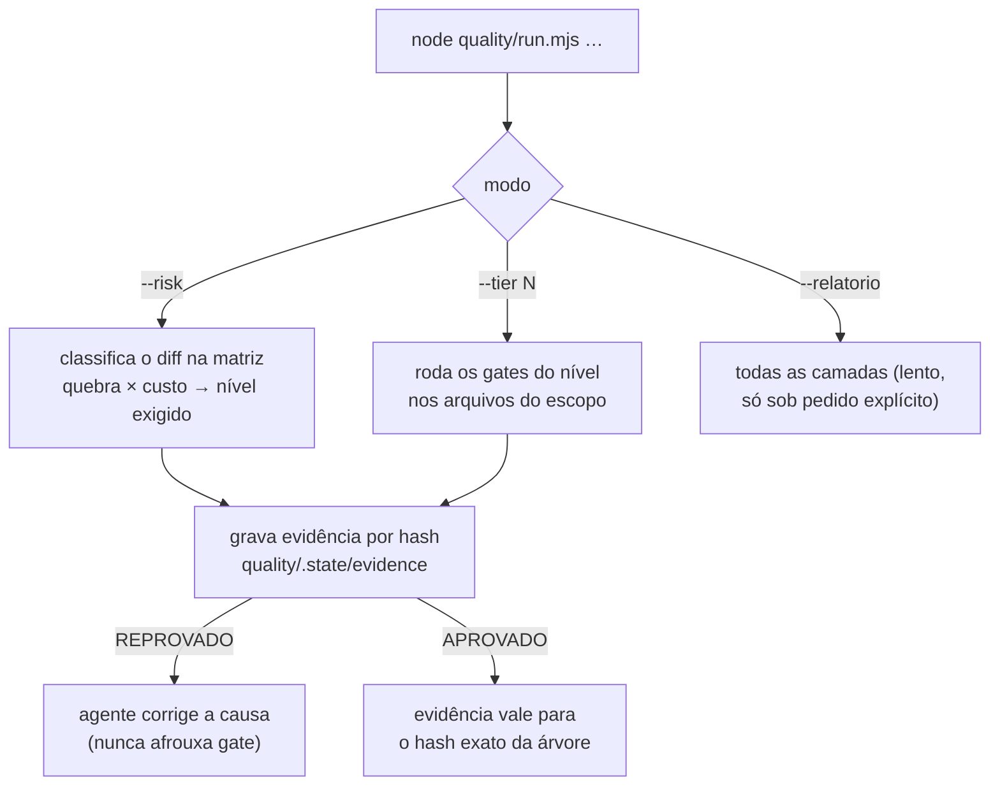

# 10. Motor de qualidade

## Propósito

O motor (`quality/run.mjs`) mede o diff com **gates determinísticos** (tamanho, complexidade, fronteiras, supressões, lint, tipos, testes, cobertura do diff), classifica o **risco** em dois eixos e escolhe o **nível de teste** exigido. É a base dos outros workflows do harness: os hooks (docs 02–04), o pre-commit e a entrega em ciclo (doc 07) só executam o motor — nunca replicam suas regras.

## Quando dispara

- Hook `post-edit.mjs` a cada edição (nível **rápido**, só o arquivo editado) — doc 03.
- `git commit` via pre-commit local (`git-pre-commit.mjs`) — ver [Pre-commit](#pre-commit-local).
- `Stop`/`TaskComplete` da sessão (`stop.mjs`, nível automático da matriz) — doc 02.
- Entrega em ciclo: gate "nível de qualidade" dentro do `eval-gates.json` — doc 07.
- Gêmeo local da release (`release-bump.mjs` roda `--tier completo --base remote`) — doc 06.

## Peças e arquivos

| Arquivo | Responsabilidade |
|---|---|
| `quality/run.mjs` | CLI: risco, níveis, relatório, evidência |
| `quality/lib/tiers.mjs` | Gates por nível e orçamento de tempo (`rapido` 60 s, `rotina` 270 s, `completo` 1 800 s) |
| `quality/lib/risk.mjs` | Classificação de risco (eixos quebra × custo) |
| `quality/lib/gates/fast.mjs` | Gates estruturais rápidos do arquivo editado |
| `quality/lib/runners/{flutter,backend,typescript,common,backend-env}.mjs` | Execução por stack (Flutter/Dart, .NET, TS/pnpm, Python/uv) |
| `quality/lib/scope.mjs` | Escopo do diff (`--files`, `--session`, `--base`) |
| `quality/lib/autofix.mjs` | Autocorreção leve de gate/teste (`--fix`) — doc 03 |
| `quality/lib/state.mjs` + evidência | Evidência por hash da árvore em `quality/.state/evidence/` |
| `quality/lib/sanitize.mjs` | Remoção de segredos/caminhos absolutos dos relatórios |
| `quality/lib/messages.mjs` + `quality/messages.pt-BR.json` | Mensagens dos gates em pt-BR |
| `quality/config/thresholds.json` | Limites estruturais (espelha QUALITY.md §3) |
| `quality/config/risk-matrix.json` | Matriz de risco (globs + regex, fonte autoritativa) |
| `quality/config/resources.json` | Teto de CPU/memória dos gates |
| `quality/config/cost-table.json` | Preços de referência para o eixo de custo (R$) |
| `quality/lib/cost-job.mjs` | Gate de custo de Cloud Run Job agendado: task-timeout × tick → execuções em voo → vCPU-h/mês (QG-022) |
| `quality/lib/deploy-pendente.mjs` | Detector de deploy esquecido: homologação aprovada vs `deploy.md` (aviso no Stop, QG-027) |
| `quality/config/autofix.json` | Escopo da autocorreção (só código de gate/teste) |
| `quality/hooks/git-pre-commit.mjs` + `install.mjs` | Gates no `git commit` (substitui o CI `quality.yml`, desativado em 2026-10-31) |

## Fluxo passo a passo



O risco é o **máximo por eixo**: `breakage` casa por glob de caminho (migrations, regras Firestore, pagamentos, Terraform e workflows de deploy = **crítico**; módulos da API, `lib/core`, identidade/presença nas Functions = **alto**) e `cost` casa por regex no conteúdo adicionado (ex.: `--memory`, `tier=db-`, limites de quota = crítico/alto). **Job agendado de Cloud Run (QG-022):** `task-timeout ≥ intervalo do tick` ⇒ job nunca termina ⇒ **crítico** com a matemática (execuções em voo, vCPU-h/mês, R$ pelo `cost-table.json`); run-rate mensal acima de `thresholds.costJob.maxMonthlyBrl` ⇒ **alto**. Baixo/médio pedem **rápido** iterando e **rotina** entregando; alto pede **completo**; custo alto ou risco crítico pedem aprovação humana. `quality/**`, `.claude/**`, `**/*.md` e `docs/**` estão em `ignoreGlobs` — documentação não sobe risco.

## Entradas, saídas e estado

- **Entrada:** diff contra `--base` (padrão HEAD; `remote` = upstream de `origin/main`) ou escopo por `--files`/`--session`.
- **Saída:** relatório pt-BR no stdout (ou `--json`) com `APROVADO/REPROVADO/ALERTA/IGNORADO` por gate. `IGNORADO` = ferramenta ausente no ambiente (ex.: `osv-scanner ✘`) — **não é aprovação**.
- **Estado:** `quality/.state/evidence/` — a evidência vale **só para o hash exato da árvore**; editar depois invalida. É o que os hooks de commit/push/deploy conferem (docs 02 e 04).

## Comandos

```bash
node quality/run.mjs --risk                               # risco + nível exigido
node quality/run.mjs --tier rapido                        # iteração (hook de edição)
node quality/run.mjs --tier rotina                        # antes de concluir tarefa
node quality/run.mjs --tier completo --base remote        # entrega/release
node quality/run.mjs --relatorio                          # todas as camadas (lento)
node quality/run.mjs --tier completo --files a.ts,b.dart  # escopo por arquivo
node quality/run.mjs --fix                                # autocorreção de gate/teste
node quality/run.mjs --tier rotina --migration-override "motivo"  # modo migração
```

Limites estruturais (resumo de `thresholds.json`; catálogo completo em QUALITY.md §2–§3): arquivo ≤ 400 NLOC (+20 de tolerância); função com CC alvo 10 e teto 20 (C#/Python 15); função ≤ 60 NLOC (teto 120); ≤ 5 parâmetros; Halstead volume alvo 1500/teto 4000; cobertura do diff por camada (backend 85%, ocr 90%, demais 80–85%). Código **legado** tem tolerância própria (`legacyTolerance`) — o ratchet proíbe piorar, não exige consertar tudo de uma vez.

<a id="pre-commit-local"></a>

## Pre-commit local

`npm run hooks:install` grava `.git/hooks/pre-commit` → `git-pre-commit.mjs`, que roda `run.mjs --fix` e depois `--tier rapido`; reprovado, bloqueia o commit. Respeita `FLUXO_SKIP_QUALITY_GATES=1` e `git commit --no-verify` (bypass de emergência, não rotina).

## Variáveis de ambiente e configuração

| Variável | Efeito |
|---|---|
| `QUALITY_MEM_MAX_MB`, `QUALITY_CPU_QUOTA`, `QUALITY_WORKERS` | Sobrescrevem o teto de `resources.json` (padrão: 3072 MB, 200% CPU, 2 workers, nice 19) |
| `QUALITY_RESOURCES=off` | Desliga o teto (uso em CI); não desliga nenhum gate |
| `FLUXO_SKIP_QUALITY_GATES=1` | Pula os gates do pre-commit |

## Modos de falha e runbook

- **Gate REPROVADO no hook:** corrigir a causa apontada (`arquivo:linha:col`); nunca editar `quality/config/*`, `quality/messages.pt-BR.json` ou `quality/test/` para passar; supressão nova exige justificativa na entrega.
- **Ferramenta ausente (`IGNORADO`):** não é aprovação; a entrega lista o que não foi medido.
- **Gate morto por memória (`tool.oom`):** subir o teto em `resources.json` — nunca reduzir o escopo do gate. Não usar `MemoryHigh`: sem swap ele estrangula em vez de encerrar.
- **Pre-commit bloqueou:** o `--fix` pode ter normalizado arquivos (EOL, `dart format`, Biome seguro) — re-`git add` o que ele corrigiu antes de recommitar.
- **REPROVADO por job sempre em voo (QG-022):** reduza o `task-timeout`, afrouxe o tick do Scheduler ou justifique a sobreposição na entrega (fila com claim seguro); preços de referência em `quality/config/cost-table.json`, teto de run-rate em `thresholds.costJob`.

## Paridade Claude Code ↔ Cline

O motor é host-agnostic (um CLI). Muda só quem o chama e como o bloqueio chega: Claude recebe `exit 2` do hook; Cline recebe `contextModification`/`context` — doc 09.

## Testes que provam o comportamento

`node --test quality/test/hooks.test.mjs` (integração hook ↔ motor) e `node --test quality/test/autofix.test.mjs`; a suíte do motor vive em `quality/test/` (rode por arquivo, regra de comandos curtos). Catálogo e limites completos: `QUALITY.md`.

## Fontes

- [quality/run.mjs](../../quality/run.mjs) · [QUALITY.md](../../quality/examples/fluxo/docs/QUALITY.md)
- [risk-matrix.json](../../quality/config/risk-matrix.json) · [thresholds.json](../../quality/config/thresholds.json) · [resources.json](../../quality/config/resources.json)
- [git-pre-commit.mjs](../../quality/hooks/git-pre-commit.mjs)


