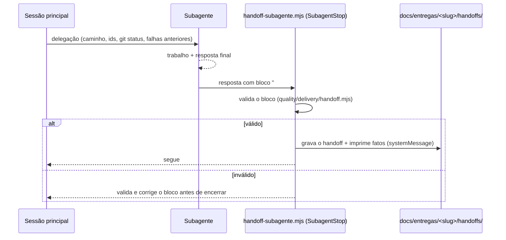

# 11. Agentes e skills de processo

## Propósito

Papéis delegáveis com restrição de ferramentas — **quem especifica não implementa, quem escreve o gate não implementa** — e skills que orquestram o ciclo pela sessão principal (subagente não dispara subagente). Cada delegação leva caminho completo, ids exatos, `git status` e a evidência de falha anterior; nenhum subagente herda o contexto da sessão.

## Quando dispara

Invocação explícita (`Agent tool` com `subagent_type=…`) nos pontos do ciclo (doc 07) ou nas rodadas de tarefa grande; skills de processo carregam pela descrição quando o pedido casa.

## Os 8 agentes (`.claude/agents/*.md`)

| Agente | Fase | Escreve | Nunca faz | `tools:` |
|---|---|---|---|---|
| `planejador` | rodada A de tarefas grandes | plano (ordem, `depends_on`, arquivos, risco) — devolve, não grava | editar arquivos | Read, Grep, Glob, Bash |
| `investigador-de-spec` | A | `specs/<ID>.md` com `Status: ready` | código de produção, gates, marcar done | + Write, Edit |
| `eval-gate-author` | B | gate tests em `quality/test/delivery/` + prova de falha `--baseline` | implementar produção, baixar critério de aceite | + Write, Edit |
| `implementador` | C | código e testes da tarefa (só o escopo) | editar spec/gate, marcar done por conta própria, mexer em mudança alheia | + Write, Edit |
| `eval-gate-fixer` | D | menor correção na causa + regressão | afrouxar asserção, forjar evidência manual | + Write, Edit |
| `avaliador-de-entrega` | E | laudo final (pronto / reparos / bloqueio) | editar código | Read, Grep, Glob, Bash |
| `revisor-de-dominio` | E (antes do PR) | relatório de domínio contra AGENTS.md + skills | editar arquivos | Read, Grep, Glob, Bash |
| `documentador` | F | docs de domínio + `entrega.md` | editar fora de `.md` | Read, Grep, Glob, Edit, Write, Bash |

O campo `tools:` não restringe caminhos — a restrição por fase é garantida pelo estado do `backlog.json` (doc 07) e pelos guardas; a identidade do agente é orientação.

## Handoff de subagente

## Skills de processo (quando cada uma dispara)

| Skill | Dispara quando | Papel |
|---|---|---|
| `entrega-em-ciclo` | iniciar/continuar entrega do `backlog.mjs` | orquestração das fases 0/A–F + homologação (doc 07) |
| `implementar-tarefa` | executar uma tarefa do backlog | ler spec, `mark in_progress`, implementar, gates, `mark done` |
| `revisar-entrega` | todas as tarefas `done`, antes de documentar | eval de cada ID + integridade + gates do diff → relatório |
| `product-owner` | triagem/priorização do roadmap | escolhe o próximo alvo, abre o backlog, espelha no Jira |
| `documentar-entrega` | concluir tarefa/entrega, hook pediu docs | `docs/`, `entrega.md`, fluxogramas (regra `fluxogramas.md`) |
| `avaliar-qualidade` | concluir tarefa, hook reprovou, pedido explícito | rodar gates e reportar (doc 10); `references/`: formato-do-relatorio, matriz-de-risco, niveis-de-teste |
| `busca-de-codigo` | achar onde algo está, mapear impacto | graphify primeiro (doc 04) |
| `modo-conciso` | "modo conciso"/"caveman"; "modo normal" desliga | respostas curtas sem perder precisão |
| `liberar-portas` | porta ocupada, "address already in use" | encerra processos locais com segurança (`scripts/dev/liberar-portas.mjs`) |
| `brainstorm-ideias` | ideias novas/features não priorizadas | documenta em `docs/parking-lot/` |
| `gitflow` | criar branches, mesclar, publicar, conflitos | matriz, receitas, versionamento (doc 05) |

Skills de **domínio** (modelo-de-contas, identidade-e-privacidade, eventos, mapa-multimodal, ui-fluxo, contratos-backend, analytics-negocios) carregam quando o código tocado é do tema — não são deste doc (ver doc 01).

## Modos de falha e runbook

- **Subagente encerrou sem HANDOFF válido:** o hook devolve o erro — o subagente corrige o bloco e encerra de novo; a sessão não segue sem o handoff gravado.
- **Subagente marcou `done` sozinho:** não é possível pelo desenho — só a sessão principal roda o `mark`; se um relatório afirma `done` sem o CLI, não é verdade.
- **Delegação sem contexto suficiente:** recomeçar com caminho completo + ids + `git status` + evidência de falha anterior; subagente não adivinha.
- **Skill citada no fluxo não existe:** verificar `.claude/skills/` (índice vivo no AGENTS.md §7) e corrigir o ponteiro.

## Testes que provam o comportamento

`node --test quality/test/delivery/agentes.test.mjs` (frontmatter válido, comandos e caminhos citados existem) · `node --test quality/test/delivery/handoff.test.mjs` (validação do bloco, se presente; fallback: `quality/delivery/handoff.mjs --help`).

## Fontes

- [.claude/agents/](../../.claude/agents) · [handoff-subagente.mjs](../../.claude/hooks/handoff-subagente.mjs) · [handoff.mjs](../../quality/delivery/handoff.mjs)
- [.claude/skills/](../../.claude/skills) · índice vivo: [AGENTS.md §7](../../AGENTS.md)

