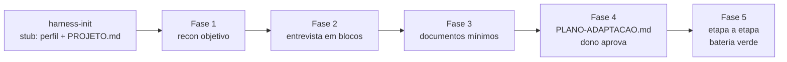

# 13. Onboarding — o harness aprende o projeto

> Instalou o harness? A próxima ação é a **skill `onboarding-assessment`**: ela lê o repositório,
> entrevista o dono, pede os documentos mínimos e gera o plano que adapta perfil, camadas,
> runners, fronteiras e skills de domínio ao projeto. O harness se adapta ao projeto — nunca o contrário.

## Fluxo

## Artefatos

| Arquivo | O que é |
|---|---|
| `quality/onboarding/RESUMO-RECON.md` | inventário do repo com evidências (stacks, comandos, riscos) |
| `quality/onboarding/documentos/` | visão, arquitetura, glossário, política de dados, contratos |
| `quality/onboarding/PLANO-ADAPTACAO.md` | perfil alvo (DIFF do stub), gates reprova/avisa, skills de domínio, etapas, pendências |

## O que o plano produz (mapa → perfil schema v1)

| Resposta do assessment | Campo do perfil / artefato |
|---|---|
| camadas reais do projeto | `layers` (globs reais do recon) |
| comandos canônicos por stack | `runner<Ts/Dotnet/Go/Rust/Cpp/Java/Flutter>` (`root`, `solution`, `testFilter`, `env`) |
| fronteiras proibidas | `boundaries` → gate `fronteiras` determinístico |
| dados sensíveis / PII | packs + `pii.publicLayers` |
| criticidade e custo | `riskMatrix` + tabela de custo (`cost-table`) |
| tracker / branches / homologação | `tracker`, `gitflow`, `homologacao` |
| áreas de domínio | `prompt.domainSkills` / `prompt.domainRules` + skills no hospedeiro |

## Por sintoma

"Harness instalado, e agora?" → esta página · "perfil divergiu do projeto" → re-rodar a skill · "dono não sabe responder" → registrar `a definir` com default do harness (a entrevista nunca trava).

## Manutenção

A skill é a fonte (`atualizado` nela). Mudou o schema do perfil (`quality/lib/profile.mjs`)? Atualize a seção "O que o plano produz" aqui e no template da Fase 4.
