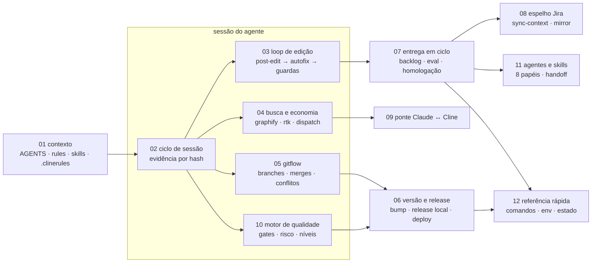

# Omni Harness — agent loop determinístico para agentes de código

> Este projeto foi **apartado do monorepo Exemplo SaaS** (2026-11-22). O Exemplo SaaS hoje é apenas o **exemplo de hospedeiro** em [quality/examples/exemplo-saas/](../examples/exemplo-saas/README.md); o núcleo não conhece produto nenhum.

Este diretório documenta, por workflow, **como o sistema de agentes de código funciona de verdade**: os hooks que executam as regras, os gates que aprovam o que o agente entrega, o ciclo que gerencia entregas multi-tarefa, o espelho Jira, a ponte entre hosts e o versionamento/release. Cada doc traz peças com caminhos exatos, fluxo Mermaid, comandos reais, variáveis de ambiente, modos de falha e os testes que provam o comportamento. Arquitetura agnóstica e decisões: [docs/parking-lot/harness-agnostico.md](../parking-lot/harness-agnostico.md); limites dos gates: `QUALITY.md` quando o projeto o mantém (no exemplo: [quality/examples/exemplo-saas/docs/QUALITY.md](../examples/exemplo-saas/docs/QUALITY.md)); núcleo permanente: [AGENTS.md](../../AGENTS.md).

## Mapa macro

## Docs

| Doc | Responde |
|---|---|
| [01-carregamento-de-contexto](01-carregamento-de-contexto.md) | Que regra chega ao agente, de onde, e como `.clinerules/` é gerado |
| [02-ciclo-de-sessao](02-ciclo-de-sessao.md) | O que roda ao abrir/encerrar a sessão e por que a evidência por hash impede "gate passou, código mudou" |
| [03-loop-de-edicao](03-loop-de-edicao.md) | A esteira completa a cada arquivo editado (nível rápido, autofix, domínio, guardas, Jira) |
| [04-busca-e-economia-de-tokens](04-busca-e-economia-de-tokens.md) | Por que graphify antes de Grep, a janela de 30 min, os modos e a reescrita rtk |
| [05-gitflow](05-gitflow.md) | Branch certa, merge certo, conflito resolvido pelo runbook |
| [06-versionamento-e-release](06-versionamento-e-release.md) | Bump por camada, release local sem Actions, regra de billing |
| [07-entrega-em-ciclo](07-entrega-em-ciclo.md) | As fases 0/A–F, o `backlog.json`, gates antes do código, homologação e compactação |
| [08-jira](08-jira.md) | Como o card acompanha cada passo sem trabalho manual |
| [09-ponte-cline](09-ponte-cline.md) | Como o mesmo hook roda nos dois hosts e o que muda na resposta |
| [10-motor-de-qualidade](10-motor-de-qualidade.md) | CLI do motor, matriz de risco, níveis, evidência e pre-commit |
| [11-agentes-e-skills](11-agentes-e-skills.md) | Os 8 papéis, o contrato de delegação e o handoff |
| [12-referencia-rapida](12-referencia-rapida.md) | Comandos, variáveis de ambiente, arquivos de estado e índice por sintoma |
| [13-onboarding](13-onboarding.md) | Como o harness aprende o projeto: recon, entrevista, documentos e o plano de adaptação |

## Glossário curto

- **Harness** — o conjunto de hooks + gates + scripts + estado que executa as regras por máquina, em vez de confiar na memória do agente.
- **Gate** — verificação determinística com veredito (`APROVADO/REPROVADO/ALERTA/IGNORADO`).
- **Evidência** — resultado aprovado amarrado ao hash exato da árvore; invalida-se quando o código muda.
- **Nível** — rápido (iterando), rotina (entregando), completo (risco alto/crítico), exigido pela matriz de risco.
- **Fase / handoff** — estágio da entrega em ciclo e o registro que cada subagente deixa ao encerrar.

## Por sintoma

"Commit bloqueado" → [02](02-ciclo-de-sessao.md)/[04](04-busca-e-economia-de-tokens.md) · "hook reprovou" → [03](03-loop-de-edicao.md) · "tarefa não marca done" → [07](07-entrega-em-ciclo.md) · "release diz nada a versionar" → [06](06-versionamento-e-release.md) · "Cline abortou" → [09](09-ponte-cline.md) · lista completa em [12](12-referencia-rapida.md).

## Manutenção

Cada doc carrega `atualizado` e `fontes`. Mudou um hook, um CLI ou um contrato? Atualize o doc correspondente **na mesma PR** (o gate de referências `quality/test/delivery/referencias.test.mjs` protege os caminhos citados). Front matter e template de seções: padrão fixo de 11 seções, pt-BR.
