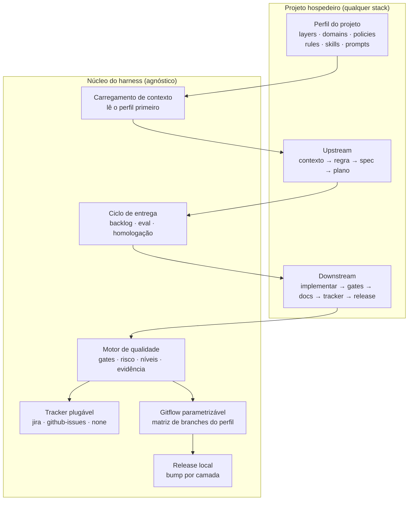

# Harness agnóstico de stack e arquitetura

- **Status:** CONCLUÍDA e **APARTADA do Fluxo** (2026-11-22) — R0 a R5 implementadas; núcleo puro (sem host/produto), Fluxo virou exemplo em `quality/examples/fluxo/`
- **Atualizado:** 2026-11-22 (R0 decidido)
- **Origem:** auditoria do `omni-harness` (bundle em `~/Extra/Projects/omni-harness`, HEAD de origem `fluxo@9b89bc9`); pedido do dono: "se transformar em um harness agnóstico de stack e arquitetura, acoplável em qualquer projeto, estruturando upstream e downstream completamente".
- **Domínios:** harness (quality/, .claude/, .clinerules/, scripts/, docs/harness/)

## O que é

Evolução do harness atual (nascido dentro do monorepo Fluxo) para um **núcleo genérico + perfil de projeto**:

- **Núcleo agnóstico** — motor de qualidade, hooks (Claude Code ↔ Cline), ciclo de entrega em backlog, busca com grafo, evidência por hash, gitflow, ponte de hosts. Zero referência a stack, domínio ou nome de produto.
- **Perfil de projeto (o acoplamento)** — diretório de configuração e overlay que cada projeto hospedeiro preenche: camadas/stacks, enums canônicos, políticas (PII, camadas públicas), regras e skills de domínio, prompt raiz, tracker, matriz de branches, thresholds.
- **Upstream estruturado** — carregamento de contexto (regras → skills → spec → plano) alimentado pelo perfil.
- **Downstream estruturado** — loop de edição → gates → testes → docs → tracker → release, com os mesmos hooks e vereditos.

## O que NÃO é

- Não é reescrita do motor: ~90% do `quality/lib` já é genérico (gates, risco, níveis, shell, anti-loop, autofix, ponte Cline).
- Não é desacoplamento do produto Fluxo — o Fluxo continua existindo e passa a ser o **primeiro perfil de referência**.
- Não é SaaS: continua harness vendored/acoplado por repositório.

## Inventário de acoplamento (auditoria real, 2026-11-22)

| # | Acoplamento | Onde | Tipo | Esforço |
|---|---|---|---|---|
| 1 | `FLUXO_*` (prefixo de env) e nome "Fluxo" em mensagens/comentários | ~100 ocorrências (hooks, lib, scripts) | cosmético/contrato | médio (alias retrocompatível) |
| 2 | `layers.json` — 13 camadas Fluxo (flutter, backend/.NET, functions, ofluxo_site, admin-web, OCR, workers…) | `quality/config/layers.json` | dado | baixo |
| 3 | `risk-matrix.json` — globs de produto | `quality/config/risk-matrix.json` | dado | baixo |
| 4 | `CANONICAL_ENUMS` — ~28 enums de domínio com paths de produto (debate, billing, creator, contas) | `.claude/hooks/lib/regras.mjs` | dado em código | médio |
| 5 | `PUBLIC_LAYER` (regex de camadas públicas do Fluxo) e PII CPF/CNPJ | `.claude/hooks/lib/regras.mjs` | política | médio |
| 6 | `STATIC_STACK_ROOTS` e `defaultTargets` (functions, admin-web, ofluxo_site…) | `quality/delivery/test-hygiene.mjs` | dado em código | baixo |
| 7 | `NOT_IN_GRAPH` (fluxo_branding_book, interface_mobile) | `quality/hooks/post-edit-graphify.mjs` | dado em código | baixo |
| 8 | path `.cache/fluxo-creator-local` (pulso cívico) | `quality/delivery/homologacao.mjs` | dado em código | baixo |
| 9 | globs de autofix com `test/**/*_test.dart` | `quality/config/autofix.json` | dado | baixo |
| 10 | Prompts de produto — missão Fluxo no AGENTS.md; 7 skills de domínio (modelo-de-contas, identidade, eventos, mapa, ui-fluxo, analytics, contratos); layering Flutter→Functions→.NET | `AGENTS.md`, `.claude/skills/*`, `.claude/rules/layering.md` | overlay de prompt | alto |
| 11 | Gates de entrega de produto (40+ testes `bil-*`, `fc-*`, `dv-*`, `man-*`, `cnpj-*`, `mobility-p0`) | `quality/test/delivery/` | artefato de entrega | fora do núcleo (ficam no repo do projeto) |
| 12 | Gitflow com `RELEASE` permanente + gêmeo `release-bump` | `.claude/rules/gitflow-branches.md`, `quality/lib/gitflow.mjs`, `scripts/deploy/local/release-bump.mjs` | política parametrizável | médio |
| 13 | Deploy GCP/Cloud Run/Cloud SQL (fluxo-ath, southamerica-east1) | `scripts/deploy/*`, `scripts/cutover_users_bucket.sh`, `scripts/create_buckets.md` | específico de produto | alto (virar plugin opcional) |
| 14 | Jira projeto OFLUXO | `scripts/tracker/*` — já parametrizado por env `JIRA_PROJECT_KEY` | já genérico | nenhum (só interface plugável) |

**Já genérico hoje:** motor de gates/níveis/risco, evidência por hash, busca graphify+rtk, anti-loop, autofix mecânico, ciclo de entrega (`backlog.mjs`, `eval.mjs`, guarda, handoff, homologação), ponte Claude↔Cline, espelho Jira (por env).

## Desenho proposto

Princípios:

1. **Config sobre código:** o que varia por projeto vira dado lido por um loader único (`quality/lib/profile.mjs`), com default seguro quando o perfil não define.
2. **Fluxo = perfil de referência:** extração com paridade 1:1 — o perfil `fluxo` reproduz exatamente os valores atuais; gates de paridade provam comportamento idêntico antes de qualquer renome.
3. **Overlay de prompt:** o núcleo traz um AGENTS genérico (como usar o harness); o projeto traz o overlay (missão, domínio, skills). `sync-clinerules` gera o índice a partir do perfil.
4. **Packs de política:** PII (CPF/CNPJ), blockchain, camadas públicas viram packs declarados no perfil — o mecanismo (regex → aviso/bloqueio) fica no núcleo.
5. **Env com namespace neutro:** `HARNESS_*` com alias `FLUXO_*` retrocompatível durante a transição.

## Fases propostas

| Fase | Entrega | Critério de pronto |
|---|---|---|
| **R0** | Esta nota aprovada; decisão das questões abertas 1–3 | Dono aprova estratégia |
| **R1 ✔** | Loader `profile.mjs` + **schema versionado do perfil + gate de validação** + extração dos itens 2, 3, 6, 7, 8, 9 e 4/5 (dados) para o perfil do fluxo **+ i18n: loader de mensagens por locale do perfil (pt-BR default, pack `pii-br`)** — feito 2026-11-22 | Gates de paridade verdes: motor se comporta igual com o perfil extraído; nenhum path de produto hardcoded fora do perfil; perfil do fluxo valida contra o schema |
| **R1.5 ✔** | Motor limpo de produto também no **baseline** (métricas do ratchet: `metrics.*`), **fronteiras de arquitetura** (`boundaries[]` + `dartPackage` em `gates/fast.mjs`) e **runners** (`runnerTs.workspaces[]` p/ workspace pnpm + router-scan; `flutter.sharedCore`) — feito 2026-11-22 | Suíte do núcleo verde com o dado extraído; `grep OCR_webscraper_crawler quality/lib/runners/typescript.mjs` = 0; keys do ratchet `baseline.json` preservadas |
| **R2-slice-1 ✔** | Overlay de prompts: `.claude/PROJETO.md` (fonte viva do produto), `prompt.{overlay,domainSkills,domainRules}` no perfil, `sync-clinerules` espelha o overlay → `.clinerules/85-projeto.md` e marca skills de overlay no índice (80) — feito 2026-11-22 | `profile.test.mjs` valida overlay/espelho/domínios; EG-REFS e `sync --check` verdes |
| **R2-slice-2 ✔** | Pack `fluxo-domain` + gate perfil↔pack↔disco (`quality/packs/fluxo-domain/manifest.json`; arquivos pertencem ao hospedeiro no modelo híbrido — movimento físico descartado, discovery do Claude Code preservado) — feito 2026-11-22 | `profile.test.mjs` valida manifest, skills e rules declarados |
| **R3 ✔** | Tracker plugável (`tracker.provider`; `jira` desligável em `jira-mirror.mjs` e `spec-sync.planSync`) + gitflow parametrizável (`gitflow.permanent/parentOf/mergeOk` do perfil em `lib/gitflow.mjs`, fallback legado) — feito 2026-11-22 | 76 testes de gitflow+jira verdes com o dado no perfil |
| **R4 ✔** | Instalador `scripts/harness-init.mjs` + smoke de acoplamento (`quality/test/attach.test.mjs`: perfil stub + sync em sincronia + hook post-edit vivo em fixture) — feito 2026-11-22 | Instalação em repo novo em < 10 min, sem editar o núcleo |
| **R4-total ✔** | Runner .NET parametrizado: `runnerDotnet.{root,solution,testFilter,workflow}` em `runners/backend.mjs` + `relatorio.runBackend` (perfil sem solution = rotina inerte) — feito 2026-11-22 | Smoke completo: `git init` + commit no fixture + `run.mjs --tier rapido` exit 0 |
| **R5 ✔** | `HARNESS_*` canônico com alias `FLUXO_*` nos switches do core (`AUTOFIX`, `JIRA_AUTOSYNC`, `JIRA_SYNC`, `SKIP_QUALITY_GATES`, `GRAPH_AUTOUPDATE`) via `quality/lib/env.mjs`; textos "Fluxo" do core neutralizados (restantes = substantivo comum) — feito 2026-11-22 | Nenhum nome de produto em mensagem/comentário de mecanismo; alias cobre scripts e CI existentes |

## Decisões tomadas (R0, 2026-11-22)

1. **Modelo de acoplamento: C — Híbrido.** Núcleo vendored, sincronizado deste repositório (omni-harness é a fonte canônica); **perfil vive no projeto hospedeiro** (`quality/profile/` ou `.harness/`), versionando junto com o código que descreve. Contrato núcleo↔perfil = schema versionado do perfil + gate que valida o perfil contra o schema. Opções A (vendored total) e B (package publicado) descartadas — A separa o perfil do produto; B exige registry/ciclo de release antes de provar valor.
2. **PII: pack opcional `pii-br`.** Mecanismo (regex → aviso/bloqueio, `pii-guard`) fica no core com padrões vazios; CPF/CNPJ, camadas públicas e aviso de blockchain entram como pack declarado no perfil. O core volta a servir projetos fora do Brasil sem perder o comportamento atual do Fluxo (que ativa o pack).
3. **Idioma: i18n completo por perfil desde já** (escopo da R1 ampliado). `messages` deixa de ser só `pt-BR.json`: loader lê `locale` do perfil e resolve arquivo de mensagens por locale; pt-BR é o locale de referência e default. Custo adicional na R1, evita renome estrutural depois.

## Decisões abertas

1. ~~Onde vive o perfil~~ **Decidida (R0)** — híbrido: perfil no projeto hospedeiro; ver "Decisões tomadas" #1.
2. ~~Distribuição do núcleo~~ **Decidida (R0)** — vendored + sync (R4); package só depois de estável; ver #1.
3. ~~PII/idioma~~ **Decidida (R0)** — pack `pii-br` + i18n por perfil na R1; ver #2 e #3.
4. **Nome do projeto** (`omni-harness`?) e do prefixo de env final (`HARNESS_*`).
5. **Gates de entrega de produto** (item 11): permanecem no repo do hospedeiro (prévia: sim) ou o núcleo carrega "gate packs" por entrega?

## Riscos

- **Quebrar o Fluxo durante a extração** — mitiga com paridade (R1 inteira sem mudar comportamento, só movendo dado).
- **Escopo grande numa entrega única** — R1–R5 são entregas independentes, cada uma com gates próprios.
- **Docs do harness desatualizados** — cada fase atualiza `docs/harness/01` e `12` na mesma PR (gate de referências).
- **Renome de env quebra CI/scripts do Fluxo** — alias retrocompatível obrigatório na R5.
- **Núcleo e perfil divergindo** — gate de paridade permanente + EG-REFS estendido.

## Referências

- Auditoria da sessão: refs ausentes 174 → ~118 após trazer `scripts/`, `.gitignore` e o ciclo do próprio harness; restantes = produto por design.
- `docs/harness/01-carregamento-de-contexto.md` e `10-motor-de-qualidade.md` — os docs que R1/R2 mais afetam.
- `HARNESS-MANIFEST.txt` — inventário atual do bundle.

