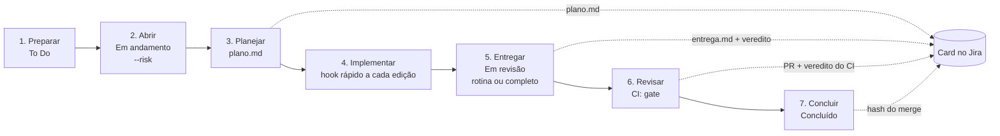
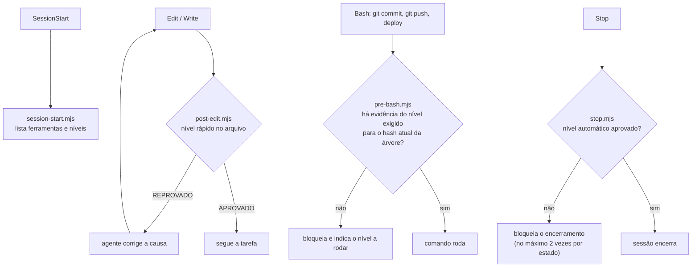
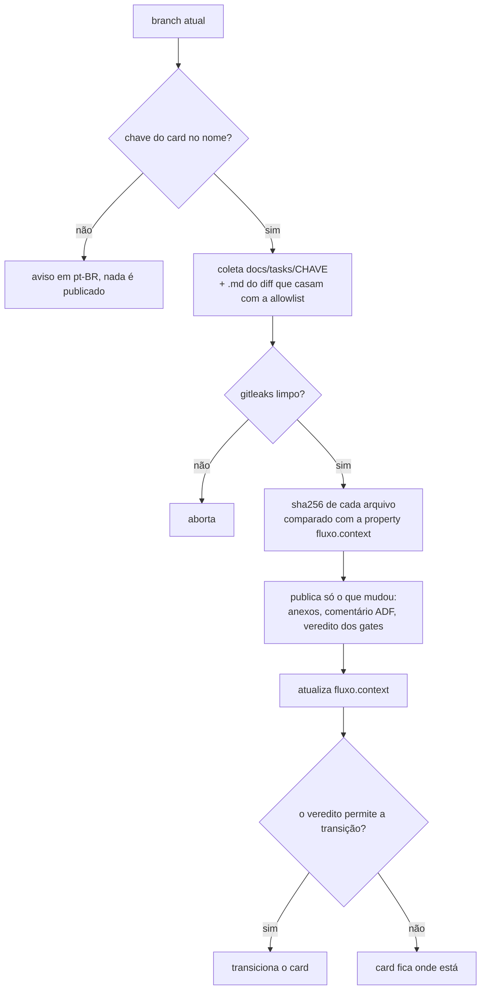
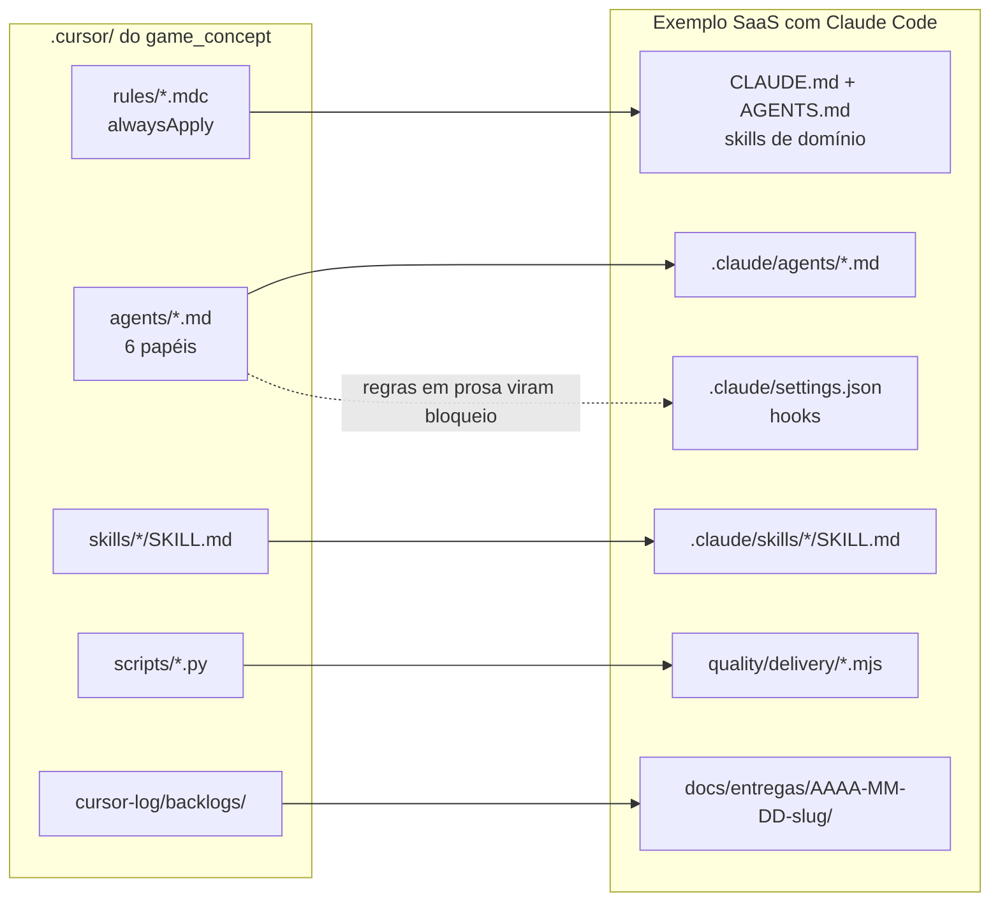
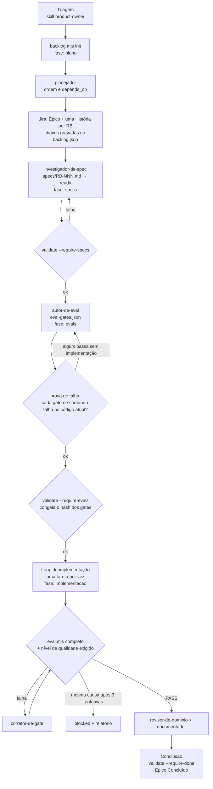
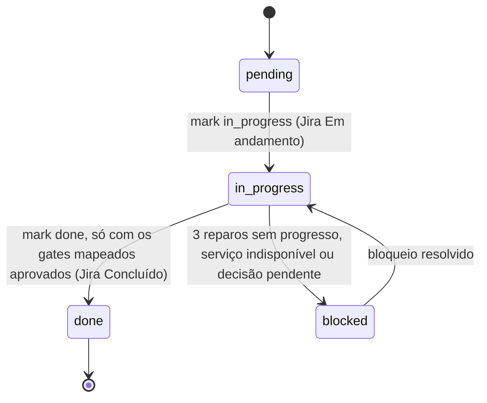
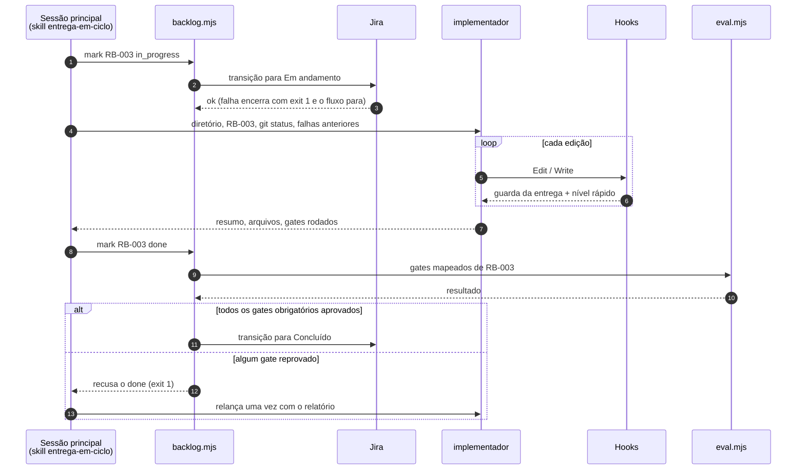
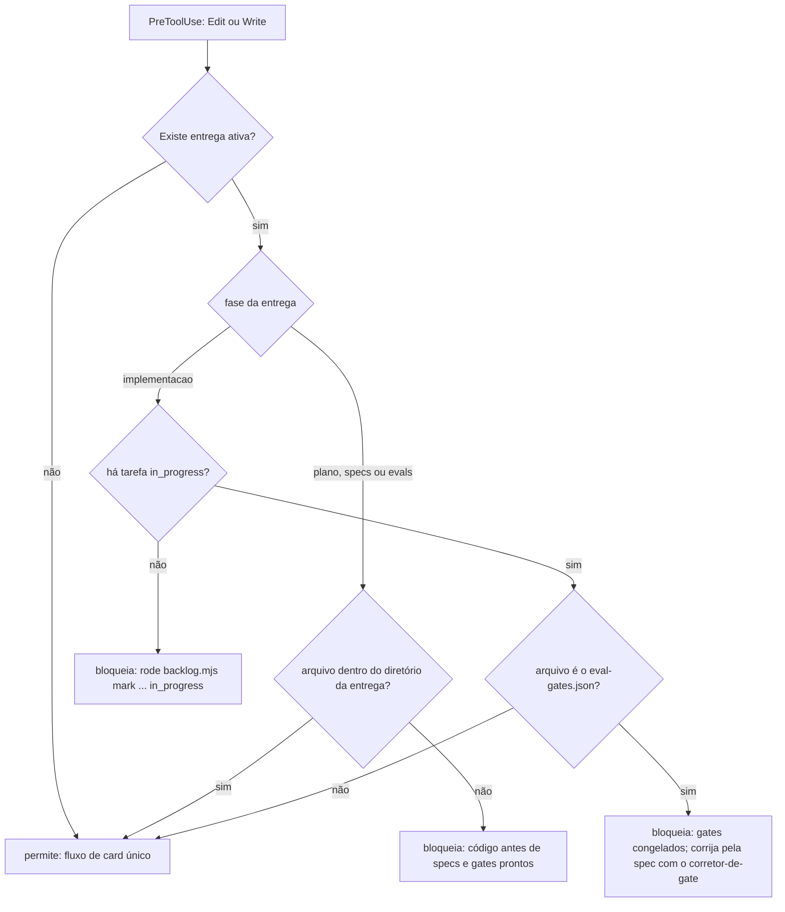
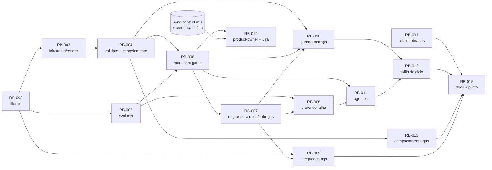

# README_AGENT_WORKFLOW.md — Como trabalhar com agentes de código no Exemplo SaaS

> **Documentação operacional viva:** a descrição atual, workflow por workflow (hooks, gates, ciclo, Jira, ponte Cline, release), está em **[docs/harness/INDEX.md](docs/harness/INDEX.md)**. Este arquivo guarda o desenho e as decisões históricas; os status abaixo foram reavaliados em 2026-11-21 contra o filesystem.

Este documento descreve como usar agentes de código (Claude Code, Codex/Cloud) no monorepo Exemplo SaaS. Ele cobre três camadas:

1. **Contexto**: `AGENTS.md`, os prompts de tarefa e a documentação viva em `docs/`.
2. **Gates**: os quality gates e eval gates determinísticos que validam o que o agente entrega ([QUALITY.md](QUALITY.md)).
3. **Rastreabilidade**: a integração com o Jira, que publica nos cards o contexto dos `.md` e o veredito dos gates.

> **Status das peças.** Cada item abaixo é marcado como **existe** (já está no repositório e funciona) ou **proposta** (desenho aprovado neste documento, ainda não implementado). A integração com o Jira é toda **proposta**.

---

## 1. Objetivo

O `AGENTS.md` mantém **consistência arquitetural, estratégica e de produto** entre sessões de trabalho com agentes. Ele não substitui o prompt da tarefa.

O `AGENTS.md` serve como:
- memória operacional do repositório;
- guardrail arquitetural;
- guia de modelagem;
- proteção contra simplificações erradas;
- referência de linguagem e direção do produto.

O prompt da tarefa diz **o que deve ser feito agora**. O card do Jira diz **por que** e **para quem**, e guarda o histórico do que foi decidido e entregue.

---

## 2. Papel de cada artefato

| Artefato | Onde | Define | Status |
|---|---|---|---|
| `AGENTS.md` | [AGENTS.md](AGENTS.md) | Núcleo que vale para toda tarefa: missão, princípios, restrições, critérios de qualidade, formato de entrega e índice dos módulos | existe |
| `CLAUDE.md` | [CLAUDE.md](CLAUDE.md) | Importa o `AGENTS.md` (`@AGENTS.md`) e acrescenta só o que é específico do Claude Code | existe |
| Skills de domínio | [.claude/skills/](.claude/skills/) | Conhecimento por tema, carregado sob demanda: `modelo-de-contas`, `identidade-e-privacidade`, `eventos`, `mapa-multimodal`, `ui-fluxo`, `contratos-backend`, `analytics-negocios`, `documentar-entrega` | existe |
| Agents | [.claude/agents/](.claude/agents/) | Papéis delegáveis: `planejador`, `revisor-de-dominio`, `documentador`, `investigador-de-spec`, `eval-gate-author`, `implementador`, `eval-gate-fixer`, `avaliador-de-entrega` | existe |
| Hooks de domínio | [.claude/hooks/](.claude/hooks/) | Regras do `AGENTS.md` verificadas por máquina (CPF/CNPJ, enums, blockchain, docs pendentes) | existe |
| Prompt da tarefa | sessão do agente | Escopo atual, arquivos-alvo, prioridade, aceites, contexto da execução | existe |
| Card do Jira | Jira (projeto `OFLUXO`) | Problema, aceites de negócio, prioridade, dono, histórico de decisões e vereditos | existe (`scripts/jira/` — o app *GitHub for Jira* continua configuração externa) |
| `docs/*.md` | [docs/](docs/) | Explicação do sistema por domínio. Deve ser atualizada junto com o código | existe |
| `docs/entregas/<AAAA-MM-DD-slug>/*.md` | `docs/entregas/` | Plano (specs), entrega, decisões e registro de uma entrega. É o que sobe para o card | existe |
| Quality gates | [QUALITY.md](QUALITY.md), [quality/](quality/) | Limites determinísticos (tamanho, complexidade, fronteiras, lint, tipos, testes, cobertura do diff) e matriz de risco | existe |
| Eval gates | [QUALITY.md §5.4](QUALITY.md#54-menu-extractor-ocr_webscraper_crawler) | Avaliação determinística do pipeline OCR/LLM contra fixtures golden e provedores mockados | proposta (`eval-golden.mjs` ainda não existe) |
| Skill `avaliar-qualidade` | [.claude/skills/avaliar-qualidade/](.claude/skills/avaliar-qualidade/) | Passo a passo para o agente rodar os gates e reportar | existe |
| Hooks do Claude Code | [.claude/settings.json](.claude/settings.json) | Executam os gates automaticamente a cada edição, ao encerrar e antes de commit/push/deploy | existe |

> **Modularização.** O `AGENTS.md` fica na raiz, onde Codex e Claude Code o encontram sozinhos, e carrega só o núcleo. O conhecimento de domínio que antes ocupava as seções 4 a 13 do arquivo agora está nas skills. O Claude Code carrega cada skill pela descrição. Outros agentes leem o `SKILL.md` do tema pela tabela de módulos do `AGENTS.md` (§7). Assim o contexto fixo de toda sessão fica menor, e cada regra de domínio só entra quando o tema aparece.

---

## 3. Exemplo SaaS recomendado de trabalho

O fluxo abaixo amarra cada etapa a um estado do card no Jira e a um gate. As colunas **Jira** e **Gate** descrevem o desenho proposto. Os comandos de gate já existem.



| Etapa | O que o agente faz | Estado no Jira | Gate | O que sobe para o card |
|---|---|---|---|---|
| 1. Preparar | Lê o `AGENTS.md`, o card e os docs do domínio | `To Do` | — | — |
| 2. Abrir | Cria a branch `<tipo>/<CHAVE>-<slug>` | `Em andamento` | `node quality/run.mjs --risk` | risco inicial (vazio) |
| 3. Planejar | Mapeia arquivos, riscos e plano em `docs/tasks/<CHAVE>/plano.md` | `Em andamento` | — | `plano.md` |
| 4. Implementar | Faz mudanças incrementais com docs junto | `Em andamento` | rápido, a cada edição, pelo hook | — |
| 5. Entregar | Escreve `docs/tasks/<CHAVE>/entrega.md` | `Em revisão` | rotina ou completo, conforme o risco | `entrega.md`, docs alterados, veredito dos gates |
| 6. Revisar | Abre a PR e responde à revisão | `Em revisão` | CI (`gate`) | link da PR, veredito do CI |
| 7. Concluir | Merge | `Concluído` | — | hash do merge |

### Etapa 1 — preparar o repositório
Antes de pedir implementação:
1. confirme que `AGENTS.md` e `CLAUDE.md` estão na raiz e que a tabela de módulos do `AGENTS.md` aponta para as skills certas;
2. mantenha `docs/` atualizada;
3. deixe claro qual pasta é de cada stack (tabela em [README.md](README.md#arquitetura-e-módulos));
4. mantenha enums, models e contratos em locais previsíveis;
5. tenha a chave do card do Jira em mãos (`<PROJ>-123`).

### Etapa 2 — abrir a tarefa
Use um prompt curto com:
- a chave do card;
- a missão;
- o domínio do produto que será tocado;
- o que não pode quebrar;
- quais arquivos ler primeiro.

O nome da branch **precisa** conter a chave do card (`feat/<PROJ>-123-cardapio-ocr`). É a partir dela que o Jira vincula branch, commits e PR (app *GitHub for Jira*), e que o script de sincronização descobre o card.

### Etapa 3 — pedir leitura antes de editar
Para tarefas maiores, peça primeiro:
- leitura do projeto;
- mapeamento dos arquivos impactados;
- plano de execução;
- riscos e compatibilidade;
- a saída de `node quality/run.mjs --risk` depois de um esboço do diff, quando o risco for incerto.

O plano vai para `docs/tasks/<CHAVE>/plano.md`. Isso reduz mudanças impulsivas, evita regressões e deixa o plano revisável no card antes da implementação.

### Etapa 4 — implementação
Depois do plano aprovado, peça:
- implementação incremental;
- documentação junto com o código;
- correção de cada `REPROVADO` que o hook rápido devolver, na causa (ver a skill `avaliar-qualidade`).

### Etapa 5 — entrega
Ao final, o agente roda o nível exigido pelo risco e escreve `docs/tasks/<CHAVE>/entrega.md` com:
- arquivos criados e alterados;
- decisões tomadas;
- pendências;
- riscos técnicos;
- próximos passos;
- o relatório de qualidade no formato de [formato-do-relatorio.md](.claude/skills/avaliar-qualidade/references/formato-do-relatorio.md), copiado da saída do motor.

---

## 4. Quality gates e eval gates no fluxo do agente

Esta seção resume como os gates existentes se encaixam no trabalho do agente. Os limites e o catálogo completo estão na [QUALITY.md](QUALITY.md).

### 4.1 O que já roda sozinho (existe)

| Momento | Hook | O que faz |
|---|---|---|
| Início da sessão | `SessionStart` → [session-start.mjs](quality/hooks/session-start.mjs) | Lista as ferramentas disponíveis (lizard, dart, flutter, dotnet, pnpm, uv, docker, firebase, osv-scanner) e os níveis |
| Cada edição | `PostToolUse` → [post-edit.mjs](quality/hooks/post-edit.mjs) | Nível **rápido** no arquivo editado, comparando com o `HEAD`. Avisa se o risco da sessão subiu |
| Antes de `git commit`, `git push` e deploy | `PreToolUse` → [pre-bash.mjs](quality/hooks/pre-bash.mjs) | Exige evidência aprovada do nível exigido para o hash exato da árvore de trabalho |
| Ao encerrar | `Stop` → [stop.mjs](quality/hooks/stop.mjs) | Roda o nível automático da matriz e bloqueia o encerramento (no máximo 2 vezes por estado) se reprovar |
| Cada edição | `PostToolUse` → [regras-de-dominio.mjs](.claude/hooks/regras-de-dominio.mjs) | **Bloqueia** CPF/CNPJ literal em código. **Avisa** sobre campo `cpf`/`cnpj` bruto em resposta da API ou rota HTTP das Functions, enum de domínio redefinido fora do arquivo canônico e dependência de blockchain |
| Ao encerrar | `Stop` → [lembrar-documentacao.mjs](.claude/hooks/lembrar-documentacao.mjs) | Bloqueia uma vez por conjunto de arquivos quando há arquivo novo de domínio, módulo da API, migration/SQL ou feature das Functions e nenhum `.md` foi alterado |
| Antes de qualquer comando git | `PreToolUse` → [pre-bash-gitflow.mjs](quality/hooks/pre-bash-gitflow.mjs) | Gitflow determinístico: taxonomia e branch pai na criação (feat/fix/chore ← develop; hotfix ← main; release/x.y.z ← develop), matriz de merge (develop ⇄ trabalho; release → main via pipeline), commit direto em main/develop negado, `--rebase` no pull de trabalho, push sincronizado com origin (atrás/divergido trava), `--force` travado e conflito travando tudo menos a resolução |
| Depois de qualquer comando git | `PostToolUse` → [post-bash-gitflow.mjs](quality/hooks/post-bash-gitflow.mjs) | Detecta conflito (merge/rebase/cherry-pick) e **para o fluxo** com runbook em pt-BR: arquivos em conflito, passos de resolução, como publicar depois e como abortar |

Os hooks de domínio têm testes em `node --test .claude/hooks/test/regras.test.mjs`.



#### Gitflow do repositório (mapeamento dos casos)

Exemplo SaaS canônico: `MAIN → DEVELOP → FEAT ⇄ DEVELOP (versão) → RELEASE (PIPELINE) → MAIN`.

| Caso | Nasce de | Volta para | Nome |
|---|---|---|---|
| `feat/` | `develop` | `develop` (merge) | `feat/<slug>` |
| `fix/` | `develop` | `develop` | `fix/<slug>` |
| `chore/` | `develop` | `develop` | `chore/<slug>` |
| `hotfix/` | `main` | `main` + `develop` (backmerge) | `hotfix/<slug>` |
| `release/` | `develop` | `main` (pipeline) + `develop` (backmerge da versão) | `release/x.y.z[-sufixo]` |

Os hooks devolvem o caminho correto na mensagem de bloqueio (ex.: "hotfix/ nasce de main…"; "use `git pull --rebase`"), e o runbook de conflito lista arquivos, passos por operação e como abortar. Mapa completo e receitas: [.claude/skills/gitflow/SKILL.md](.claude/skills/gitflow/SKILL.md). Testes: `node --test quality/test/gitflow.test.mjs quality/test/gitflow-hooks.test.mjs`.

**Versionamento por camada**: cada camada tem versão própria com bump determinístico (commits convencionais desde a última tag da camada: breaking → major, feat → minor, demais → patch), salvo como tag `<camada>@vX.Y.Z` na branch release e propagada para main e develop pelos merges. `npm run version:bump` (plano), `-- --apply` na release, `-- --init` (tags de baseline na primeira vez), `-- --next <camada>` (versão do próximo apply, usada pelos builds) e `-- --check` (valida as três branches e a sincronia dos manifests). Em produção quem roda é o workflow `release-tag.yml` (push em `RELEASE`): `--init` ou `--apply`, push dos commits e tags, GitHub Release por tag nova. Os deploys injetam a versão com `--next` (`VITE_APP_VERSION` no site e no admin, `APP_VERSION` na imagem do backend); o rodapé do site mostra `vX.Y.Z`. O apply também gera `ofluxo_site/public/versions.json`.

### 4.2 Risco e nível

O risco é classificado em dois eixos, **quebra do backend** e **escala de custo**, pela matriz [quality/config/risk-matrix.json](quality/config/risk-matrix.json):

| Risco | Nível exigido | Aprovação humana |
|---|---|---|
| baixo / médio | rápido (iterando), rotina (entregando) | não |
| alto | completo | sim, se o eixo de custo for alto |
| crítico | completo | sempre |

`**/*.md` e `docs/**` estão em `ignoreGlobs` na matriz. Mudanças só de documentação não sobem o risco e não exigem nível de teste.

### 4.3 Eval gates (proposta, QUALITY.md §5.4)

O pipeline OCR/LLM do Menu Extractor é avaliado **sem chamar provedores reais**. Document AI, Gemini e Firecrawl ficam mockados, e a saída é comparada com fixtures golden em `OCR_webscraper_crawler/testdata/`:

| Métrica | Regra |
|---|---|
| Recall de itens | `|itens ∩ golden| / |golden|` ≥ baseline por fixture |
| Preço exato | preço em centavos igual ao golden ≥ baseline |
| Seção correta | item na seção do golden ≥ baseline |
| Schema | saída valida contra `schemas/menu.json` (validador Python `menu-schema`, que existe) |

O script previsto é `scripts/eval-golden.mjs`, que grava `quality/reports/ocr-eval.json`. Quando um golden muda de propósito, ele é regenerado na mesma PR e revisado como diff.

**Regra para agentes:** nenhum agente pode usar um LLM como juiz de um gate. Avaliação com LLM serve para exploração e nunca substitui o golden.

### 4.4 Regras invioláveis (resumo da skill)

- Nunca editar `quality/config/*.json`, `quality/messages.pt-BR.json` ou `quality/test/` para fazer um gate passar.
- Nunca adicionar supressão sem justificar no `entrega.md`.
- `ALERTA` e `IGNORADO` não são aprovação. O `entrega.md` diz o que não foi medido.
- Não afirmar que um gate passou se ele não rodou.

---

## 5. Integração com o Jira (proposta)

### 5.1 Objetivo

Cada card do Jira deve refletir, sem trabalho manual:
1. o **contexto** que o agente usou e produziu (`plano.md`, `entrega.md` e os docs de domínio alterados);
2. o **veredito dos gates** (risco nos dois eixos, nível executado, status, o que não foi medido);
3. os **vínculos** com branch, commits e PR.

A publicação tem que ser **determinística**: o mesmo commit gera sempre o mesmo conteúdo no card, sem LLM resumindo nada no caminho. O agente escreve os `.md`; um script publica.

### 5.2 Peças

| Peça | Responsabilidade | Status |
|---|---|---|
| App *GitHub for Jira* | Vincula branch, commits e PR ao card pela chave no nome. Habilita Smart Commits (`<PROJ>-123 #comment ...`) | proposta (configuração no Jira) |
| `scripts/jira/sync-context.mjs` | Publica os `.md` e o veredito no card | existe (criação de épico/cards, sync de contexto e transições; configuração por env `JIRA_*`) |
| `quality/config/jira.json` | Allowlist de caminhos publicáveis, limites de tamanho, mapeamento de estados | continua proposta — a configuração hoje vive no código e nas env `JIRA_*` |
| Job `jira-sync` no CI | Roda o sync depois do job `gate` na PR e no merge | proposta |
| Credenciais | `JIRA_BASE_URL`, `JIRA_EMAIL`, `JIRA_API_TOKEN` em env local (`.env`, que já é gitignored) e em secrets do GitHub Actions | proposta |

### 5.3 Convenção de arquivos por tarefa

```text
docs/tasks/<PROJ>-123/
  plano.md       # etapa 3: escopo, arquivos impactados, riscos, plano
  entrega.md     # etapa 5: arquivos, decisões, pendências, relatório de qualidade
  decisoes.md    # opcional: ADRs curtas da tarefa
```

Cada arquivo começa com front matter, que o script valida antes de publicar:

```yaml
---
jira: <PROJ>-123
tipo: plano          # plano | entrega | decisoes
dominios: [empresas, ocr]
atualizado: 2026-10-01
---
```

Os docs de domínio (`docs/empresas/*.md`, `docs/migration/*.md` etc.) **não** recebem front matter de card. Eles sobem quando aparecem no diff da branch.

### 5.4 O que o `sync-context.mjs` faz

1. **Descobre o card** pela branch atual (regex `[A-Z][A-Z0-9]+-\d+`). Sem chave, encerra com aviso em pt-BR e não publica nada.
2. **Coleta os `.md`**: os de `docs/tasks/<CHAVE>/`, mais os `.md` alterados no diff contra `origin/main` que casem com a allowlist de `quality/config/jira.json`. PDF, DOCX e arquivos fora da allowlist nunca sobem.
3. **Sanitiza**: roda gitleaks nos arquivos coletados e aborta se houver achado. Remove caminhos absolutos locais.
4. **Calcula o `sha256`** de cada arquivo e lê a *issue property* `fluxo.context` do card, que guarda os hashes já publicados. Só publica o que mudou, o que mantém o sync idempotente e barato.
5. **Publica**:
   - `plano.md` e `entrega.md` como **anexos** (versão completa) e como **comentário** com um resumo determinístico: front matter, títulos de seção e a tabela de qualidade, sem reescrita;
   - docs de domínio alterados como **anexos**, mais um comentário com a lista de caminhos e links permanentes para o commit no GitHub;
   - o **veredito dos gates**, a partir de `node quality/run.mjs --risk --json` e da última evidência do nível exigido, como comentário em pt-BR usando os textos de `quality/messages.pt-BR.json`.
6. **Atualiza a issue property** `fluxo.context` com `{ commit, arquivos: {caminho: sha256}, risco, nivel, veredito }`. Ela é o estado de máquina do card e permite que outro agente leia o contexto sem baixar anexos.
7. **Transiciona o card** conforme o mapeamento em `jira.json` (por exemplo, `entrega.md` publicado com veredito "Pode entregar" vira `Em revisão`). A transição só acontece se o veredito permitir: "Precisa corrigir" nunca move o card para revisão.



Formato: a API REST v3 do Jira usa ADF (Atlassian Document Format) em comentários e descrições. O Markdown é convertido para ADF por uma biblioteca, sem LLM. Anexos vão como `.md` puro.

### 5.5 Onde o sync roda

| Onde | Quando | Bloqueia? |
|---|---|---|
| Local, pelo agente | Ao fim das etapas 3 e 5, com `node scripts/jira/sync-context.mjs` | Não. Falha de rede ou de credencial vira aviso no `entrega.md` |
| CI, job `jira-sync` | Depois do job `gate`, em PR e em push para `main` | Não. O `gate` continua sendo o único required check |

O sync **nunca** é pré-requisito de commit ou push, para não acoplar a entrega à disponibilidade do Jira. Ele também não entra na matriz de risco: os `.md` estão em `ignoreGlobs`, e o script vive fora das camadas medidas.

### 5.6 Leitura do card pelo agente

No início da tarefa, o agente lê do card apenas o necessário:
- título, descrição e critérios de aceite;
- a issue property `fluxo.context` (estado da última sincronização);
- os comentários posteriores ao último sync, que são o feedback humano.

O agente não baixa anexos que ele mesmo publicou: a versão canônica está no repositório, em `docs/tasks/<CHAVE>/`. Isso evita gastar tokens relendo o próprio contexto.

### 5.7 Segurança

- O token do Jira é pessoal (local) ou de conta de serviço (CI), com escopo mínimo: ler e comentar issues, anexar, transicionar e gravar issue properties.
- Nada sobe sem passar pela allowlist e pelo gitleaks. `.env*`, `google-services.json`, `firebase_options.dart`, `docs/**/*.pdf` e `docs/**/*.docx` ficam fora por padrão.
- O card é um espelho. Decisões que mudam o produto voltam para o repositório (`docs/` ou `AGENTS.md`) por PR, e não ficam só no Jira.

---

## 6. Prompt base recomendado para tarefas grandes

```md
Card: <PROJ>-123
Leia o card, o AGENTS.md, as skills dos temas tocados e os docs do domínio antes de editar.
Use o AGENTS.md como regra permanente.
Preserve compatibilidade com as features já implementadas.
Não simplifique os conceitos de pessoa, business, artista e coletivo.
Escreva o plano em docs/tasks/<PROJ>-123/plano.md e pare para aprovação.
Depois de aprovado, implemente, rode o nível de qualidade exigido pelo risco
e escreva docs/tasks/<PROJ>-123/entrega.md com:
- arquivos criados
- arquivos alterados
- decisões
- pendências
- próximos passos
- relatório de qualidade (formato da skill avaliar-qualidade)
```

---

## 7. Templates de prompt

### 7.1 Nova feature

```md
Card: <PROJ>-123. Você está trabalhando no projeto Exemplo SaaS.

Leia primeiro:
- AGENTS.md e as skills dos temas tocados (.claude/skills/<tema>/SKILL.md)
- documentação do domínio relacionado
- arquivos que implementam a feature atual

Objetivo desta tarefa:
[descrever aqui]

Regras:
- não quebrar fluxos existentes;
- manter compatibilidade;
- preferir extensibilidade;
- documentar mudanças;
- rodar `node quality/run.mjs --risk` e o nível exigido antes de concluir.

Entregáveis:
1. implementação;
2. documentação;
3. docs/tasks/<PROJ>-123/entrega.md.
```

### 7.2 Refatoração

```md
Card: <PROJ>-123. Faça uma refatoração cuidadosa da feature [X].

Antes de editar:
1. leia o repositório;
2. identifique modelos, serviços e telas impactados;
3. explique riscos;
4. proponha o plano em docs/tasks/<PROJ>-123/plano.md.

Depois:
- implemente sem quebrar contratos sem necessidade;
- não aumente funções legadas: extraia (o gate de complexidade compara com o HEAD);
- atualize docs;
- escreva entrega.md com o relatório de qualidade.
```

### 7.3 Ponta a ponta (app + API + functions)

```md
Card: <PROJ>-123. Trabalhe nesta tarefa ponta a ponta.

Escopo:
- Flutter (lib/)
- API .NET (backend/) e/ou Functions (functions/)
- modelagem de dados
- documentação

Exemplo SaaS esperado:
1. mapear o estado atual e as flags USE_API_* envolvidas;
2. implementar models/contracts;
3. implementar services/use-cases;
4. implementar UI;
5. implementar backend;
6. atualizar docs;
7. rodar o nível completo se o risco for alto ou crítico;
8. entregar entrega.md.
```

---

## 8. Como dividir tarefas grandes

Para tarefas amplas, quebre em 3 rodadas. Cada rodada termina com um sync para o card.

| Rodada | Pedido | Termina com |
|---|---|---|
| A — leitura e plano | leitura do repositório, arquivos impactados, plano, riscos, `--risk` estimado | `plano.md` no card, aguardando aprovação |
| B — implementação principal | models, services, backend/functions, frontend, docs | nível rápido limpo; commit com a chave do card |
| C — acabamento | testes, seeds/mocks, limpeza, revisão de docs, nível exigido | `entrega.md` e veredito no card; card em revisão |

---

## 9. Regras operacionais importantes

### Sempre pedir
- tipagem forte;
- centralização de enums e contratos;
- documentação de decisões;
- chave do card na branch e nos commits;
- relatório de qualidade copiado da saída do motor, sem arredondar.

### Evitar
- prompts vagos como "faz isso tudo" sem contexto;
- pedir código sem citar arquivos e domínio;
- deixar o agente redefinir a visão do produto sozinho;
- misturar várias features grandes sem prioridade;
- colar no prompt o conteúdo de docs grandes que o agente pode ler sozinho;
- decisões que ficam só em comentário do Jira e nunca voltam para o repositório.

---

## 10. O que revisar em toda PR/tarefa entregue pelo agente

Checklist:
- a modelagem respeita o `AGENTS.md`?
- houve breaking change não documentada?
- enums ficaram centralizados?
- dados sensíveis estão protegidos?
- a feature conversa com mapa/feed/agenda quando deveria?
- a documentação foi atualizada?
- existe risco de regressão em features já implementadas?
- o nível exigido pelo risco foi executado, e o veredito no `entrega.md` bate com a saída do motor?
- há supressões novas? Estão justificadas?
- o que ficou `IGNORADO` ou `ALERTA` está explícito?
- o card do Jira tem o `entrega.md` e o veredito do último commit?

---

## 11. Estrutura de documentação viva

```text
AGENTS.md                              # núcleo + índice de módulos (Codex e Claude Code)
CLAUDE.md                              # @AGENTS.md + regras do Claude Code
README_AGENT_WORKFLOW.md               # este arquivo
QUALITY.md                             # catálogo de gates e limites
.claude/
  skills/<tema>/SKILL.md               # conhecimento de domínio sob demanda
  agents/{planejador,revisor-de-dominio,documentador}.md
  hooks/{regras-de-dominio,lembrar-documentacao}.mjs, lib/, test/
docs/
  <domínio>/*.md                       # empresas, eventos, identidade, migration, payments, ...
  entregas/<AAAA-MM-DD-slug>/          # backlog.json, specs/, eval-gates.json, handoffs/, entrega.md
quality/
  config/{risk-matrix,thresholds,layers,cost-table}.json
  config/jira.json                     # continua proposta (config hoje por env JIRA_*)
scripts/jira/sync-context.mjs          # existe
```

---

## 12. Estratégia recomendada para o Exemplo SaaS

Use agentes como:
- executores de tarefas delimitadas (um card, uma branch);
- aceleradores de refatoração, com o ratchet dos gates impedindo regressão;
- escritores de documentação técnica;
- geradores de scaffolding;
- implementadores de módulos isolados.

Não use o agente como substituto de direção de produto. A direção continua obedecendo:
- mapa como interface central;
- eventos + negócios + artistas + comunidades;
- identidade confiável;
- economia urbana integrada;
- escalabilidade com abstrações corretas.

---

## 13. Tooling para comportamento determinístico e economia de tokens

Levantamento de ferramentas que reforçam que o agente sempre se comporte da mesma forma e que reduzem o volume de contexto consumido. A coluna **Status** indica se a ferramenta já está em uso no Exemplo SaaS.

### 13.1 Princípio

Tudo o que pode ser decidido por uma máquina sai do prompt e vira ferramenta. Decisões por máquina são reproduzíveis e custam zero tokens de raciocínio. O agente lê **vereditos curtos** (JSON, pt-BR) em vez de logs inteiros e implementa o que a ferramenta apontou.

### 13.2 Guardrails determinísticos do agente

| Ferramenta | O que reforça | Status |
|---|---|---|
| Hooks do Claude Code (`SessionStart`, `PostToolUse`, `PreToolUse`, `Stop`) | Gates executados pela harness, não pela "memória" do agente. Bloqueiam commit/push/deploy sem evidência | existe |
| `permissions.allow` / `deny` em `.claude/settings.json` | Lista fechada de comandos sem confirmação. `deny` para comandos destrutivos (`git push --force`, `firebase deploy` fora de CI) | existe (só allow); sugerido adicionar `deny` |
| Skills com `allowed-tools` | Restringe o que o agente pode chamar durante uma rotina, como a skill `avaliar-qualidade` | existe |
| Evidência por hash da árvore (`quality/.state/evidence`) | Um gate só vale para o estado exato do código | existe |
| Matriz de risco em JSON | Risco calculado por glob e regex, nunca estimado | existe |
| Instruções do Codex (`AGENTS.md`) e do Claude (`CLAUDE.md` com `@import`) | Mesma regra base para os dois agentes, sem duplicar texto | existe |
| `lefthook` ou `pre-commit` | Os mesmos gates rápidos para humanos, antes do commit | existe (pre-commit nativo do repo: `quality/hooks/git-pre-commit.mjs`, instalável com `npm run hooks:install`; substitui o CI `quality.yml`, desativado em 2026-10-31) |
| `commitlint` (Conventional Commits + chave Jira obrigatória) | Formato de commit verificável, base do Smart Commit | proposta |
| `danger-js` | Regras de PR em código: `entrega.md` presente, chave na branch, supressão nova exige justificativa | proposta |

### 13.3 Análise estática e contratos (substituem revisão por LLM)

| Ferramenta | Stack | Substitui | Status |
|---|---|---|---|
| `lizard` | todas | Julgamento sobre complexidade e tamanho de função | existe |
| `dart analyze` / `flutter analyze` | Flutter | Revisão de lint | existe |
| `dotnet build --warnaserror` + analyzers CA | .NET | Revisão de lint | existe (CI) |
| `tsc --noEmit` | TS | Revisão de tipos | existe |
| `ast-grep` | todas | Busca e refatoração estrutural por padrão de AST, no lugar de leitura arquivo por arquivo. Regras YAML viram gates de padrão proibido | proposta |
| `semgrep` | todas | Regras de segurança e de padrão do projeto (ex.: write no Firestore com `USE_API_*` ativo) | proposta |
| `dependency-cruiser` | TS (OCR, web) | Fronteiras de import | proposta (QUALITY.md §5.4) |
| `NetArchTest` | .NET | Fronteiras entre módulos | proposta (QUALITY.md §5.2) |
| `jscpd` | todas | Detecção de duplicação | proposta (QUALITY.md §4) |
| `oasdiff` | .NET | Breaking change no contrato REST | proposta (G4) |
| `squawk` | SQL | Migration insegura | proposta (G4) |
| `ajv` / `menu-schema` (Python) | OCR | Validação de saída por JSON Schema | parcial: `menu-schema` existe |
| `markdownlint` + validação de front matter (`ajv`) | docs | Garante que `plano.md`/`entrega.md` têm os campos que o sync do Jira lê | proposta |
| `lychee` | docs | Links quebrados nos `.md` | proposta |
| `actionlint` + `zizmor` | CI | Workflows válidos e seguros | proposta (G5) |
| `gitleaks` | todas | Segredos no diff e no que sobe para o Jira | existe (CI) |
| `osv-scanner` | todas | Dependências vulneráveis | proposta (não instalado localmente) |
| `tflint` / `trivy config` | Terraform | Revisão de IaC | proposta (G5) |

### 13.4 Eval determinístico de LLM

| Ferramenta | Uso | Status |
|---|---|---|
| Fixtures golden + mocks de provedor | Eval do OCR sem rede e sem custo (QUALITY.md §5.4) | proposta |
| `nock` / `msw` / `undici MockAgent` | Interceptar HTTP de provedores pagos nos testes | `nock` e `msw` existem; `MockAgent` sugerido no OCR |
| `promptfoo` | Suíte de regressão de prompts do structurer, com asserções determinísticas (JSON Schema, igualdade, regex). Roda em **modo cache/replay** no CI | proposta |
| Gravação/replay de respostas (cassettes) | Grava uma resposta real do Gemini uma vez e reproduz no CI. Mudança de prompt exige regravar na mesma PR | proposta |
| `temperature: 0` + saída estruturada (`responseSchema`) | Reduz variância na chamada real. **Não** substitui o golden, porque a saída ainda não é garantidamente idêntica | verificar no `packages/structurer` |

### 13.5 Economia de tokens

| Ferramenta / prática | Como reduz tokens | Status |
|---|---|---|
| `rtk` (Rust Token Killer) | Proxy de CLI que filtra a saída de `git`, testes e builds antes de chegar ao agente. Claude Code: hook `quality/hooks/pre-bash-rtk.mjs` reescreve o comando. Cline CLI/SDK: o hook `.clinerules/hooks/PreToolUse` reescreve via `overrideInput`; extensão VS Code: sem reescrita, a regra `.clinerules` manda prefixar. Medir com `rtk gain` | feito (hook + regra) |
| `graphify` (grafo de código, `--code-only`, sem chave de API) | Consulta por identificador no lugar de busca bruta; o hook dá uma dica (uma vez a cada 30 min) em vez de bloquear, e `GRAPHIFY_HOOK_MODE=strict` (só Claude Code) exige a consulta; falha aberta, e o Cline nunca cancela porque `cancel` aborta a tarefa. Medido: `SplashScreen` → arquivo, herança e referências em ~400 tokens. Dart sem número de linha | feito |
| Modo conciso (caveman) | Respostas de chat curtas, sem perder precisão; auto-clareza para código, commits, docs e avisos. Skill `modo-conciso`, regra sempre ativa | feito |
| `quality/run.mjs --json` | Veredito compacto em vez de logs de `flutter test`/`dotnet test` | existe |
| Escopo por diff (`--files`, `--session`, `--base`) | Gates e leitura limitados ao que mudou | existe |
| Skills com *progressive disclosure* | Só a descrição fica no contexto. O corpo e as `references/` carregam quando a skill é usada | existe |
| Subagente `Explore` | Varreduras amplas rodam fora do contexto principal e devolvem só a conclusão | existe (Claude Code) |
| `CLAUDE.md` enxuto com `@import` | Contexto fixo mínimo. Docs longos são lidos sob demanda | existe |
| Índice de docs (`docs/INDEX.md`, uma linha por arquivo) | O agente escolhe o doc certo sem abrir vários | proposta (o equivalente do harness é `docs/harness/INDEX.md`) |
| `ripgrep` + `jq` | Busca e extração precisas, sem abrir arquivo inteiro | existe (ambiente) |
| `ast-grep` | Uma consulta estrutural no lugar de várias leituras | proposta |
| `universal-ctags` / LSP via MCP (ex.: Serena) | Navegação por símbolo (definição e referências) em vez de ler arquivos grandes. Útil nos 35 arquivos Dart acima de 1 000 linhas | proposta |
| `repomix` | Empacota um subdiretório em um arquivo compacto para revisão pontual. **Não** usar no repo inteiro | opcional |
| Hash de conteúdo no sync do Jira (`fluxo.context`) | Não republica nem relê o que não mudou | existe (implementado no `scripts/jira/sync-context.mjs`) |
| Issue property como estado de máquina | O agente lê um JSON pequeno no lugar do histórico de comentários do card | existe (mesmo script) |
| `jira-cli` (ankitpokhrel) ou Atlassian CLI (`acli`) com saída `--plain`/JSON | Consultas ao Jira com saída curta e previsível | proposta |
| Servidor MCP da Atlassian | Acesso ao Jira e ao Confluence por ferramenta tipada. Preferir para leitura interativa; para publicação, usar o script determinístico | proposta |
| `/compact` e `/clear` entre rodadas A, B e C | Cada rodada começa com contexto limpo; o estado está nos `.md` e no card | prática |
| Prompt caching | Prefixo estável (instruções, `AGENTS.md`) reaproveitado entre turnos. Evitar editar o `AGENTS.md` no meio de uma sessão | automático no Claude Code |

### 13.6 Ordem sugerida de adoção

1. **Já disponível, só usar:** `--json` e `--files` do motor, subagente `Explore`, `rtk`, `/compact` entre rodadas.
2. **Barato e alto retorno:** `docs/INDEX.md`, `deny` em `.claude/settings.json`, `commitlint` com chave Jira.
3. **Integração Jira:** `quality/config/jira.json`, `scripts/jira/sync-context.mjs`, job `jira-sync` no CI, app *GitHub for Jira*.
4. **Gates novos:** `ast-grep`/`semgrep` com regras do projeto, `markdownlint` + front matter, `jscpd`, `dependency-cruiser`.
5. **Eval de LLM:** fixtures golden + mocks, depois `promptfoo` em replay.

---

## 14. Próximo passo recomendado

Para cada módulo importante do Exemplo SaaS, mantenha um prompt-base específico em `docs/prompts/`:
- `prompt_business_module.md`
- `prompt_identity_module.md`
- `prompt_map_discovery.md`
- `prompt_chat_module.md`
- `prompt_trips_module.md`

Cada prompt-base cita os docs do domínio, as flags `USE_API_*` envolvidas e as regras da matriz de risco que o domínio costuma acionar. Assim o agente recebe contexto consistente por domínio, gasta menos tokens descobrindo onde as coisas estão e a qualidade tende a subir.

---

## 15. Harness de entrega em ciclo para o Claude Code

Esta seção adapta ao Exemplo SaaS o harness que o projeto `game_concept` (Pindorama Reborn) mantém em `.cursor/`. Lá, um orquestrador entrega uma seção inteira do roadmap com papéis separados: quem especifica não implementa, quem escreve o gate não implementa e nenhum código é escrito antes de os gates existirem. Aqui o mesmo desenho é montado com as peças nativas do Claude Code (subagentes, skills e hooks), e várias regras que lá dependem da obediência do agente viram bloqueio mecânico.

O fluxo de card único das seções 3 a 5 continua valendo. O ciclo desta seção serve para entregas com várias tarefas (um épico, uma fase da migração REST, um módulo novo).

### 15.1 Avaliação do `.cursor/` do game_concept

| Peça | Conteúdo | O que faz |
|---|---|---|
| `rules/*.mdc` (8, todas `alwaysApply`) | layering, SOLID/DRY, padrões GDScript, estética, locomoção, roadmap→Jira, graphify, respostas curtas | Regras permanentes, sempre com pares de exemplo `❌ BAD` / `✅ GOOD` |
| `agents/*.md` (6) | orquestrador, planejador de backlog, investigador de spec, autor de eval, implementador, corretor de gate | Um papel por agente, com entrada, proibições e formato de retorno fixos |
| `skills/*/SKILL.md` (11) | `roadmap-delivery-loop` (+ `reference.md`), product owner, desenvolvedor de backlog, `overflow-roadmap`, especialistas de arte e dados | Procedimentos carregados sob demanda. As skills que alteram estado usam `disable-model-invocation: true` |
| `scripts/*.py` | `roadmap_backlog.py` (`init`, `mark`, `status`, `render`, `validate`), `generate_eval_gate.py`, `run_eval_gate.py`, `validate_test_integrity.py`, `overflow_roadmap.py` | Tudo o que é estado ou veredito sai de script, não do agente |
| `cursor-log/backlogs/AAAA-MM-DD-slug/` | `backlog.json`, `BACKLOG.md`, `specs/RB-NNN.md`, `eval-gates.json`, `eval-gate.sh`, `evidence/`, `eval-report.*` | Registro durável de cada entrega |

**O que funciona bem e vale copiar:**
- **Papéis separados.** O investigador escreve specs e não toca em código. O autor de eval escreve gates e não implementa. O implementador não marca a tarefa como concluída. O corretor não afrouxa gate.
- **Eval antes do código.** Todos os gates existem e são validados antes da primeira linha de produção.
- **Estado em JSON, Markdown regenerado.** O `backlog.json` é a fonte da verdade, e o `BACKLOG.md` é gerado a partir dele.
- **Gates sem shell.** O comando é um array de argumentos. Pipeline, redirecionamento, `bash -c`, rede e instalação ficam proibidos dentro de um gate.
- **Evidência manual explícita.** Verificação visual ou humana vira um gate `manual` com arquivo de evidência e uma linha de resultado. Nunca é tratada como automática.
- **Critério de parada.** A mesma causa raiz depois de 3 reparos, um serviço externo indisponível ou uma decisão humana pendente marcam a tarefa como `blocked`.
- **Detector de *force-pass*.** O `validate_test_integrity.py` procura asserts tautológicos, testes vazios, skips incondicionais, exceções engolidas e saídas `PASS` antecipadas.
- **Jira amarrado à mudança de estado.** O `mark` transiciona o card. Se a transição falha, o comando sai com erro e o fluxo para.
- **Compactação.** O `overflow-roadmap` arquiva o que foi entregue e reduz o roadmap vivo, o que economiza tokens nas sessões seguintes.

**Limites, que o Exemplo SaaS resolve com hooks:**
- As regras críticas estão em prosa: "não codar antes de `in_progress`", "não marcar `done` só pela descrição do agente", "não afrouxar gate". Nada impede o agente de violá-las.
- O orquestrador é um agente. No Claude Code isso não funciona, porque subagentes não disparam outros subagentes. O orquestrador precisa ser a sessão principal guiada por uma skill.
- A evidência manual pode ser inventada. O validador de integridade só pega os casos óbvios.
- Um gate escrito depois do código pode passar sem nunca ter falhado. Nada exige provar que ele falha no código antigo.

### 15.2 Mapeamento para o Claude Code



| game_concept (`.cursor/`) | Exemplo SaaS (`.claude/` e repositório) | Status |
|---|---|---|
| `rules/*.mdc` com `alwaysApply` | `CLAUDE.md` (importa o `AGENTS.md`) para regras globais. As regras por tema viraram as skills de domínio (`modelo-de-contas`, `eventos`, `mapa-multimodal`, `identidade-e-privacidade`, `contratos-backend`, `ui-fluxo`, `analytics-negocios`) | existe |
| Regras por pasta (layering) | `quality/config/layers.json` + gate `fronteiras`. Opcional: um `CLAUDE.md` por stack (`lib/`, `functions/`, `backend/`, `OCR_webscraper_crawler/`), carregado quando o agente lê arquivos daquela pasta | gate existe; `CLAUDE.md` por pasta é proposta |
| `roadmap-delivery-orchestrator` (agente) | Skill `entrega-em-ciclo` executada pela **sessão principal** | existe |
| `roadmap-backlog-planner` | Agente `planejador` (já faz a rodada A sem editar), estendido para devolver a ordem e o `depends_on` das tarefas | existe |
| `backlog-spec-investigator` | Agente `investigador-de-spec` | existe |
| `eval-gate-author` | Agente `eval-gate-author` (o "autor-de-eval" do desenho) | existe |
| `backlog-implementer` | Agente `implementador` | existe |
| `eval-gate-fixer` | Agente `eval-gate-fixer` (o "corretor-de-gate" do desenho) | existe |
| — (sem equivalente) | Agentes `revisor-de-dominio` (semântica de domínio) e `documentador` (docs e `entrega.md`) | existe |
| `pindorama-product-owner` | Skill `product-owner`: triagem, abertura da entrega e espelho no Jira (seção 5) | existe |
| `pindorama-backlog-developer` | Skill `implementar-tarefa`, com `disable-model-invocation: true` | existe (sem o disable-model-invocation; o ponto de parada é regra da skill) |
| `overflow-roadmap` | Skill `compactar-entregas`: arquiva entregas concluídas e mantém só specs e relatório | parcial — `quality/delivery/compactar-entregas.mjs` existe; a skill não | 
| `scripts/*.py` | `quality/delivery/*.mjs`, em Node como o motor de qualidade, sem dependência nova | existe |
| `validate_test_integrity.py` | Gate `integridade-de-testes` no motor (`rotina` e `completo`) | existe (`integridade.mjs` + `validate-testes.mjs`) |
| `graphify`, respostas curtas | Portado e integrado: grafo `--code-only` + hook de dica (`pre-bash-dispatch.mjs`, `.clinerules/hooks/PreToolUse`; modo `strict` opcional), `rtk` por hook e modo conciso (skill `modo-conciso`). Ver seção 13.5 e `.claude/rules/economia-de-tokens.md` | feito |

### 15.3 Estrutura proposta

```text
CLAUDE.md                              # existe: @AGENTS.md + regras do Claude Code
.claude/
  settings.json                        # existe; ganha os hooks da 15.7
  agents/
    planejador.md                      # existe (estender: ordem e depends_on)
    revisor-de-dominio.md              # existe
    documentador.md                    # existe
    investigador-de-spec.md            # proposta
    autor-de-eval.md                   # proposta
    implementador.md                   # proposta
    corretor-de-gate.md                # proposta
  skills/
    avaliar-qualidade/                 # existe
    <7 skills de domínio>/             # existe
    documentar-entrega/                # existe
    entrega-em-ciclo/SKILL.md          # proposta (orquestração)
    entrega-em-ciclo/reference.md      # proposta (schemas e comandos)
    product-owner/SKILL.md             # proposta
    implementar-tarefa/SKILL.md        # proposta
    compactar-entregas/SKILL.md        # proposta
quality/
  delivery/
    backlog.mjs                        # init | mark | status | render | validate
    eval.mjs                           # executa gates sem shell; --gate EG-NNN
    integridade.mjs                    # detector de force-pass
  hooks/
    guarda-entrega.mjs                 # PreToolUse (Edit|Write), ver 15.7
docs/entregas/AAAA-MM-DD-slug/
  BACKLOG.md                           # gerado a partir do backlog.json
  backlog.json                         # fonte da verdade: tarefas, status, fase, chaves Jira
  specs/RB-NNN.md
  eval-gates.json
  evidencias/EG-NNN.md
  eval-report.json
  eval-report.md
```

As entregas ficam em `docs/entregas/`, e não em `.claude/`, por três motivos: entram em PR e revisão, o sync do Jira já publica a partir de `docs/`, e `docs/**` está em `ignoreGlobs` na matriz de risco, então escrever specs não sobe o risco da sessão.

O runner é `node quality/delivery/eval.mjs <dir>`, que lê o `eval-gates.json` diretamente. Não há `eval-gate.sh` gerado, o que evita um script executável dentro de `docs/`.

### 15.4 Papéis

| Agente | Recebe | Escreve | Nunca faz | Ferramentas (`tools:`) |
|---|---|---|---|---|
| `planejador` | Diretório da entrega, escopo | Ordem e `depends_on` (devolve para a sessão gravar) | Editar arquivos, implementar, criar card | Read, Grep, Glob, Bash |
| `investigador-de-spec` | Diretório, ids das tarefas | `specs/RB-NNN.md` com `Status: ready` | Código de produção, `eval-gates.json`, marcar `done` | Read, Grep, Glob, Bash, Write, Edit |
| `autor-de-eval` | Diretório com todas as specs `ready` | `eval-gates.json` | Código de produção, baixar critério de aceite | Read, Grep, Glob, Bash, Write, Edit |
| `implementador` | Diretório, **um** id, `git status`, falhas anteriores | Código e testes da tarefa | Editar spec ou gate, marcar `done`, mexer em mudança alheia | Read, Grep, Glob, Bash, Write, Edit |
| `corretor-de-gate` | `eval-report.md`, `git status`, tentativas anteriores | Menor correção na causa + teste de regressão | Apagar ou afrouxar gate sem prova, inventar evidência | Read, Grep, Glob, Bash, Write, Edit |
| `revisor-de-dominio` | Diff final | Relatório de domínio | Editar arquivos | Read, Grep, Glob, Bash |
| `documentador` | Diff, saída do motor | Docs de domínio e `entrega.md` | Editar fora de `.md` | Read, Grep, Glob, Edit, Write, Bash |

O campo `tools:` não restringe caminhos. A restrição "o investigador só escreve em `docs/entregas/`" é garantida pela fase gravada no `backlog.json` e verificada pelo hook da 15.7, e não pela identidade do agente.

Toda delegação leva caminho completo, ids exatos, `git status` e a evidência de falha anterior. Nenhum subagente herda o contexto da sessão principal.

### 15.5 Fases da entrega



A **prova de falha** é a única fase nova em relação ao game_concept. Um gate que passa antes da implementação não mede a tarefa. Foi isso que validou as correções do OCR nesta branch: o teste de deduplicação do router falhou no código antigo (3 jobs criados) antes de passar no novo (1 job). Gates `manual` e gates de não regressão declarados como tal na spec ficam fora da prova.

### 15.6 Ciclo de uma tarefa





Regras do ciclo:
- uma tarefa `in_progress` por vez, e nunca dois implementadores em arquivos que se sobrepõem;
- se o implementador falhar duas vezes, a tarefa vai para o `corretor-de-gate`, e o card continua `Em andamento` durante o reparo;
- `done` só é gravado pelo `backlog.mjs`, e só com os gates mapeados aprovados.

### 15.7 Regras em prosa que viram bloqueio

| Regra no game_concept | Mecanismo no Exemplo SaaS |
|---|---|
| "Não implemente enquanto a tarefa estiver `pending`" | `mark in_progress` exige dependências `done` e uma tarefa por vez. O `guarda-entrega.mjs` (`PostToolUse`) só **avisa** sobre edição fora do escopo e só atua com `quality/.state/entrega-ativa.json`, que nada grava hoje: não é bloqueio |
| "Investigador e autor de eval não tocam em código" | O mesmo hook: nas fases `plano`, `specs` e `evals` só `docs/entregas/<dir>/` é editável |
| "Nunca marque `done` só pelo que o agente descreveu" | `backlog.mjs mark --status done` roda os gates mapeados e recusa se algum obrigatório reprovar |
| "Não afrouxe gate para ficar verde" | `mark in_progress` grava `gates_sha` (impressão dos gates da tarefa). O `mark done` recusa gates alterados depois disso, a menos que venha `--correcao "<o que mudou e por quê>"`, que fica em `gates_nota`. Timeout por gate: `timeout_ms` (padrão 120 s, máximo 15 min) |
| "Não edite o `status` no `backlog.json`" | Hook `quality/delivery/guarda-backlog.mjs` (`PreToolUse` em `Edit\|Write\|MultiEdit`) **nega** a edição que muda status de tarefa; tarefa nova só como `pending`. O `mark` é o único caminho (roda gates, grava datas, congela gates, espelha no Jira). Vale no Claude Code; o Cline não tem hook que bloqueie, então lá segue por regra e pelo `integridade.mjs` |
| "Não invente evidência manual" | A evidência precisa da linha `Resultado: APROVADO` e dos campos data, commit, observador e passos. `integridade.mjs` reprova evidência sem esses campos ou criada no mesmo commit que o código, sem artefato anexo |
| "Não faça teste que passa sozinho" | Gate `integridade-de-testes` nos níveis `rotina` e `completo` |
| "Transição do Jira que falha é erro" | `backlog.mjs mark` sai com exit 1. O hook `pre-bash.mjs` já bloqueia commit sem evidência; o `mark` herda o mesmo padrão |



A entrega ativa fica em `quality/.state/entrega-ativa.json`, no mesmo diretório da evidência dos níveis de qualidade. Sem esse arquivo, o hook não interfere no fluxo de card único. As mensagens de bloqueio seguem o padrão pt-BR de `quality/messages.pt-BR.json`.

### 15.8 Contratos dos artefatos

**`backlog.json`** (resumo):

```json
{
  "schema_version": 1,
  "fase": "implementacao",
  "origem": { "tipo": "jira-epico", "chave": "<PROJ>-40" },
  "eval_gates_sha256": "…",
  "tasks": [
    {
      "id": "RB-001",
      "titulo": "Deduplicar jobs concorrentes no router do OCR",
      "status": "done",
      "depends_on": [],
      "jira": { "key": "<PROJ>-41", "epic_key": "<PROJ>-40" }
    }
  ]
}
```

**`specs/RB-NNN.md`**: as seções obrigatórias seguem as do game_concept, mais duas que o `AGENTS.md` exige:

- `Evidência no código` (arquivos, símbolos e comportamento atual observado)
- `Contrato de implementação`
- `Critérios de aceite` (resultados observáveis, incluindo falha e limpeza)
- `Mapeamento de eval` (gates e modo de cada um)
- `Riscos e dependências` (colisão de arquivos, mudanças do usuário em aberto)
- `Impacto em domínios` (mapa, feed, agenda, perfil; skills de domínio acionadas)
- `Privacidade` (dados expostos e camada pública afetada)

**`eval-gates.json`**: as chaves continuam em inglês, iguais ao game_concept, para os scripts serem portáveis. O nível de qualidade entra como mais um gate de comando:

```json
{
  "schema_version": 1,
  "gates": [
    {
      "id": "EG-001",
      "title": "Router compartilha um job entre pedidos concorrentes",
      "mode": "command",
      "tasks": ["RB-001"],
      "command": ["pnpm", "--filter", "@menu-extractor/router", "test"],
      "cwd": "OCR_webscraper_crawler",
      "timeout_seconds": 180,
      "required": true
    },
    {
      "id": "EG-002",
      "title": "Nível de qualidade exigido pelo risco",
      "mode": "command",
      "tasks": ["RB-001", "RB-002"],
      "command": ["node", "quality/run.mjs", "--tier", "completo"],
      "cwd": ".",
      "timeout_seconds": 600,
      "required": true
    },
    {
      "id": "EG-003",
      "title": "Ler cardápio com IA no emulador Android",
      "mode": "manual",
      "tasks": ["RB-002"],
      "evidence": "evidencias/EG-003.md",
      "required": true
    }
  ]
}
```

O gate EG-003 é o tipo de verificação que só aparece no aparelho. Nesta branch, as Functions passavam em teste e o app no emulador ainda devolvia `UNAVAILABLE`, porque o Android bloqueava HTTP em texto puro para `10.0.2.2`.

**Códigos de saída** (iguais ao game_concept): `0` aprovado, `1` gate ou validação reprovada, `2` argumento, schema ou caminho inválido.

### 15.9 Relação com o fluxo de card único

| Situação | Onde fica o registro | Quem orquestra |
|---|---|---|
| Um card, uma branch | `docs/tasks/<CHAVE>/{plano,entrega}.md` (seções 3 a 5) | Sessão principal, rodadas A, B e C |
| Épico ou fase com várias tarefas | `docs/entregas/AAAA-MM-DD-slug/` | Skill `entrega-em-ciclo` |

Numa entrega em ciclo, a spec `RB-NNN.md` substitui o `plano.md` daquele card, e o `eval-report.md` mais o relatório do motor substituem a parte de qualidade do `entrega.md`. O sync do Jira (seção 5.4) publica os dois tipos de diretório pela mesma allowlist.

### 15.10 Ordem de adoção

1. `quality/delivery/backlog.mjs` e `eval.mjs`, com os testes em `quality/test/`. Porte direto de `roadmap_backlog.py`, `run_eval_gate.py` e `workflow_lib.py`.
2. Agentes `investigador-de-spec`, `autor-de-eval`, `implementador` e `corretor-de-gate`, e a extensão do `planejador`. O texto parte dos agentes do game_concept, trocando Godot/GDScript pelas stacks do Exemplo SaaS e citando as skills de domínio.
3. Skill `entrega-em-ciclo` com `reference.md`, que copia a estrutura do `roadmap-delivery-loop`: fases, checklist e exemplos `❌` / `✅`.
4. Hook `guarda-entrega.mjs` e o `mark done` condicionado aos gates.
5. `integridade.mjs` como gate do motor.
6. Skill `product-owner` e o espelho no Jira, depois que o `sync-context.mjs` (seção 5) existir.
7. Skill `compactar-entregas`, quando houver entregas concluídas acumuladas.

### 15.11 O que não portar

- As regras de Godot, GDScript, estética e locomoção, que são do jogo. O equivalente no Exemplo SaaS são as skills de domínio, que já existem.
- O token pessoal do Jira em arquivo local fora do `.env`. O Exemplo SaaS segue a seção 5.7.
- O `eval-gate.sh` gerado. O runner em Node lê o JSON direto, e não há script executável em `docs/`.

---

## 16. Backlog — harness-entrega-em-ciclo

Backlog id: `harness-entrega-em-ciclo`  
Gerado: 2026-10-01  
**Estado: 15/15 tarefas `done` (fechada em 2026-11-15).** O estado vivo e o relatório estão em [`docs/entregas/2026-10-01-harness-entrega-em-ciclo/SUMMARY.md`](docs/entregas/2026-10-01-harness-entrega-em-ciclo/SUMMARY.md); esta seção é o registro histórico do bootstrap. A documentação operacional atual do harness está em [docs/harness/](docs/harness/INDEX.md).

Este backlog refatora o harness atual (seções 4 e 13) para a entrega em ciclo da seção 15. Ele segue o fluxo do `roadmap-delivery-loop` do game_concept: backlog, specs investigadas, gates escritos antes do código, implementação de uma tarefa por vez e eval completo no fim.

### 16.1 Fases do loop

```text
- [x] 1. Gerar backlog                         (esta seção)
- [x] 2. Investigar cada tarefa e deixar a spec `ready`   (investigador-de-spec)
- [x] 3. Escrever os gates e provar que falham             (gates em backlog.json + baseline)
- [x] 4. Implementar uma tarefa por vez                    (implementador — RB-001 a RB-013 done)
- [x] 5. Rodar o eval completo e reparar                   (74/74 gates passando)
- [x] 6. Reportar backlog, eval e evidências manuais (RB-015 + RB-014 concluídas — SUMMARY de 2026-11-15)
```

### 16.2 Bootstrap: o backlog constrói a própria ferramenta

As tarefas RB-002 a RB-006 criam o `backlog.mjs` e o `eval.mjs`, que são as ferramentas que gerenciam backlogs. Até elas existirem, o loop roda à mão, com as mesmas regras:

| Período | Estado das tarefas | Quem garante as regras |
|---|---|---|
| Antes de RB-007 | Coluna **Status** da tabela 16.3, editada à mão neste arquivo | A sessão principal, seguindo as regras em prosa da 16.8 |
| RB-007 em diante | `docs/entregas/2026-10-01-harness-entrega-em-ciclo/backlog.json`, via `backlog.mjs` | `backlog.mjs mark` (gates antes do `done`) |
| RB-010 em diante | Idem | Hook `guarda-entrega.mjs` (bloqueio de edição) |

Depois da RB-007, esta seção vira um ponteiro para o diretório da entrega, e o `BACKLOG.md` gerado passa a ser a versão viva.

### 16.3 Tarefas

> Tabela **congelada** no estado do bootstrap — não editar (gerencie pelo `backlog.json` do diretório). Estado final real: 15/15 `done`; ver [SUMMARY.md](docs/entregas/2026-10-01-harness-entrega-em-ciclo/SUMMARY.md).

| Id | Tarefa | Status | Depende de | Fonte | Gates propostos |
|---|---|---|---|---|---|
| RB-001 | Corrigir referências quebradas do harness atual | `pending` | — | 15.11, achados da 15 | EG-REFS |
| RB-002 | Biblioteca comum `quality/delivery/lib.mjs` | `pending` | — | 15.3, 15.10 item 1 | EG-LIB |
| RB-003 | `backlog.mjs init`, `status` e `render` | `pending` | RB-002 | 15.3, 15.8 | EG-BACKLOG |
| RB-004 | `backlog.mjs validate` e congelamento dos gates | `pending` | RB-003 | 15.7, 15.8 | EG-VALIDATE |
| RB-005 | Runner `eval.mjs` sem shell, com relatório | `pending` | RB-002 | 15.3, 15.8 | EG-EVAL |
| RB-006 | `backlog.mjs mark` condicionado aos gates | `pending` | RB-004, RB-005 | 15.6, 15.7 | EG-MARK |
| RB-007 | Migrar este backlog para `docs/entregas/` | `pending` | RB-006 | 16.2 | EG-MIGRA |
| RB-008 | Prova de falha (`eval.mjs --baseline`) | `pending` | RB-005, RB-007 | 15.5 | EG-BASELINE |
| RB-009 | Detector de *force-pass* `integridade.mjs` | `pending` | RB-002, RB-007 | 15.1, 15.7 | EG-INTEG |
| RB-010 | Hook `guarda-entrega.mjs` | `pending` | RB-004, RB-006, RB-007 | 15.7 | EG-GUARDA |
| RB-011 | Agentes do ciclo e extensão do `planejador` | `pending` | RB-006, RB-008 | 15.4 | EG-AGENTES |
| RB-012 | Skills `entrega-em-ciclo` e `implementar-tarefa` | `pending` | RB-010, RB-011 | 15.5, 15.6 | EG-SKILLS, EG-CICLO |
| RB-013 | Skill e script `compactar-entregas` | `pending` | RB-004 | 15.2 | EG-COMPACTA |
| RB-014 | Skill `product-owner` e espelho no Jira | `pending` | RB-006 + externo | 5, 15.2 | EG-JIRA, EG-JIRA-MANUAL |
| RB-015 | Documentação final e entrega piloto | `pending` | RB-001 a RB-013 | 15.9, 15.10 | EG-CICLO, EG-PILOTO, EG-REG |



Ordem de execução (primeira tarefa `pending` da tabela com dependências `done`): RB-001 a RB-013 na ordem da tabela, depois RB-015. A RB-014 fica fora da ordem até o bloqueio externo cair.

### 16.4 Specs

> As versões vivas (com `Status: ready` e a investigação completa) estão em [`docs/entregas/2026-10-01-harness-entrega-em-ciclo/specs/`](docs/entregas/2026-10-01-harness-entrega-em-ciclo/); as cópias abaixo mantêm o texto do desenho original (`Status: draft`).

Todas começam em `Status: draft`. Cada uma traz a evidência já levantada nesta sessão; a fase 2 completa a investigação no código e muda o status para `ready`. Nenhuma tarefa entra em implementação com spec em `draft`.

#### RB-001 — Corrigir referências quebradas do harness atual

Status: draft

- **Evidência no código:** o `AGENTS.md` está na raiz, mas as seções 2, 6, 7 e 11 deste arquivo apontam para `docs/agents/AGENTS.md`, que não existe mais (sobraram `docs/agents/AGENTS (2).md` e uma cópia antiga deste arquivo). O `CLAUDE.md` cita `.claude/hooks/`, que não existe. A skill `documentar-entrega` e o agente `documentador` citam um hook `lembrar-documentacao` que não está no `.claude/settings.json`.
- **Contrato de implementação:** corrigir os caminhos deste arquivo; decidir entre criar o hook `lembrar-documentacao` ou remover as citações (decisão do usuário); remover ou arquivar as cópias antigas em `docs/agents/`.
- **Critérios de aceite:** todo caminho citado como **existe** neste arquivo, no `CLAUDE.md`, nos agentes e nas skills aponta para um arquivo real; nenhum hook citado deixa de estar registrado no `settings.json`.
- **Mapeamento de eval:** EG-REFS.
- **Riscos e dependências:** este arquivo tem edições suas não commitadas; a tarefa só altera caminhos. A decisão sobre o hook pode bloquear a tarefa.
- **Impacto em domínios:** nenhum. **Privacidade:** nenhuma.

#### RB-002 — Biblioteca comum `quality/delivery/lib.mjs`

Status: draft

- **Evidência no código:** o game_concept concentra em `workflow_lib.py` (265 linhas) a versão do schema, os status válidos, as seções obrigatórias da spec e a escrita de JSON. O Exemplo SaaS já tem utilitários em `quality/lib/` (`messages.mjs`, `tiers.mjs`) que devem ser reaproveitados.
- **Contrato de implementação:** `SCHEMA_VERSION = 1`; `STATUS = pending | in_progress | done | blocked`; `FASES = plano | specs | evals | implementacao | concluida`; seções obrigatórias da spec (15.8); leitura e escrita atômica de JSON; descoberta da raiz do repositório; mensagens via `quality/messages.pt-BR.json`.
- **Critérios de aceite:** escrita atômica (arquivo temporário + rename); JSON inválido gera erro com código de saída `2`; nenhuma dependência npm nova.
- **Mapeamento de eval:** EG-LIB.
- **Riscos e dependências:** novas chaves no `messages.pt-BR.json` são adição, não alteração de mensagens existentes.
- **Impacto em domínios:** nenhum. **Privacidade:** nenhuma.

#### RB-003 — `backlog.mjs init`, `status` e `render`

Status: draft

- **Evidência no código:** `roadmap_backlog.py init` lê checkboxes `- [ ]` de uma seção de um Markdown e grava `backlog.json`, `BACKLOG.md` e `specs/RB-NNN.md` em `draft`, com fonte e linha de origem.
- **Contrato de implementação:** `init --fonte <arquivo.md> --secao "<título>" --nome <slug>` cria `docs/entregas/AAAA-MM-DD-slug/`; aceita várias `--secao`; recusa a operação sem seção, salvo `--todas`; grava o `sha256` da fonte. `status` imprime as contagens. `render` regenera o `BACKLOG.md` a partir do JSON.
- **Critérios de aceite:** `render` é idempotente (mesmo JSON, mesmo arquivo); diretório já existente gera erro `2` sem sobrescrever nada; seção inexistente gera erro `2`.
- **Mapeamento de eval:** EG-BACKLOG.
- **Riscos e dependências:** RB-002.
- **Impacto em domínios:** nenhum. **Privacidade:** nenhuma.

#### RB-004 — `backlog.mjs validate` e congelamento dos gates

Status: draft

- **Evidência no código:** `roadmap_backlog.py validate --require-specs --require-evals --require-done` verifica specs `ready`, cobertura de gates por tarefa e status final.
- **Contrato de implementação:** os mesmos três níveis; `--require-specs` reprova spec em `draft`, seção faltando ou comentário de template; `--require-evals` reprova tarefa sem gate obrigatório, gate `command` com string em vez de array, executável de shell (`bash`, `sh`, `-c`) e gate `manual` sem caminho de evidência. Na primeira aprovação de `--require-evals`, grava `eval_gates_sha256` e muda a fase para `implementacao`.
- **Critérios de aceite:** cada violação tem mensagem pt-BR própria e sai com `1`; um hash divergente sem nota de correção na seção "Mapeamento de eval" da spec reprova.
- **Mapeamento de eval:** EG-VALIDATE.
- **Riscos e dependências:** RB-003.
- **Impacto em domínios:** nenhum. **Privacidade:** nenhuma.

#### RB-005 — Runner `eval.mjs` sem shell, com relatório

Status: draft

- **Evidência no código:** `run_eval_gate.py` (203 linhas) executa arrays com timeout e trata gates manuais pela linha `Result: PASS`; o game_concept ainda gera um `eval-gate.sh`, que aqui não existe (15.11).
- **Contrato de implementação:** `node quality/delivery/eval.mjs <dir> [--gate EG-x]` executa com `spawn` e `shell: false`, respeita `cwd` e `timeout_seconds`, aceita evidência manual com `Resultado: APROVADO` e grava `eval-report.json` e `eval-report.md` no formato do game_concept, com o veredito em pt-BR.
- **Critérios de aceite:** códigos `0` (tudo aprovado), `1` (gate obrigatório reprovado) e `2` (schema ou caminho inválido); timeout conta como reprovação com a duração registrada; a saída de cada gate vai truncada para o relatório.
- **Mapeamento de eval:** EG-EVAL.
- **Riscos e dependências:** RB-002. Comando que não existe no ambiente (por exemplo `dotnet`) aparece como **IGNORADO**, não como aprovado, igual ao motor de qualidade.
- **Impacto em domínios:** nenhum. **Privacidade:** a saída dos gates pode conter segredos; o relatório passa pelo `sanitize` de `quality/lib/`.

#### RB-006 — `backlog.mjs mark` condicionado aos gates

Status: draft

- **Evidência no código:** no game_concept, o `mark` só muda o status e sincroniza o Jira; quem roda os gates é o orquestrador, por instrução em prosa.
- **Contrato de implementação:** `mark <dir> RB-NNN --status in_progress` exige dependências `done`, nenhuma outra tarefa `in_progress` e fase `implementacao`. `--status done` roda os gates mapeados pelo `eval.mjs` e só grava `done` com todos os obrigatórios aprovados e o hash dos gates intacto. `blocked` exige `--motivo`. Ponto de extensão para o Jira, sem efeito até a RB-014. Grava `quality/.state/entrega-ativa.json`.
- **Critérios de aceite:** `done` com gate reprovado sai com `1` sem alterar o JSON; o `BACKLOG.md` é regenerado a cada `mark` aprovado.
- **Mapeamento de eval:** EG-MARK.
- **Riscos e dependências:** RB-004, RB-005.
- **Impacto em domínios:** nenhum. **Privacidade:** nenhuma.

#### RB-007 — Migrar este backlog para `docs/entregas/`

Status: draft

- **Evidência no código:** a seção 16 é o backlog vivo durante o bootstrap (16.2).
- **Contrato de implementação:** `backlog.mjs init --fonte README_AGENT_WORKFLOW.md --secao "16.3 Tarefas"`, ou um importador da tabela, gera `docs/entregas/2026-10-01-harness-entrega-em-ciclo/` com os status atuais e as specs desta seção; esta seção passa a ser um ponteiro.
- **Critérios de aceite:** as 15 tarefas, com status, dependências e specs, batem com a 16.3 e a 16.4; `validate --require-specs` roda sobre o diretório migrado.
- **Mapeamento de eval:** EG-MIGRA.
- **Riscos e dependências:** RB-006. O `init` lê checkboxes, e esta seção usa tabela; a spec decide entre ajustar o formato aqui ou criar o importador.
- **Impacto em domínios:** nenhum. **Privacidade:** nenhuma.

#### RB-008 — Prova de falha (`eval.mjs --baseline`)

Status: draft

- **Evidência no código:** nenhum script do game_concept prova que um gate falha antes da implementação. Nesta branch, a prova foi feita à mão com `git stash` (teste de deduplicação do router: 3 jobs no código antigo, 1 no novo).
- **Contrato de implementação:** `eval.mjs <dir> --baseline <ref>` cria um `git worktree` temporário em `<ref>`, roda os gates `command` lá e registra no relatório quais falharam. Gate que passa no baseline reprova a fase 3, salvo `"baseline": "regressao"` justificado na spec. Remove o worktree no fim, inclusive em erro.
- **Critérios de aceite:** a árvore de trabalho e o stash do usuário não são tocados; gates `manual` ficam fora; o worktree é removido mesmo com timeout.
- **Mapeamento de eval:** EG-BASELINE.
- **Riscos e dependências:** RB-005, RB-007. Gates que precisam de `node_modules` no worktree podem exigir instalação; a spec define se o baseline reaproveita os `node_modules` da árvore principal.
- **Impacto em domínios:** nenhum. **Privacidade:** nenhuma.

#### RB-009 — Detector de *force-pass* `integridade.mjs`

Status: draft

- **Evidência no código:** `validate_test_integrity.py` (887 linhas) cobre Python e GDScript. O Exemplo SaaS tem testes em Dart (`flutter_test`), TS (vitest e `node:test`), C# (xUnit) e Python (pytest).
- **Contrato de implementação:** detectar assert tautológico, teste sem assert, skip incondicional, `catch` vazio em teste, gate com comando no-op (`true`, `exit 0`) e evidência manual sem os campos obrigatórios; severidades alta, média e baixa; sair com `1` em alta ou média. Escopo pelo diff (`--base`), como o motor.
- **Critérios de aceite:** cada padrão tem fixture positiva e negativa em `quality/test/`; nenhum falso positivo nos testes atuais do repositório (rodada completa registrada no relatório).
- **Mapeamento de eval:** EG-INTEG.
- **Riscos e dependências:** RB-002, RB-007. Entrar no motor como gate dos níveis `rotina` e `completo` altera `quality/config/`; isso é adição de gate, não afrouxamento, e precisa de revisão humana explícita.
- **Impacto em domínios:** nenhum. **Privacidade:** nenhuma.

#### RB-010 — Hook `guarda-entrega.mjs`

Status: draft

- **Evidência no código:** os hooks atuais (`session-start`, `post-edit`, `pre-bash`, `stop`) vivem em `quality/hooks/` e estão registrados no `.claude/settings.json`. Não existe bloqueio por fase da entrega.
- **Contrato de implementação:** `PreToolUse` em `Edit|Write|MultiEdit|NotebookEdit`, seguindo o fluxograma da 15.7. Sem `quality/.state/entrega-ativa.json`, não faz nada. Bloqueia com exit `2` e mensagem pt-BR que diz o comando a rodar.
- **Critérios de aceite:** os três bloqueios da 15.7 e o caminho livre têm teste; o hook responde em menos de 1 s; JSON de entrega corrompido não bloqueia o trabalho (aviso, não erro).
- **Mapeamento de eval:** EG-GUARDA.
- **Riscos e dependências:** RB-004, RB-006, RB-007. Um hook errado trava todas as edições da sessão: a spec define a forma de desligar (apagar o `entrega-ativa.json`).
- **Impacto em domínios:** nenhum. **Privacidade:** nenhuma.

#### RB-011 — Agentes do ciclo e extensão do `planejador`

Status: draft

- **Evidência no código:** o game_concept tem 6 agentes em `.cursor/agents/`; o Exemplo SaaS tem `planejador`, `revisor-de-dominio` e `documentador` em `.claude/agents/`.
- **Contrato de implementação:** criar `investigador-de-spec`, `autor-de-eval`, `implementador` e `corretor-de-gate`, com frontmatter `name`, `description` e `tools` (tabela 15.4), entrada, proibições e formato de retorno fixos, citando os comandos reais do `backlog.mjs` e do `eval.mjs`; estender o `planejador` para devolver ordem e `depends_on`.
- **Critérios de aceite:** cada agente cita só comandos e caminhos que existem; nenhum agente marca `done`; o `planejador` continua sem editar arquivos.
- **Mapeamento de eval:** EG-AGENTES.
- **Riscos e dependências:** RB-006, RB-008.
- **Impacto em domínios:** os agentes citam as skills de domínio pelo nome. **Privacidade:** nenhuma.

#### RB-012 — Skills `entrega-em-ciclo` e `implementar-tarefa`

Status: draft

- **Evidência no código:** `roadmap-delivery-loop/SKILL.md` e `reference.md` no game_concept; `pindorama-backlog-developer` com `disable-model-invocation: true`.
- **Contrato de implementação:** `entrega-em-ciclo` com as fases da 15.5, o checklist da 16.1, a regra de parada (3 reparos) e exemplos `❌` / `✅`; o `reference.md` traz os schemas e comandos da 15.8. `implementar-tarefa` só pode ser chamada pelo usuário.
- **Critérios de aceite:** a skill manda a sessão principal orquestrar (subagentes não disparam subagentes); todo comando citado existe; o `CLAUDE.md` passa a citar a skill.
- **Mapeamento de eval:** EG-SKILLS, EG-CICLO.
- **Riscos e dependências:** RB-010, RB-011.
- **Impacto em domínios:** nenhum. **Privacidade:** nenhuma.

#### RB-013 — Skill e script `compactar-entregas`

Status: draft

- **Evidência no código:** `overflow_roadmap.py` (417 linhas) arquiva o roadmap vivo e apaga gates e evidências de backlogs concluídos, mantendo specs e `BACKLOG.md`.
- **Contrato de implementação:** `node quality/delivery/compactar.mjs <dir> [--aplicar]`, com simulação por padrão; só age em entrega `concluida` com eval `PASS`; mantém `BACKLOG.md`, specs e `eval-report.md`; remove `evidencias/` só depois de registrar os caminhos no relatório.
- **Critérios de aceite:** sem `--aplicar`, nenhum arquivo muda; entrega não concluída gera erro `1`.
- **Mapeamento de eval:** EG-COMPACTA.
- **Riscos e dependências:** RB-004. Evidência manual pode ser exigida em auditoria; a spec define se ela é arquivada ou apagada.
- **Impacto em domínios:** nenhum. **Privacidade:** nenhuma.

#### RB-014 — Skill `product-owner` e espelho no Jira

Status: draft

- **Evidência no código:** no game_concept, `jira_sync.py` cria o épico e as histórias e transiciona os cards pelo `mark`. No Exemplo SaaS, o `scripts/jira/sync-context.mjs` e o `quality/config/jira.json` ainda são proposta (seção 5), e não há credenciais configuradas.
- **Contrato de implementação:** skill de triagem e abertura de entrega; o ponto de extensão do `mark` (RB-006) chama o sync; transição que falha sai com `1`.
- **Critérios de aceite:** sem credenciais, o `mark` funciona e avisa que o Jira não foi atualizado; com credenciais, cada `mark` move o card.
- **Mapeamento de eval:** EG-JIRA (com cliente HTTP mockado), EG-JIRA-MANUAL (card movido de verdade, evidência com link).
- **Riscos e dependências:** RB-006. **Bloqueio externo:** o `sync-context.mjs` da seção 5 e as credenciais do Jira. Fica `pending` fora da ordem até isso existir.
- **Impacto em domínios:** nenhum. **Privacidade:** token só em `.env` ou secrets do CI (5.7).

#### RB-015 — Documentação final e entrega piloto

Status: draft

- **Evidência no código:** as seções 2, 4, 11 e 13 deste arquivo, o `CLAUDE.md` e a `QUALITY.md` descrevem o harness atual.
- **Contrato de implementação:** marcar como **existe** o que foi entregue; registrar o gate `integridade-de-testes` na `QUALITY.md`; rodar uma entrega piloto pequena e real de ponta a ponta (sugestão: a mensagem crua `UNAVAILABLE` da tela "Ler cardápio com IA", vista na sessão de 2026-09-26), incluindo um bloqueio provocado de propósito pelo hook.
- **Critérios de aceite:** a entrega piloto passa por todas as fases com `validate --require-done` aprovado; o relatório mostra um bloqueio do `guarda-entrega` e um `done` recusado por gate reprovado; a suíte de `quality/test/` continua verde.
- **Mapeamento de eval:** EG-CICLO, EG-PILOTO, EG-REG.
- **Riscos e dependências:** RB-001 a RB-013.
- **Impacto em domínios:** depende do item escolhido para o piloto. **Privacidade:** nenhuma.

### 16.5 Gates propostos

> Implementados conforme o `eval-gates.json` do diretório da entrega (e os testes em `quality/test/delivery/`); a tabela abaixo é o desenho original.

O `autor-de-eval` transforma esta tabela no `eval-gates.json` na fase 3, cria os testes e prova que cada gate de comando falha antes da implementação. Os comandos são arrays executados sem shell.

| Gate | Modo | Tarefas | Comando |
|---|---|---|---|
| EG-REFS | comando | RB-001 | `["node", "--test", "quality/test/delivery/referencias.test.mjs"]` |
| EG-LIB | comando | RB-002 | `["node", "--test", "quality/test/delivery/lib.test.mjs"]` |
| EG-BACKLOG | comando | RB-003 | `["node", "--test", "quality/test/delivery/backlog.test.mjs"]` |
| EG-VALIDATE | comando | RB-004 | `["node", "--test", "quality/test/delivery/validate.test.mjs"]` |
| EG-EVAL | comando | RB-005 | `["node", "--test", "quality/test/delivery/eval.test.mjs"]` |
| EG-MARK | comando | RB-006 | `["node", "--test", "quality/test/delivery/mark.test.mjs"]` |
| EG-MIGRA | comando | RB-007 | `["node", "quality/delivery/backlog.mjs", "validate", "docs/entregas/2026-10-01-harness-entrega-em-ciclo", "--require-specs"]` |
| EG-BASELINE | comando | RB-008 | `["node", "--test", "quality/test/delivery/baseline.test.mjs"]` |
| EG-INTEG | comando | RB-009 | `["node", "--test", "quality/test/delivery/integridade.test.mjs"]` |
| EG-GUARDA | comando | RB-010 | `["node", "--test", "quality/test/delivery/guarda.test.mjs"]` |
| EG-AGENTES | comando | RB-011 | `["node", "--test", "quality/test/delivery/agentes.test.mjs"]` (frontmatter válido, comandos e caminhos citados existem) |
| EG-SKILLS | comando | RB-012 | `["node", "--test", "quality/test/delivery/skills.test.mjs"]` |
| EG-COMPACTA | comando | RB-013 | `["node", "--test", "quality/test/delivery/compactar.test.mjs"]` |
| EG-JIRA | comando | RB-014 | `["node", "--test", "quality/test/delivery/jira.test.mjs"]` |
| EG-JIRA-MANUAL | manual | RB-014 | evidência `evidencias/EG-JIRA-MANUAL.md` |
| EG-CICLO | comando | RB-012, RB-015 | `["node", "--test", "quality/test/delivery/ciclo.integration.test.mjs"]` (fixture de entrega completa: init, specs, gates, mark, done, bloqueios) |
| EG-PILOTO | manual | RB-015 | evidência `evidencias/EG-PILOTO.md` |
| EG-REG | comando | RB-015 | `["node", "--test", "quality/test/"]` (a suíte atual do motor não regride) |

O motor de qualidade não mede o próprio harness: `quality/**` e `.claude/**` estão em `ignoreGlobs` na `quality/config/risk-matrix.json`. Por isso a cobertura do harness vem inteira destes gates, e o EG-REG protege o que já existe.

### 16.6 Jira

| Backlog | Jira |
|---|---|
| Esta entrega | Épico "Harness de entrega em ciclo" |
| RB-001 a RB-015 | Uma História por tarefa, filha do épico |
| `pending` · `in_progress` · `done` · `blocked` | To Do · Em andamento · Concluído · Em andamento com comentário do bloqueio |

Sem credenciais, os cards não são criados e as chaves ficam vazias no backlog, como o game_concept faz. Depois da RB-014, um `sync-all` cria os cards e alinha os estados das tarefas já concluídas.

### 16.7 Prompt para iniciar

```md
Rode a fase 2 do backlog `harness-entrega-em-ciclo` (README_AGENT_WORKFLOW.md §16).
Para cada RB-001 a RB-015, investigue o código real e complete a spec da 16.4:
evidência com caminhos e símbolos, contrato, critérios de aceite observáveis,
gates, riscos e dependências. Mude `Status: draft` para `Status: ready` só depois
da investigação. Não implemente nada. Registre decisões em aberto em vez de
escolher sozinho (por exemplo, o hook `lembrar-documentacao` da RB-001).
```

### 16.8 Regra de entrega

Uma tarefa só está `done` quando a spec está `ready`, os gates obrigatórios mapeados passam e o estado registra `done`. Até a RB-006, quem registra é a sessão principal, editando a tabela 16.3; da RB-007 em diante, só o `backlog.mjs mark` registra.

Durante o bootstrap, a sessão principal segue à mão o que os hooks vão garantir depois:
- marcar `in_progress` na 16.3 antes de editar qualquer código da tarefa;
- uma tarefa `in_progress` por vez;
- não marcar `done` sem rodar os gates mapeados e colar o resultado na spec;
- não editar um gate depois da fase 3 sem uma nota de correção na spec;
- a mesma causa raiz depois de 3 reparos vira `blocked`, com o motivo.

A entrega está concluída quando todas as tarefas, exceto a RB-014 se o bloqueio externo continuar, estiverem `done`, o eval completo passar, e esta seção e a seção 15 marcarem como **existe** o que foi entregue.
